# Luồng tương tác

Tài liệu này mô tả người chơi đi từ màn này sang màn khác thế nào, và game phản ứng ra sao ở từng bước. Mã màn hình (SCR-xx) lấy từ `06_screens.md`. Sơ đồ viết bằng Mermaid; Codex dựng thành ảnh PNG lưu ở `design/flows/` khi cần duyệt (ví dụ bằng `mmdc` nếu máy có Mermaid CLI, hoặc dán vào trình xem Mermaid).

## F1 — Lần đầu mở game

Người chơi mới tải game đi thẳng vào câu chuyện, không bị bắt đăng nhập hay đọc hướng dẫn. Mười nhiệm vụ đầu là bài hướng dẫn trá hình (Phần 3 GDD).

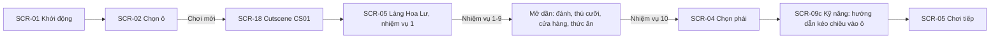

Mỗi hệ thống mới mở bằng một thẻ lớn giữa màn (SCR-05, thông báo mở hệ thống), rồi một mũi tên chỉ vào nút tương ứng cho tới khi người chơi chạm.

## F2 — Vòng chơi chính

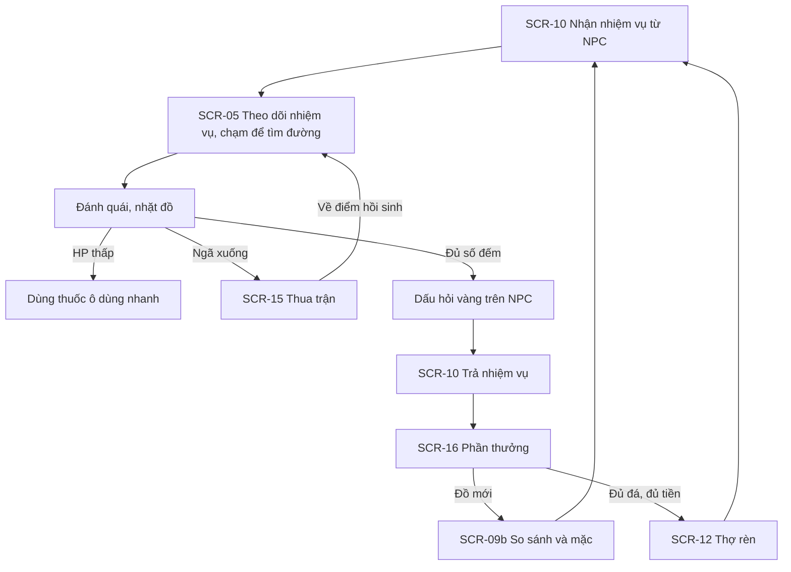

Game tự lưu ở các mốc: vào hoặc rời làng, xong nhiệm vụ, sau mỗi lần rèn hoặc mua bán, mỗi 2 phút, và khi ứng dụng xuống nền.

## F3 — Cường hóa ở thợ rèn

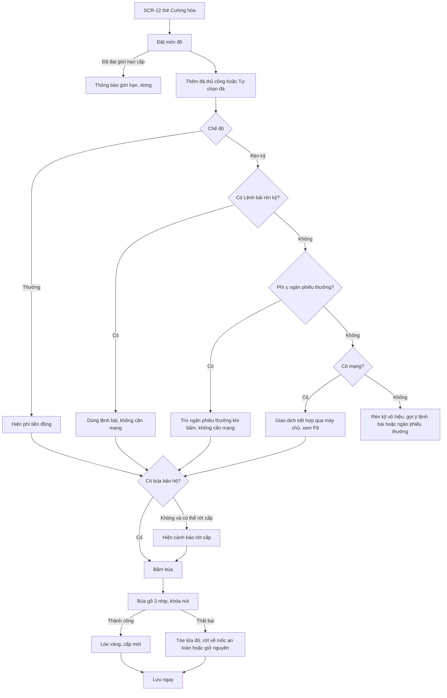

Lưu ngay sau mỗi lần rèn, và trạng thái số ngẫu nhiên lưu trong file, để tắt game giữa chừng không đổi được kết quả. Cách này không chống được người cố tình chép đè file lưu cũ trước khi rèn; game offline chấp nhận giới hạn đó (GDD Phần 6, mục 1).

## F4 — Nạp tiền (bản có ngân phiếu nạp)

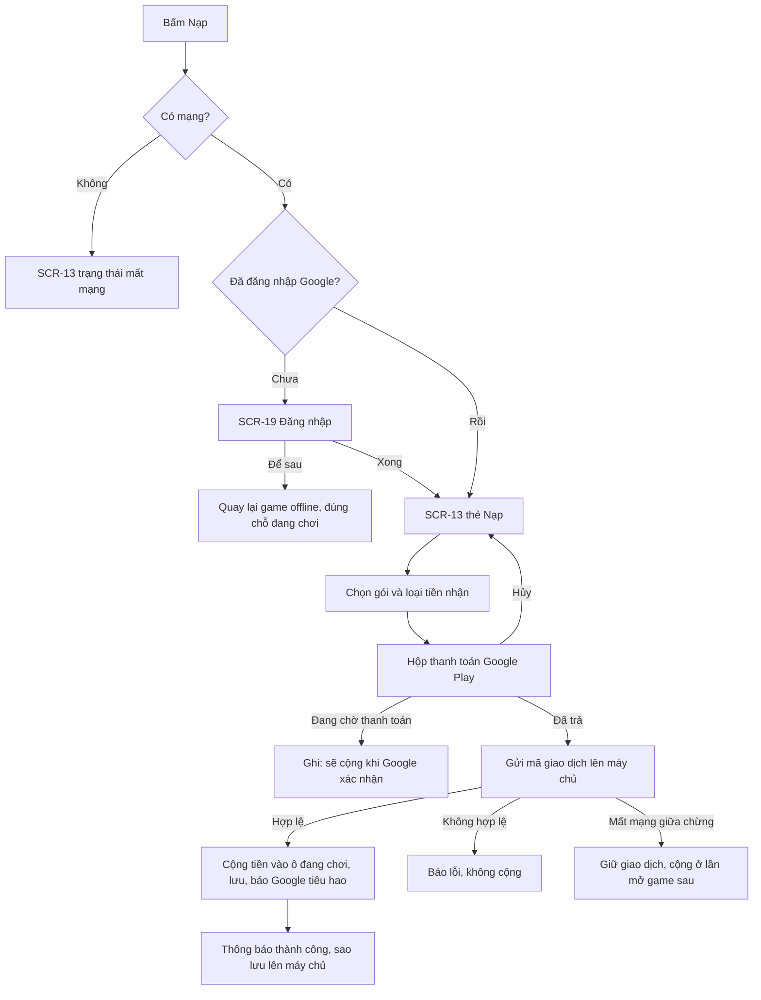

Hoàn tiền đi theo luồng F10.

## F5 — Đánh boss

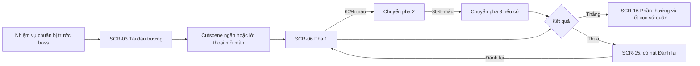

## F6 — Giữ ải

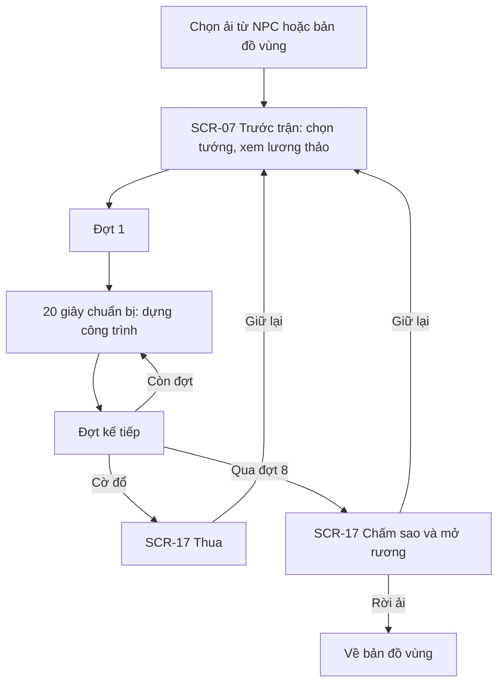

## F7 — Xóa ô nhân vật

Xóa không khôi phục được, nên phải qua hai lần xác nhận (SCR-02). Ở bản đầu mọi ô đều chưa liên kết máy chủ, nên chỉ có nhánh "Chưa". Các nhánh còn lại thuộc bản có ngân phiếu nạp; quy tắc đầy đủ ở `12_ngan_phieu.md`, mục 9.

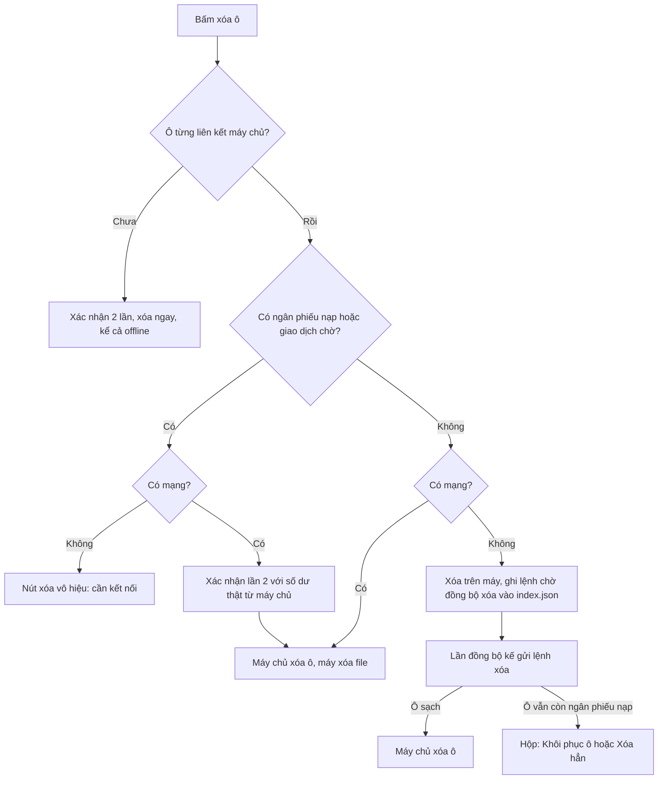

## F8 — Mất mạng và khôi phục

Game chơi offline. Chỉ ba nhóm hành động cần mạng: nạp, tiêu ngân phiếu nạp, sao lưu. Ngân phiếu thưởng tiêu offline bình thường (`12_ngan_phieu.md`). Khi mất mạng, các nút đó chuyển sang trạng thái mất mạng thay vì biến mất, để người chơi hiểu vì sao. Khi có mạng trở lại, game tự đồng bộ giao dịch treo và sao lưu, rồi hiện một thông báo nổi ngắn.

## F9 — Mua bằng ngân phiếu

Ở bản đầu chỉ có nhánh "G ≤ ngân phiếu thưởng"; mọi nhánh còn lại thuộc bản có ngân phiếu nạp.

Áp dụng cho cửa hàng ngân phiếu, phí Rèn kỹ và đổi ngân phiếu ra ngân lượng. Quy tắc đầy đủ ở `12_ngan_phieu.md`, mục 4 và 5. Điểm cốt lõi: khi cần cả hai nguồn, máy **không trừ gì** cho tới khi máy chủ xác nhận, và mỗi giao dịch có một mã duy nhất để không bị trừ hai lần.

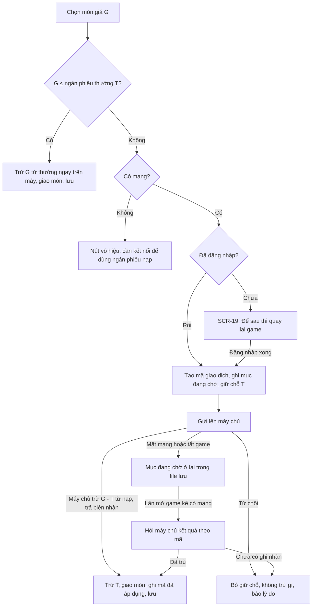

## F10 — Hoàn tiền ngân phiếu nạp (bản có ngân phiếu nạp)

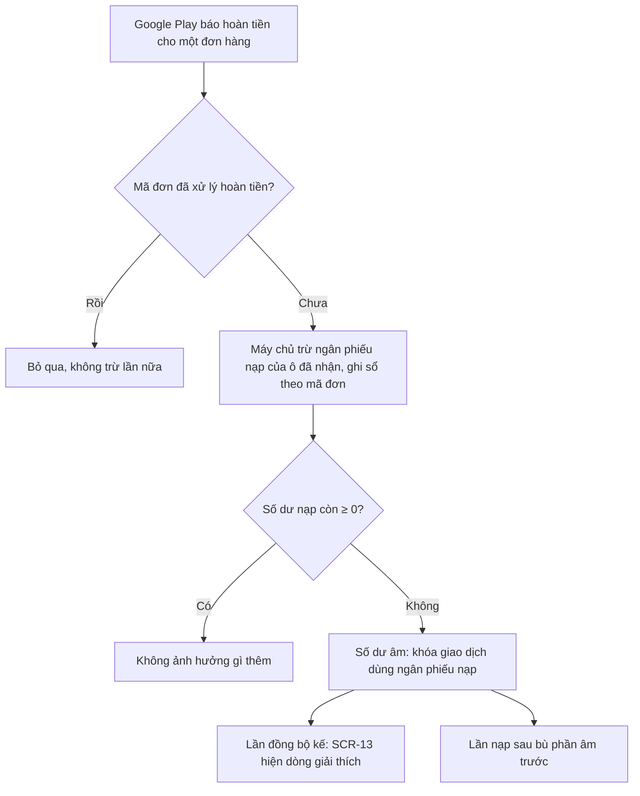

Không thu hồi món đã mua, không khóa gameplay, không đụng tới ngân phiếu thưởng.

## F11 — Đi nhanh bằng bản đồ vùng

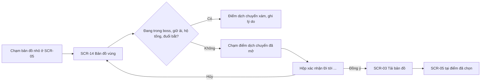

## F12 — Đồng bộ và đối chiếu giao dịch (bản có ngân phiếu nạp)

Chạy mỗi lần mở game có mạng và đã đăng nhập, và mỗi khi có mạng trở lại. Không bao giờ chặn gameplay: nếu đang chơi thì chạy ngầm, xong hiện một thông báo nổi. Quy tắc ở `12_ngan_phieu.md`, mục 6.

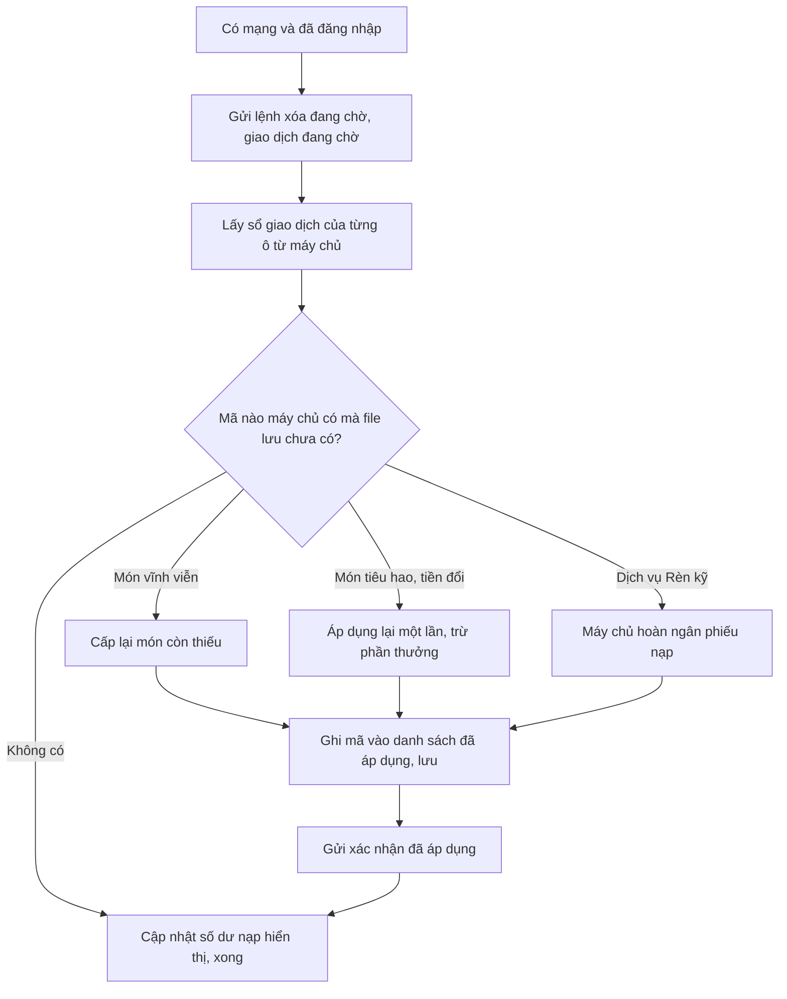

## F13 — Mua và khôi phục món vĩnh viễn (bản đầu)

Quy tắc ở `12_ngan_phieu.md`, mục 12. "Cấp" trong sơ đồ nghĩa là cấp theo quyền lợi: quyền lợi sở hữu cấp nếu ô chưa có, quyền lợi cấp một lần (khoản ngân phiếu thưởng của gói khởi đầu) cấp nếu ô chưa có cờ đã nhận.

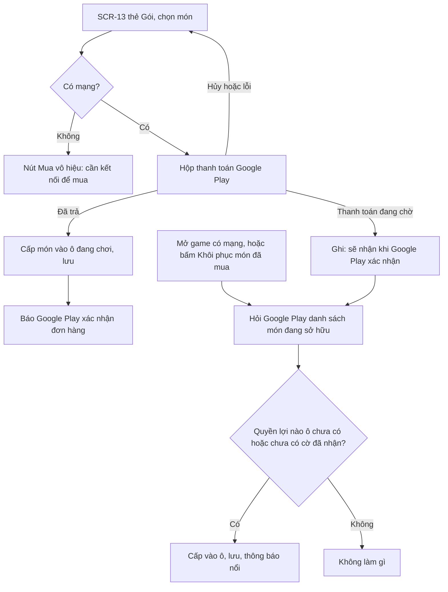

Hoàn tiền ở bản đầu: món biến mất khỏi danh sách sở hữu của Google Play; game không thu hồi món đã cấp, chỉ không cấp cho ô chơi mới.

## Tự soát luồng

- Mọi mũi tên đều đi tới một màn có trong `06_screens.md`.
- Mọi điểm rẽ nhánh đều có đủ các nhánh, kể cả nhánh lỗi và mất mạng.
- Không có ngõ cụt: từ mọi màn đều quay về được SCR-05 hoặc SCR-02.
- Những chỗ ghi "cần chốt" được liệt kê lại trong `11_design_freeze.md`.
