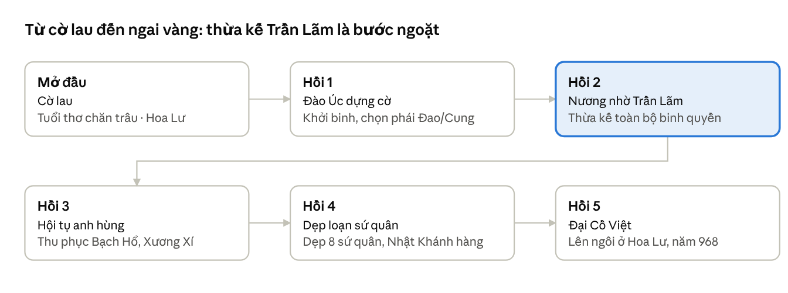

**Phiên bản 2.4, ngày 28/10/2026.** Đây là bản chính thức, nằm ở `docs/GDD.md` trong Design Kit v2.4 (bản sửa cùng ngày). Mọi tiêu đề có nhãn **[Phạm vi sau]** là phần giữ sẵn cho bản có ngân phiếu nạp hoặc bản online, không triển khai ở bản đầu. File Word và PDF được dựng tự động từ đúng file này nên nội dung giống hệt; tài liệu trên claude.ai là bản làm việc. Khi duyệt, nói theo số phiên bản.

Tài liệu thiết kế của Cờ Lau Khởi Nghĩa, game nhập vai hành động 2D offline, miễn phí và có nạp tiền, về Đinh Bộ Lĩnh và loạn 12 sứ quân. Tài liệu gồm bảy phần: bối cảnh và cốt truyện; hệ thống và số liệu (tham khảo thể loại); nhiệm vụ; bản đồ, quái và boss; giao diện và điều khiển; kỹ thuật và sản xuất; prompt tạo hình ảnh.


**Mục lục**

- **Phần 1. Bối cảnh và cốt truyện**
    - 1\. Tổng quan
    - 2\. Bối cảnh lịch sử
    - 3\. Đinh Bộ Lĩnh
    - 4\. Thế giới game
    - 5\. Cốt truyện theo hồi
    - 6\. Nhân vật
    - 7\. Đối thủ và boss
    - 8\. Gameplay gắn với bối cảnh
    - 9\. Vật phẩm, trang bị, nâng cấp và cửa hàng
    - 10\. Mỹ thuật và âm thanh
    - 11\. Thuật ngữ, lưu ý và tư liệu tham khảo
- **Phần 2. Hệ thống và số liệu**
    - 1\. Tổng quan
    - 2\. Chỉ số nhân vật và công thức
    - 3\. Kỹ năng phái Đao và phái Cung
    - 4\. Trang bị và cường hóa
    - 5\. Luyện đá, tách đồ, dịch chuyển và tinh luyện
    - 6\. Thú cưỡi
    - 7\. Cửa hàng NPC và dịch vụ
    - 8\. Quái và boss
    - 9\. Phạm vi loại trừ, kiểm tra và bản quyền
    - 10\. Tiền tệ và nạp tiền
- **Phần 3. Nhiệm vụ**
    - 1\. Tổng quan
    - 2\. Mở đầu và Hồi 1 — Đào Úc dựng cờ (cấp 1–15)
    - 3\. Hồi 2 — Nương nhờ Trần Lãm (cấp 15–28)
    - 4\. Hồi 3 — Hội tụ anh hùng (cấp 28–38)
    - 5\. Hồi 4 — Dẹp loạn sứ quân (cấp 38–56)
    - 6\. Hồi 5 — Đại Cồ Việt (cấp 56–60)
    - 7\. Nhiệm vụ lặp lại và giữ ải
    - 8\. Quy tắc phần thưởng
- **Phần 4. Bản đồ, quái và boss**
    - 1\. Chỉ số quái
    - 2\. Bản đồ và quái theo vùng
    - 3\. Boss
    - 4\. Rơi đồ
- **Phần 5. Giao diện và điều khiển**
    - 1\. Màn hình chơi và điều khiển
    - 2\. Menu nhân vật
    - 3\. Màn NPC
    - 4\. Chọn ô nhân vật, lưu game và danh hiệu
- **Phần 6. Kỹ thuật và sản xuất**
    - 1\. Kiến trúc
    - 2\. Dữ liệu game
    - 3\. Lưu game
    - 4\. Tài sản cần sản xuất
    - 5\. Nạp tiền và máy chủ nhỏ
    - 6\. Thứ tự làm và việc còn phải chốt
    - 7\. Chuẩn bị cho bản online sau này
- **Phần 7. Prompt hình ảnh**
    - 1\. Cách làm để hình đồng bộ
    - 2\. Khối phong cách
    - 3\. Prompt khám phá phong cách
    - 4\. Đinh Bộ Lĩnh
    - 5\. Đồng minh và NPC
    - 6\. Quái
    - 7\. Boss sứ quân
    - 8\. Bản đồ
    - 9\. Thú cưỡi
    - 10\. Giao diện và biểu tượng
    - 11\. Kiểm tra trước khi duyệt

# Phần 1. Bối cảnh và cốt truyện

## 1. Tổng quan

Cờ Lau Khởi Nghĩa là game nhập vai hành động 2D kể hành trình của **Đinh Bộ Lĩnh** — từ cậu bé chăn trâu lấy bông lau làm cờ tập trận ở Hoa Lư, tới vị tướng dẹp loạn 12 sứ quân và lên ngôi hoàng đế năm 968, lập nước Đại Cồ Việt. Người chơi luôn điều khiển Đinh Bộ Lĩnh, không tạo nhân vật riêng; game có 3 ô nhân vật, mỗi ô là một lần chơi với một phái cố định.

Chủ đề xuyên suốt là **thống nhất**: một đất nước vừa giành độc lập sau nghìn năm Bắc thuộc lại tự chia năm xẻ bảy, và một người đứng ra gom các mảnh lại — không chỉ bằng gươm giáo mà còn bằng thu phục lòng người. Đây là điểm khác biệt lớn với một game Thánh Gióng: kẻ thù không phải ngoại xâm, mà là chính những thủ lĩnh người Việt. Vì vậy nhiều trận "boss" kết thúc bằng hàng phục hoặc liên minh chứ không phải tiêu diệt.

Giọng điệu nên là **dã sử hiện thực có điểm xuyết giai thoại**: phần lớn là chiến trận, chính trị, mưu lược thời loạn; các giai thoại dân gian (rồng vàng che chở, cờ lau tập trận) được giữ làm nét chấm phá, không biến game thành thần thoại.

### Nguyên tắc bám chính sử

1. **Mốc lớn và kết cục theo sử sách.** Theo quyết định đã chốt của dự án: Trần Lãm truyền lại binh quyền cho Đinh Bộ Lĩnh; Phạm Bạch Hổ, Ngô Nhật Khánh, Ngô Xương Xí quy phục; tám sứ quân còn lại bị đánh dẹp bằng quân sự.
2. **Sáng tạo ở khoảng trống.** Sử ghi rất ít về từng trận đánh, đường hành quân, tính cách các sứ quân. Đó là nơi đội viết được tự do thiết kế nhiệm vụ, lời thoại và đánh boss.
3. **Ghi rõ nguồn gốc chi tiết.** Trong tài liệu này: *theo chính sử* (Đại Việt sử ký toàn thư, Việt sử lược…), *theo giai thoại* (truyền tụng dân gian, thần tích), và *mở rộng cho game*.
4. **Tôn trọng các vị được thờ.** Đinh Tiên Hoàng và nhiều sứ quân hiện vẫn được thờ ở đền, đình làng. Đối thủ trong game là người có thật, không bôi xấu cá nhân.

## 2. Bối cảnh lịch sử

### Từ Bạch Đằng đến khoảng trống quyền lực

Năm 938, **Ngô Quyền** đánh tan quân Nam Hán trên sông Bạch Đằng, chấm dứt hơn một nghìn năm Bắc thuộc. Năm 939 ông xưng vương, đóng đô ở Cổ Loa. Nhưng nền độc lập còn non trẻ: bộ máy nhà nước sơ khai, quyền lực thực sự nằm trong tay các hào trưởng địa phương — những dòng họ giàu có, có ruộng đất, có quân riêng từ thời thuộc Đường.

Năm 944 Ngô Quyền mất. Em vợ ông là **Dương Tam Kha** cướp ngôi, xưng Bình Vương. Các con Ngô Quyền phải lẩn trốn: **Ngô Xương Ngập** chạy về nương nhờ hào trưởng Phạm Lệnh Công ở Trà Hương; **Ngô Xương Văn** bị Dương Tam Kha nhận làm con nuôi. Khắp nơi các thế lực địa phương bắt đầu không phục triều đình.

Năm 950, Ngô Xương Văn nhân lúc được sai đi đánh dẹp đã quay quân lật đổ Dương Tam Kha, giành lại ngôi, rồi đón anh về cùng trị nước: Xương Ngập xưng **Thiên Sách Vương**, Xương Văn xưng **Nam Tấn Vương** — sử gọi là thời Hậu Ngô Vương. Nhưng uy quyền nhà Ngô chỉ còn trên danh nghĩa. Xương Ngập mất năm 954. Xương Văn phải liên tục đem quân đi dẹp các hào trưởng nổi lên.

### Loạn 12 sứ quân (khoảng 965–968)

Năm 965, trong lúc đi đánh hai thôn Đường, Nguyễn (vùng Thái Bình, nay thuộc Hà Nội – Phú Thọ, các nguồn ghi khác nhau), Ngô Xương Văn trúng tên phục kích mà chết. Từ đó không còn ai đủ uy tín đứng đầu. Đất nước vỡ thành nhiều vùng cát cứ; sử cũ chọn ghi lại **mười hai thủ lĩnh lớn nhất**, gọi là mười hai sứ quân. Mỗi sứ quân giữ một vùng, đắp thành, nuôi quân, đánh lẫn nhau giành đất. Dân chúng chịu cảnh binh đao liên miên.

Cần biết thêm hai điều khi viết kịch bản:

- Con số "mười hai" là cách sử gia chọn lọc; thực tế còn nhiều thế lực nhỏ hơn. Game có thể đưa thêm các toán cướp, hào trưởng nhỏ làm kẻ thù phụ mà không trái sử.
- Nhiều sứ quân **không phải loạn thần**: một số là dòng dõi nhà Ngô, một số là tướng cũ của Ngô Quyền, một số là hào trưởng bảo vệ quê hương. Họ có lý lẽ riêng — đây là chất liệu tốt cho đối thoại trước trận boss.

### Kết cục

Đinh Bộ Lĩnh, sau khi hợp quân với sứ quân Trần Lãm và thừa kế lực lượng của ông, lần lượt thu phục và đánh dẹp các sứ quân khác, được tôn là **Vạn Thắng Vương**. Năm 968 ông lên ngôi hoàng đế, hiệu **Đinh Tiên Hoàng**, đặt quốc hiệu **Đại Cồ Việt**, đóng đô ở **Hoa Lư** (Ninh Bình). Năm 970 đặt niên hiệu Thái Bình — niên hiệu đầu tiên của nước ta. Năm 979, ông và con trưởng Đinh Liễn bị Đỗ Thích ám hại; sau đó Lê Hoàn lên ngôi, lập nhà Tiền Lê. Game nên dừng ở khoảnh khắc lên ngôi 968; giai đoạn 968–979 được kể bằng một epilogue ngắn (mục 5).

## 3. Đinh Bộ Lĩnh

### Xuất thân

Đinh Bộ Lĩnh quê ở động Hoa Lư, châu Đại Hoàng (Ninh Bình ngày nay). Năm sinh thường được ghi là 924, nhưng các nguồn chưa thống nhất. Cha là **Đinh Công Trứ**, từng làm thứ sử Hoan Châu (Nghệ An) dưới thời Dương Đình Nghệ và Ngô Quyền. *Theo chính sử*, cha mất sớm, Bộ Lĩnh theo mẹ là **Đàm thị** về quê, sống nhờ nhà chú, làm nghề chăn trâu.

### Giai thoại cờ lau tập trận

*Theo chính sử và giai thoại*, Bộ Lĩnh chơi với lũ trẻ chăn trâu, được chúng tôn làm "vua": bọn trẻ khoanh tay làm kiệu khiêng cậu, lấy **bông lau làm cờ**, bày trận đánh nhau với trẻ làng bên. Trẻ con các làng đều nể phục. Đây là hình ảnh gốc của tên game và nên là màn mở đầu.

Các giai thoại khác, có thể dùng chọn lọc:

- **Mổ trâu khao quân:** cậu mổ trâu nhà chú để khao bọn trẻ. Chú giận, cầm gươm đuổi. Cậu chạy tới bờ sông, cầu gãy, sa xuống bùn — *theo giai thoại*, chú thấy có rồng vàng che phủ cậu nên sợ hãi, bỏ đi. Đây là cảnh mang màu huyền thoại duy nhất nên giữ, vì nó gắn với ý "mệnh trời".
- **Rời quê:** sau xung đột, Bộ Lĩnh tụ tập trai tráng, dựng căn cứ ở Đào Úc (vùng Hoa Lư). *Theo một số tài liệu*, ông còn chống lại chú và các hào trưởng xung quanh, dần lớn mạnh.
- **Đinh Liễn làm con tin:** *theo chính sử*, Bộ Lĩnh từng sai con trưởng Đinh Liễn sang làm con tin ở triều Hậu Ngô. Khi quân nhà Ngô đánh Hoa Lư không được, họ treo Liễn lên ngọn sào đòi Bộ Lĩnh hàng. Bộ Lĩnh không lùi, còn sai người định bắn; quân Ngô biết không ép được, đành rút. Cảnh này thể hiện mặt cứng rắn đến tàn nhẫn của ông — nên giữ để nhân vật có chiều sâu, nhưng xử lý tiết chế.
- **Theo Trần Lãm:** Bộ Lĩnh cùng con là Đinh Liễn đến nương nhờ sứ quân **Trần Lãm** ở Bố Hải Khẩu. Trần Lãm quý tài, nhận làm con nuôi, giao binh quyền; khi Trần Lãm mất, Bộ Lĩnh thống lĩnh toàn bộ lực lượng.

### Tính cách cho game

Sử mô tả Đinh Bộ Lĩnh là người **có chí lớn, quả quyết, cứng rắn**. Khi làm vua ông đặt vạc dầu, chuồng hổ ở sân điện để răn kẻ phạm tội — phản ánh một con người tin vào kỷ cương nghiêm khắc trong thời loạn. Đề xuất nhân vật trong game:

- Thời trẻ: tinh nghịch, thủ lĩnh bẩm sinh, hào phóng với anh em.
- Thời khởi binh: thực tế, mưu lược, biết nhẫn nhịn chờ thời.
- Thời dẹp loạn: quyết đoán, sẵn sàng dùng vũ lực nhưng đề cao thu phục nhân tâm khi có thể.
- Lời thoại: ngắn, mạnh, dân dã — không văn hoa kiểu Nho sĩ.

## 4. Thế giới game

### Xã hội thế kỷ 10

Đất nước lúc này chưa có quốc hiệu chính thức sau khi nhà Ngô suy yếu; người đương thời vẫn quen gọi theo tên cũ thời thuộc Đường là **Giao Châu** hay **An Nam**. Quyền lực nằm trong tay các **hào trưởng** — chủ ruộng đất lớn, có gia binh, có thành lũy riêng. Dân chủ yếu làm ruộng lúa nước, sống thành làng; Phật giáo đã lan rộng, nhà sư có uy tín lớn (về sau nhà Đinh phong chức Tăng thống). Chữ Hán là văn tự hành chính. Thành lũy chủ yếu là **thành đất, lũy tre, hào nước**, tận dụng sông ngòi, đầm lầy và núi đá vôi.

### Bảng 12 sứ quân

Vùng đất ghi theo tên cổ; vị trí hiện nay theo cách xác định phổ biến, nhưng một số nơi các nhà nghiên cứu còn tranh luận, cần đối chiếu trước khi làm bản đồ chính thức. Kết cục theo đúng quyết định của dự án.

| Sứ quân | Căn cứ (tên cổ) | Vị trí hiện nay (phổ biến) | Xuất thân | Kết cục trong game |
|---|---|---|---|---|
| Trần Lãm (Trần Minh Công) | Bố Hải Khẩu | Thái Bình (cũ) | Hào trưởng, gốc Quảng Đông | Nhận Bộ Lĩnh làm con nuôi, truyền binh quyền |
| Phạm Bạch Hổ (Phạm Phòng Át) | Đằng Châu | Hưng Yên | Tướng cũ của Ngô Quyền | Quy phục |
| Ngô Nhật Khánh (Ngô Lãm Công) | Đường Lâm | Sơn Tây, Hà Nội | Dòng dõi nhà Ngô | Quy phục |
| Ngô Xương Xí (Ngô Sứ Quân) | Bình Kiều | Thanh Hóa hoặc Hưng Yên (còn tranh luận) | Con Ngô Xương Ngập | Quy phục |
| Đỗ Cảnh Thạc (Đỗ Cảnh Công) | Đỗ Động Giang | Thanh Oai, Hà Nội | Tướng cũ nhà Ngô | Bị đánh dẹp |
| Kiều Công Hãn (Kiều Tam Chế) | Phong Châu | Phú Thọ | Cháu Kiều Công Tiễn | Bị đánh dẹp |
| Kiều Thuận (Kiều Lệnh Công) | Hồi Hồ | Cẩm Khê, Phú Thọ | Hào trưởng | Bị đánh dẹp |
| Nguyễn Khoan (Nguyễn Thái Bình) | Tam Đái | Vĩnh Tường, Phú Thọ (trước là Vĩnh Phúc) | Hào trưởng | Bị đánh dẹp |
| Nguyễn Siêu (Nguyễn Hữu Công) | Tây Phù Liệt | Thanh Trì, Hà Nội | Hào trưởng | Bị đánh dẹp |
| Lý Khuê (Lý Lãng Công) | Siêu Loại | Thuận Thành, Bắc Ninh | Hào trưởng | Bị đánh dẹp |
| Nguyễn Thủ Tiệp (Nguyễn Lệnh Công) | Tiên Du | Bắc Ninh | Hào trưởng | Bị đánh dẹp |
| Lã Đường (Lã Tá Công) | Tế Giang | Văn Giang, Hưng Yên | Hào trưởng | Bị đánh dẹp |

Ghi chú: việc sáp nhập tỉnh năm 2025 đã đổi tên hành chính nhiều nơi (ví dụ Vĩnh Phúc nhập Phú Thọ, Thái Bình nhập Hưng Yên); bảng trên giữ tên cũ quen thuộc để dễ tra tư liệu.

### Các vùng đất trong game

Bản đồ trải trên đồng bằng và trung du Bắc Bộ, chia thành các cụm theo sông lớn — mỗi cụm là một chương với vài sứ quân:

- **Hoa Lư – Đào Úc** (Ninh Bình): vùng khởi đầu và căn cứ chính. Núi đá vôi, hang động, đầm nước — địa hình hiểm, dễ thủ khó công.
- **Vùng ven biển phía Đông** (Bố Hải Khẩu, Đằng Châu, Tế Giang): đồng chiêm trũng, cửa sông, thuyền bè. Nơi Bộ Lĩnh gặp Trần Lãm và mở rộng thế lực.
- **Vùng trung tâm sông Hồng – sông Đáy** (Đỗ Động, Tây Phù Liệt, Đường Lâm): đất trù phú, các thành lớn, nhiều trận then chốt.
- **Vùng Kinh Bắc** (Siêu Loại, Tiên Du): làng xã đông đúc, chùa chiền — trung tâm Phật giáo.
- **Vùng trung du phía Tây Bắc** (Phong Châu, Hồi Hồ, Tam Đái): đồi rừng, ngã ba sông Đà – sông Lô – sông Hồng.
- **Cổ Loa**: kinh đô cũ của Ngô Quyền, biểu tượng chính thống — nơi đặt một cảnh quan trọng (*mở rộng cho game*), dù Bộ Lĩnh chọn Hoa Lư làm kinh đô.

## 5. Cốt truyện theo hồi

Cốt truyện có một màn mở đầu và năm hồi. Ba hồi đầu là quá trình **lớn mạnh** của Đinh Bộ Lĩnh; hai hồi sau là quá trình **thống nhất** — lần lượt đối mặt các sứ quân theo từng vùng.



Hồi 2 là bản lề: thừa kế lực lượng Trần Lãm biến Bộ Lĩnh từ thủ lĩnh địa phương thành một thế lực ngang hàng các sứ quân.

### Mở đầu — Cờ lau

Hoa Lư, cậu bé Bộ Lĩnh chăn trâu cùng lũ bạn. Người chơi học điều khiển qua trò chơi đánh trận giả: cầm cờ lau, chỉ huy bọn trẻ chống trẻ làng bên. Màn kết bằng chuyện mổ trâu khao quân, bị chú đuổi, cầu gãy và hình ảnh rồng vàng — gieo ý niệm "người có mệnh lớn". Cảnh chuyển: thời gian trôi, đất nước bắt đầu loạn.

### Hồi 1 — Đào Úc dựng cờ

Bộ Lĩnh trưởng thành, tụ tập trai tráng ở Đào Úc, cùng những người bạn thuở nhỏ như **Đinh Điền, Nguyễn Bặc** (*theo chính sử*, đều là đồng hương, theo ông từ đầu). Nhiệm vụ: luyện quân, bảo vệ làng khỏi trộm cướp, khuất phục các hào trưởng nhỏ quanh Hoa Lư. Kết hồi: quân Hậu Ngô kéo đến đánh Hoa Lư; sự kiện Đinh Liễn bị treo trên ngọn sào; Bộ Lĩnh giữ vững, quân Ngô rút.

### Hồi 2 — Nương nhờ Trần Lãm

Nhà Ngô sụp đổ (965), loạn sứ quân bùng nổ. Lực lượng còn mỏng, Bộ Lĩnh đưa Đinh Liễn về Bố Hải Khẩu theo Trần Lãm. Hồi này dạy người chơi về **liên minh**: làm nhiệm vụ cho Trần Lãm, đánh giặc biển, giữ cửa sông, giành lòng tin của tướng sĩ. Trần Lãm nhận Bộ Lĩnh làm con nuôi. Kết hồi: Trần Lãm mất, Bộ Lĩnh thừa kế toàn bộ binh lực, đưa quân về Hoa Lư — từ đây ông là một thế lực ngang hàng các sứ quân.

### Hồi 3 — Hội tụ anh hùng

Đinh Bộ Lĩnh mở rộng ảnh hưởng ở vùng ven biển và Nam sông Hồng. Đây là hồi **thu phục**: Phạm Bạch Hổ ở Đằng Châu, Ngô Xương Xí ở Bình Kiều. Mỗi người có một chuỗi nhiệm vụ riêng; kết thúc bằng đàm phán, thử thách hoặc trận đấu tay đôi danh dự chứ không phải tàn sát. **Lê Hoàn** — một viên tướng trẻ — xuất hiện và gia nhập (*theo chính sử*, Lê Hoàn theo Đinh Liễn, được Bộ Lĩnh trọng dụng).

### Hồi 4 — Dẹp loạn sứ quân

Hồi dài nhất, chia thành các chương theo vùng (mục 4). Bộ Lĩnh lần lượt đánh dẹp tám sứ quân bằng quân sự. Ngô Nhật Khánh ở Đường Lâm quy phục ở giữa hồi — tạo nhịp nghỉ chính trị giữa các trận chiến lớn. Thứ tự đánh sắp theo địa lý, đi từ Hoa Lư ngược lên phía bắc qua ba chương (chi tiết ở mục 7). Kết hồi: sứ quân cuối cùng gục ngã, binh sĩ tôn Bộ Lĩnh là **Vạn Thắng Vương**.

### Hồi 5 — Đại Cồ Việt

Năm 968, lễ lên ngôi tại Hoa Lư. Đây là phần kết mang tính nghi lễ: đặt quốc hiệu Đại Cồ Việt, phong tước cho công thần (Nguyễn Bặc, Đinh Điền, Lê Hoàn…), dựng kinh thành. *Mở rộng cho game:* người chơi có thể đi một vòng kinh thành mới, gặp lại những nhân vật từng quy phục hoặc từng là kẻ thù, nhìn thấy đất nước đã yên.

### Epilogue 968–979

Sau lễ lên ngôi là một epilogue ngắn, không có màn chơi: chuỗi tranh vẽ kèm lời tự sự kể việc xây dựng triều chính, tổ chức quân đội thập đạo, đúc tiền Thái Bình Hưng Bảo và giữ hòa hiếu với nhà Tống. Epilogue khép lại bằng cái chết của Đinh Tiên Hoàng và Đinh Liễn năm 979, kể tiết chế qua tranh và lời dẫn, không mô tả chi tiết bạo lực.

## 6. Nhân vật

### Gia đình

- **Đàm thị** *(theo chính sử)* — mẹ Bộ Lĩnh. Nuôi con một mình sau khi chồng mất; sau này được tôn làm Hoàng thái hậu. Trái tim cảm xúc của phần mở đầu.
- **Đinh Công Trứ** *(theo chính sử)* — cha, thứ sử Hoan Châu. Mất sớm; có thể xuất hiện qua hồi tưởng hoặc di vật (thanh gươm, ấn quan) làm động lực cho Bộ Lĩnh.
- **Người chú** *(theo giai thoại, sử không ghi rõ tên)* — đối thủ đầu tiên. Nên khắc họa như người khắc nghiệt nhưng không phải ác nhân.
- **Đinh Liễn** *(theo chính sử)* — con trưởng, từng làm con tin, sau theo cha đánh trận, được phong Nam Việt Vương. Là đồng đội có thể điều khiển ở một số màn (*mở rộng cho game*).

### Đồng minh và công thần

| Nhân vật | Nguồn | Vai trò trong truyện | Đề xuất vai trò trong game |
|---|---|---|---|
| Đinh Điền | Theo chính sử | Bạn đồng hương, theo từ đầu, sau làm Ngoại giáp | Đồng đội cận chiến, tính nóng nảy |
| Nguyễn Bặc | Theo chính sử | Bạn đồng hương, mưu lược, sau là Định Quốc công | Quân sư, NPC giao nhiệm vụ chính |
| Lê Hoàn | Theo chính sử | Tướng trẻ, sau là Thập đạo tướng quân, rồi lên ngôi lập nhà Tiền Lê | Đồng đội tầm xa / kỵ binh; có nét bí ẩn, gợi tương lai |
| Trịnh Tú | Theo chính sử | Công thần nhà Đinh | NPC hậu cần, cung cấp lương thảo |
| Lưu Cơ | Theo chính sử | Công thần, sau trông coi kinh thành | NPC xây dựng căn cứ Hoa Lư |
| Trần Lãm | Theo chính sử | Sứ quân, cha nuôi, truyền binh quyền | Người thầy, nhân vật then chốt hồi 2 |
| Ngô Chân Lưu (Khuông Việt) | Theo chính sử | Nhà sư, sau được phong Tăng thống, cố vấn triều Đinh | NPC tâm linh, mở khóa kỹ năng thiền / hồi phục (*mở rộng cho game*) |

Thời điểm một số công thần gặp Bộ Lĩnh không được sử ghi rõ; đội viết có thể sắp lại cho hợp nhịp truyện, miễn không mâu thuẫn với các mốc lớn.

### NPC đời thường

*Mở rộng cho game:* thợ rèn Hoa Lư (nâng cấp vũ khí), người buôn ngựa (thú cưỡi), lái buôn đường sông (cửa hàng di động), sư trụ trì các chùa (điểm lưu, hồi phục), bô lão các làng (giao nhiệm vụ phụ), và bọn trẻ chăn trâu thời thơ ấu — gặp lại khi trưởng thành, một số trở thành binh lính.

## 7. Đối thủ và boss

Vì sử ghi rất ít về từng sứ quân, toàn bộ phong cách chiến đấu dưới đây là *mở rộng cho game*, dựa trên địa hình căn cứ và xuất thân của họ. Mỗi sứ quân nên có **một lý lẽ riêng** để người chơi thấy họ là con người chứ không phải quái vật.

### Ba sứ quân quy phục

Với ba người này, trận "boss" là thử thách hoặc đấu danh dự, kết thúc bằng hàng phục và mở ra đồng minh mới.

- **Phạm Bạch Hổ** — lão tướng của Ngô Quyền, từng dự trận Bạch Đằng. Lý lẽ: giữ quê, chờ minh chủ xứng đáng. Thử thách: đấu tay đôi trên thuyền; thắng thì ông quy thuận, mang theo thủy quân.
- **Ngô Xương Xí** — con Thiên Sách Vương, người thừa kế chính thống của nhà Ngô nhưng thế yếu. Lý lẽ: giữ huyết mạch nhà Ngô. Thử thách: nhiệm vụ cứu người thân hoặc bảo vệ thành Bình Kiều khỏi sứ quân khác; kết bằng đàm phán.
- **Ngô Nhật Khánh** — dòng dõi nhà Ngô ở Đường Lâm, đất "hai vua" (quê Phùng Hưng, Ngô Quyền). Lý lẽ: danh phận dòng họ. Kết bằng nghị hòa chính trị; *theo chính sử*, về sau quan hệ hai nhà còn được thắt chặt bằng hôn nhân.

### Tám sứ quân bị đánh dẹp

| Sứ quân | Căn cứ | Ý tưởng trận boss |
|---|---|---|
| Đỗ Cảnh Thạc | Đỗ Động Giang | Tướng cũ dày dạn, thành nhiều lớp lũy; trận công thành dài, nhiều pha. Mở màn hồi 4, chặn cửa ngõ phía bắc Hoa Lư — một bức tường khó ngay đầu chương |
| Kiều Công Hãn | Phong Châu | Đánh trong rừng đồi trung du, mai phục, cung nỏ |
| Kiều Thuận | Hồi Hồ | Thủ lĩnh vùng sông nước ngã ba sông, trận trên bến thuyền |
| Nguyễn Khoan | Tam Đái | Thành giữa đầm lầy, phải tìm đường tre ngầm |
| Nguyễn Siêu | Tây Phù Liệt | Đánh hai bờ sông, thành chia đôi; phải chặn quân chi viện |
| Lý Khuê | Siêu Loại | Vùng đông dân, đánh trong làng xã, tránh gây hại dân |
| Nguyễn Thủ Tiệp | Tiên Du | Đồi núi thấp Kinh Bắc, đội kỵ binh mạnh |
| Lã Đường | Tế Giang | Bãi bồi ven sông Hồng, quân bộ đông, chiến thuật biển người |

Các dòng "ý tưởng trận boss" là gợi ý; đội nên kiểm tra thần tích địa phương của từng sứ quân trước khi chốt, vì nhiều nơi có truyền thuyết riêng rất đáng khai thác (ví dụ tên tướng dưới quyền, binh khí, ngựa).

### Thứ tự đánh theo địa lý

Lộ trình đi từ căn cứ Hoa Lư ngược lên phía bắc, chia ba chương; độ khó tăng dần theo đường hành quân. Người chơi phải đi đúng thứ tự này, không được tự chọn sứ quân. Đây là thứ tự thiết kế cho game, vì sử không ghi trình tự các trận.

1. **Chương 1 — Nam sông Hồng** (gần Hoa Lư nhất)
    1. Đỗ Cảnh Thạc — Đỗ Động Giang (Thanh Oai)
    2. Nguyễn Siêu — Tây Phù Liệt (Thanh Trì)
2. **Chương 2 — Vượt sông Hồng sang phía đông**
    1. Lã Đường — Tế Giang (Văn Giang)
    2. Lý Khuê — Siêu Loại (Thuận Thành)
    3. Nguyễn Thủ Tiệp — Tiên Du
3. **Chương 3 — Ngược lên trung du phía tây bắc**
    1. Ngô Nhật Khánh — Đường Lâm (quy phục, nhịp nghỉ chính trị)
    2. Nguyễn Khoan — Tam Đái (Vĩnh Tường)
    3. Kiều Công Hãn — Phong Châu
    4. Kiều Thuận — Hồi Hồ (Cẩm Khê): xa nhất, boss cuối hồi 4

### Kẻ thù thường

Lính các sứ quân (giáo, khiên, cung nỏ, kỵ binh), thủy quân trên thuyền, toán thổ phỉ lợi dụng thời loạn, quân Hậu Ngô ở hồi 1, và thú hoang vùng núi Hoa Lư (hổ, rắn, lợn rừng). Mỗi sứ quân nên có **màu cờ hiệu riêng** để người chơi phân biệt trên chiến trường.

## 8. Gameplay gắn với bối cảnh

Phần này kết hợp chất liệu lịch sử thời Đinh với cơ chế phổ biến của thể loại nhập vai mobile. Hình ảnh, tên gọi, nội dung và số liệu phải được thiết kế riêng theo bối cảnh thế kỷ 10.

### Phát triển nhân vật

Người chơi luôn là Đinh Bộ Lĩnh. Theo tiến trình cốt truyện, cuối Hồi 1 người chơi chọn một trong **hai phái:** **Đao** **hoặc Cung**. Màn cờ lau thời thơ ấu gợi ý cả hai lối đánh (cầm gậy xông lên đầu hàng hay đứng sau bắn ná), nên lựa chọn có lý do trong truyện. Hai phái có vai trò riêng: Đao thủ chắc, máu tốt, gây choáng và khống chế nhưng đánh chậm; Cung đánh xa, chuyển mục tiêu nhanh, công cao nhưng thủ yếu. Hai phái bù trừ nhau rõ: một bên giữ tuyến, một bên dứt điểm từ xa.

| Phái | Lối đánh | Điểm mạnh | Điểm yếu | Chỉ số ưu tiên |
|---|---|---|---|---|
| Đao | Cận chiến, chém nặng, quét rộng, gây choáng, chém trên lưng ngựa | Thủ chắc, máu cao, khống chế đám đông, giữ tuyến đầu | Tốc đánh chậm, phải áp sát, kém với địch ở xa | Sức mạnh → Thể lực → Thân pháp |
| Cung | Tầm xa, bắn xuyên, bắn tỏa, đặt bẫy, kỵ xạ | Công cao, an toàn khi giữ khoảng cách, săn boss tốt | Thủ yếu, dễ thua khi bị áp sát | Khí lực → Thể lực → Thân pháp |

Mỗi phái gợi ý có một đòn thường, 5–6 kỹ năng chủ động, 3 kỹ năng nội tại mở dần theo cấp và một tuyệt kỹ cuối game. Phái đã chọn là cố định, không đổi được. Game có 3 ô nhân vật: mỗi ô là một lần chơi riêng của Đinh Bộ Lĩnh với một phái; muốn chơi phái khác thì tạo nhân vật ở ô mới và học lại từ đầu. Người chơi không chọn giới tính, tên hay ngoại hình: nhân vật luôn là Đinh Bộ Lĩnh, và vẻ ngoài chỉ thay đổi theo vũ khí và quần áo đang mặc (mũ, áo, quần, giày hiện trực tiếp trên nhân vật). Ba ô nhân vật tách biệt hoàn toàn: trang bị, tiền, tiến độ và thành tựu của ô nào thuộc riêng ô đó.

Mỗi lần lên cấp, người chơi nhận **điểm tiềm năng** để cộng vào bốn chỉ số (gợi ý: Sức mạnh, Thân pháp, Thể lực, Khí lực) và **điểm kỹ năng** để học hoặc nâng cấp chiêu trong cây kỹ năng của phái. Mỗi phái có chiêu chủ động, chiêu bị động và một chiêu tuyệt kỹ. Sách binh pháp cấp cao rơi từ boss sứ quân hoặc nhận từ công thần — gắn tiến trình sức mạnh với cốt truyện.

Kỹ năng gợi ý có màu lịch sử: **Cờ lau phất trận** (tăng công cho quân xung quanh), **Rồng vàng hộ thân** (khiên tạm thời, gợi giai thoại), **Vạn thắng** (tuyệt kỹ cuối game, mở khóa khi được tôn Vạn Thắng Vương), **Hiệu lệnh trống đồng** (gây choáng diện rộng).

### Thú cưỡi

Thú cưỡi vừa là phương tiện vừa là một tuyến phát triển riêng, gắn với câu chuyện:

- **Trâu** — mở đầu, gắn với tuổi thơ chăn trâu. Chậm nhưng khỏe, húc ngã kẻ địch. Giữ lại suốt game như thú cưỡi kỷ niệm, có thể nâng cấp.
- **Ngựa chiến** — từ hồi 1–2, nhanh, cho phép chém hoặc bắn cung ngay trên lưng ngựa. Nhiều giống ngựa mua ở người buôn ngựa hoặc thu từ sứ quân bị đánh bại.
- **Thuyền chiến** — các màn sông nước (Bố Hải Khẩu, Đằng Châu, Hồi Hồ). Không phải thú cưỡi tự do mà là màn chơi đặc biệt.
- **Voi chiến** — thú cưỡi cuối game, cực mạnh nhưng chậm, dùng trong trận công thành lớn (*mở rộng cho game*; voi được dùng trong chiến tranh ở nước ta qua nhiều thời kỳ).

Thú cưỡi có cấp, chỉ số riêng và ô trang bị riêng (yên, cương, giáp thú). Nuôi bằng thức ăn (cỏ, lúa) và đá cường hóa riêng.

### Quân đội và căn cứ Hoa Lư

Đặc trưng của Cờ Lau: đây là game về **người thống nhất đất nước**, nên ngoài sức mạnh cá nhân còn có **sức mạnh quân đội**. Đề xuất:

- **Căn cứ Hoa Lư** nâng cấp dần (trại lính, lò rèn, chuồng ngựa, kho lương, chùa) — mỗi công trình mở khóa NPC hoặc cửa hàng mới. Lưu Cơ là NPC phụ trách.
- **Quân số và danh vọng:** mỗi vùng được giải phóng hoặc thu phục góp thêm lính và lương thảo. Trong trận lớn, người chơi gọi một số lính đồng minh theo quân số hiện có.
- **Cắm cờ chiếm điểm:** trên chiến trường, cắm cờ lau ở các cứ điểm để quân mình tiến lên — vừa là cơ chế, vừa lặp lại hình ảnh tên game.

### Nội dung lặp lại (cho game offline)

Vì game offline và chơi trọn vẹn, các hoạt động lặp lại nên mang tính luyện tập chứ không bắt điểm danh mỗi ngày:

- **Giữ ải** — cắm cờ lau giữ một cứ điểm trước 8 đợt địch, dựng chông tre, rào tre, chòi nỏ bằng lương thảo và đưa một tướng đi cùng; rơi đá cường hóa và nguyên liệu. Gợi từ chuyện tập trận cờ lau thuở nhỏ (chi tiết ở Phần 3, mục 7).
- **Lôi đài làng** — đấu võ với cao thủ các vùng, nhận danh vọng và sách kỹ năng.
- **Dẹp thổ phỉ** — nhiệm vụ lặp lại ở các vùng đã giải phóng.
- **Diễn tập cờ lau** — chế độ thử thách chỉ huy, gợi lại trò chơi thời thơ ấu.

### Gục ngã

Hết máu: Bộ Lĩnh bị thương, được đưa về trại gần nhất hoặc chùa (điểm hồi sinh), mất một ít lương thảo thay vì mất trang bị.

## 9. Vật phẩm, trang bị, nâng cấp và cửa hàng

Các cơ chế thợ rèn gồm cường hóa, luyện đá, tách đồ và kích ẩn. Thiết kế, hình ảnh và số liệu phải được xây dựng riêng; số đang ghi là gợi ý cân bằng.

Bảng số liệu chi tiết, công thức và kỹ năng từng phái nằm ở phần Hệ thống và số liệu.

### Ô trang bị

Trang bị có 10 ô, dùng đồ phù hợp bối cảnh thế kỷ 10:

| Ô | Cờ Lau Khởi Nghĩa |
|---|---|
| Vũ khí | Đao (phái Đao) hoặc cung (phái Cung) |
| Đầu | Mũ trụ, khăn chít đầu |
| Thân | Giáp da, giáp vảy, áo chiến |
| Tay | Bao tay da, xà cạp tay |
| Chân | Khố chiến, quần vải lãnh |
| Bàn chân | Dép cỏ, giày da |
| Cổ | Chuỗi hạt, vòng cổ đồng |
| Ngón | Nhẫn đồng, nhẫn ngọc |
| Hông | Ngọc bội, ấn tín |
| Bùa | Bùa chùa, lá bùa hộ mệnh |

### Cường hóa +1 đến +16 ("đập đồ")

NPC phụ trách là **thợ rèn Hoa Lư**. Mỗi lần cường hóa tốn **đá mài** và tiền; cấp càng cao tỷ lệ thành công càng giảm, thất bại ở mốc cao có thể bị rớt cấp.

- **Đá mài cấp 1–12:** rơi từ quái, giữ ải, boss. Dùng đá cấp càng cao, tỷ lệ thành công càng lớn.
- **Luyện đá:** ghép 3 viên cùng cấp thành 1 viên cấp cao hơn, có tỷ lệ thất bại.
- **Hai chế độ:** *Thường* (tốn tiền đồng, có rủi ro rớt cấp) và *Rèn kỹ* (tốn thêm ngân phiếu theo phí Rèn kỹ, hoặc một Lệnh bài rèn kỹ rơi từ boss cho người không nạp; tỉ lệ cao hơn).
- **Bảo hộ:** bùa xin ở chùa giúp không rớt cấp khi thất bại.
- **Tách đồ:** phá món đã cường hóa, thu lại khoảng một nửa số đá để dồn cho món mới.
- **Mốc hiệu ứng:** đồ phát sáng ở +4, +8, +12, +16; vũ khí mở thêm dòng chỉ số ẩn ở +8 và +12.

### Tinh luyện và kích ẩn

- **Tinh luyện** (cấp 1–9): chỉ làm được với đồ từ +12 trở lên, dùng **quặng tinh** sơ, trung, cao. Bước chuẩn bị trước tinh luyện có thể gộp bước đó vào một nhiệm vụ của thợ rèn Phong Châu.
- **Kích ẩn theo phái:** Với hai phái, không dùng vòng tương khắc; dùng hai bộ trang bị riêng: **bộ** **Đao** (kích ẩn ra phòng thủ, phản đòn cận chiến, hút máu) và **bộ Cung** (kích ẩn ra chính xác, chí mạng, tầm bắn). Mặc đủ bộ của phái mình thì mở dòng chỉ số ẩn.

### Thú cưỡi

Thú cưỡi phù hợp cốt truyện Đinh Bộ Lĩnh: trâu, ngựa, voi (mục 8) đều có cấp, nuôi bằng **cỏ non, lúa, cỏ thuốc**; thú có 4 ô trang bị riêng (yên, cương, giáp thú, chuông/lục lạc) cũng cường hóa được bằng đá riêng.

### Cửa hàng NPC

| NPC | Bán / dịch vụ |
|---|---|
| Thợ rèn Hoa Lư | Cường hóa, luyện đá, tách đồ, tinh luyện |
| Bà hàng cơm chợ làng | Thức ăn hồi máu và khí lực lâu dài: cơm nắm, cá kho, bánh chưng |
| Ông lang thuốc nam | Thuốc hồi máu tức thời, giải độc |
| Lái buôn ngựa | Thú cưỡi, thức ăn và đồ cho thú |
| Thợ may làng | Giáp da, áo chiến, đồ thời trang (hóa trang) |
| Sư trụ trì chùa | Bùa bảo hộ, bùa hộ mệnh, học kỹ năng thiền |
| Lái buôn đường sông | Cửa hàng di động, đồ hiếm đổi bằng chiến lợi phẩm |
| Quan thu lương | Đổi chiến lợi phẩm, danh vọng lấy tiền và vật phẩm |

### Tiền tệ

Game miễn phí; phạm vi mua món vĩnh viễn và ba loại tiền được quy định ở Phần 2, mục 10:

- **Tiền đồng** — tiền chính. Trước năm 970 là đồng tiền cũ lưu hành từ thời thuộc Đường; sau khi lên ngôi, có thể đổi hình thành **Thái Bình Hưng Bảo** — theo nhiều nhà nghiên cứu là đồng tiền đầu tiên do nhà nước Việt Nam đúc, thời Đinh Tiên Hoàng.
- **Ngân lượng** — bạc nén. Có từ thưởng nhiệm vụ, boss, hoặc nạp; trả thay tiền đồng ở mọi NPC khi thiếu.
- **Ngân phiếu** — có hai nguồn: ngân phiếu nạp và ngân phiếu thưởng từ nhiệm vụ (tiêu được cả khi offline); mua ở cửa hàng ngân phiếu, trả phí Rèn kỹ, đổi ra ngân lượng. Ngân phiếu xuất hiện muộn hơn thế kỷ 10 rất nhiều; game dùng tên này cho dễ hiểu.
- **Lương thảo** — dùng nuôi quân, nâng cấp căn cứ.
- **Danh vọng** theo vùng — đổi đồ đặc biệt ở từng vùng đã giải phóng.

### Vật phẩm rơi ngẫu nhiên

Chiến lợi phẩm ngẫu nhiên: đánh quái có cơ hội rơi **túi chiến lợi phẩm**, mở ra kinh nghiệm, tiền đồng hoặc đá mài. Sách binh pháp cấp cao, cỏ thuốc thú cưỡi và quặng tinh rơi chủ yếu từ boss sứ quân và chế độ giữ ải.

## 10. Mỹ thuật và âm thanh

### Phong cách hình ảnh

Hình ảnh 2D ưu tiên dễ đọc trên điện thoại và chạy tốt trên máy yếu, với chất liệu **cảnh sắc Bắc Bộ thế kỷ 10**:

- **Địa hình đặc trưng:** núi đá vôi Hoa Lư soi bóng xuống đầm nước, đồng chiêm trũng, lũy tre làng, bến sông, đồi trung du. Hoa Lư phải là vùng đẹp và dễ nhận nhất game.
- **Kiến trúc:** nhà gỗ mái tranh và mái ngói mũi hài sơ khai, thành đất đắp lũy, cổng gỗ, chòi canh, chùa gỗ nhỏ. Kinh đô Hoa Lư dựng bằng thành đất nối các dãy núi — đúng cách người xưa tận dụng núi làm tường thành.
- **Trang phục:** áo cánh, khố, quần vải, khăn chít đầu cho dân thường và lính; giáp da, giáp vảy, mũ trụ cho tướng. Tránh áo dài, nón quai thao hay trang phục triều Nguyễn — lỗi hay gặp khi làm game cổ trang Việt.
- **Cờ hiệu:** mỗi sứ quân một màu cờ riêng; cờ của Bộ Lĩnh khởi đầu là bông lau trắng, về sau thành cờ vàng có biểu tượng bông lau — biểu tượng thị giác của cả game.
- **Bảng màu:** xanh lúa, xám đá vôi, nâu đất, vàng rơm; màu đỏ và lửa dành cho chiến trận.

### Âm thanh và âm nhạc

- **Nhạc cụ:** trống, chiêng, tù và cho chiến trận; sáo trúc, đàn bầu, đàn nguyệt cho làng quê; mõ và chuông chùa cho không gian Phật giáo.
- **Chủ đề nhạc:** giai điệu chính bắt đầu bằng sáo trúc mộc mạc ở màn cờ lau, rồi được dàn trống hóa dần qua từng hồi, thành bản hùng tráng ở lễ lên ngôi.
- **Âm thanh hệ thống:** tiếng búa rèn khi cường hóa (thành công ngân dài, thất bại gãy cụt), tiếng trâu rống, ngựa hí, tiếng hò reo khi cắm cờ chiếm điểm.
- **Đồng dao:** bọn trẻ chăn trâu hát đồng dao tự sáng tác ở màn mở đầu; cuối game một thế hệ trẻ mới lại hát về "ông vua cờ lau".

## 11. Thuật ngữ, lưu ý và tư liệu tham khảo

### Thuật ngữ

| Thuật ngữ | Nghĩa | Dùng trong game |
|---|---|---|
| Sứ quân | Thủ lĩnh cát cứ một vùng sau khi nhà Ngô suy yếu | Boss chính |
| Hào trưởng | Người giàu có, có thế lực ở địa phương | NPC, kẻ thù phụ |
| Hoa Lư | Quê và kinh đô của Đinh Bộ Lĩnh (Ninh Bình) | Căn cứ chính |
| Đào Úc | Căn cứ đầu tiên của Bộ Lĩnh ở vùng Hoa Lư | Vùng hồi 1 |
| Vạn Thắng Vương | Danh hiệu được tôn sau khi dẹp loạn | Mốc cuối hồi 4, tên tuyệt kỹ |
| Đại Cồ Việt | Quốc hiệu đặt năm 968 | Cảnh kết |
| Thái Bình | Niên hiệu từ năm 970 | Epilogue |
| Thái Bình Hưng Bảo | Đồng tiền thời Đinh | Tiền tệ cuối game |
| Thập đạo | Tổ chức quân đội nhà Đinh (mười đạo) | Hệ thống quân đội mở rộng |

### Lưu ý

- **Người có thật, đang được thờ.** Đinh Tiên Hoàng có đền ở cố đô Hoa Lư; nhiều sứ quân được thờ ở quê. Không bôi nhọ, không bịa chuyện xấu đời tư. Mỗi sứ quân bị đánh bại nên có cảnh kết đàng hoàng.
- **Tách bạch sử và sáng tạo** trong codex và mô tả phát hành, nhất là nếu game hướng tới học sinh.
- **Vị trí căn cứ và năm sinh** còn tranh luận ở một số trường hợp (Bình Kiều, năm sinh 924); khi làm bản đồ nên ghi "theo cách xác định phổ biến".
- Mình chưa tra cứu nguồn trực tuyến cho phần lịch sử khi viết; các chi tiết lịch sử nên đối chiếu lại với sử liệu bên dưới.

### Tư liệu lịch sử nên đọc

- *Đại Việt sử ký toàn thư*, Ngoại kỷ quyển 5 – Bản kỷ quyển 1 (thời Ngô, loạn sứ quân, kỷ nhà Đinh).
- *Việt sử lược* (thời Trần) — bản sử cổ ghi về nhà Đinh.
- *Khâm định Việt sử thông giám cương mục* (thời Nguyễn).
- Thần tích, ngọc phả ở các đền thờ sứ quân và đền vua Đinh ở Hoa Lư — kho chi tiết cho nhân vật và boss.
- Hồ sơ Quần thể danh thắng Tràng An (UNESCO, 2014) — tư liệu cảnh quan Hoa Lư.


# Phần 2. Hệ thống và số liệu

2026-10-27 · Phan Quang

## 1. Tổng quan

Phần này mô tả hệ thống riêng của Cờ Lau, có tham khảo cơ chế phổ biến của thể loại nhập vai mobile. Số liệu tham khảo cần tự thiết kế lại trước Mốc A1.

Có ba nguyên tắc thiết kế. Thứ nhất, **dùng các cấu trúc quen thuộc của thể loại**: 4 điểm tiềm năng, cường hóa +1 đến +16, luyện đá ghép 3 viên, bảo hiểm chống rớt cấp, thú cưỡi có cấp và sao. Thứ hai, **co lại theo game offline một người chơi**: cấp tối đa 60, không có hoạt động online; dùng tiền đồng, ngân lượng, ngân phiếu theo phạm vi mua hàng đã chốt (mục 10). Thứ ba, **không dùng vòng hệ tương khắc**: phái Đao gây choáng, phái Cung gây ghim chân, kháng chỉ còn một chỉ số "kháng tất cả".

Số liệu trong phần này là đề xuất cần cân bằng riêng. Mọi tài nguyên phát hành phải do dự án tự làm hoặc có quyền sử dụng hợp lệ (mục 9 của phần này).

## 2. Chỉ số nhân vật và công thức

### Bốn điểm tiềm năng

Nhân vật có bốn chỉ số gốc, khởi đầu ở 5 / 5 / 5 / 10, và cộng thêm **25 điểm tiềm năng mỗi cấp** (từ cấp 70 trở lên nhiều hơn, game mình không cần). Người chơi tự phân điểm và có thể tẩy để cộng lại bằng giấy tẩy tiềm năng. Chỉ số thứ tư là Khí lực.

**Phải tự đặt lại số trước Mốc A1** — số tham khảo, chưa duyệt để triển khai; giữ nguyên số trong lượt này.

| Chỉ số | Tác dụng (đề xuất) |
|---|---|
| Sức mạnh | Lực đánh gốc của phái Đao |
| Thân pháp | 1 điểm = 1 chính xác và 1,5 né đòn |
| Thể lực | 1 điểm = 10 HP tối đa |
| Khí lực | 1 điểm = 10 MP tối đa, và là lực đánh gốc của phái Cung |

Phái Đao tính tấn công từ Sức mạnh; phái Cung tính từ Khí lực. Vì vậy người chơi Đao dồn Sức mạnh → Thể lực → Thân pháp, còn người chơi Cung dồn Khí lực → Thể lực → Thân pháp. Game mình giữ đúng sự phân chia này, nên hai phái thật sự khác nhau ngay từ cách cộng điểm.

### Công thức chiến đấu

Các công thức dưới đây lấy từ `Body.java` và `Place.java`, đã bỏ phần ba hệ.

- **HP tối đa** = Thể lực × 10, rồi cộng % HP từ trang bị và kỹ năng, rồi cộng HP cộng thẳng từ trang bị.
- **MP tối đa** = Khí lực × 10, tính tương tự.
- **Tấn công** = chỉ số gốc của phái × (100% + % tấn công từ kỹ năng + % từ vũ khí), cộng tấn công cộng thẳng từ vũ khí và trang bị. Mỗi đòn đánh ra ngẫu nhiên từ 90% đến 100% con số này.
- **Chí mạng**: mỗi điểm chí mạng là 0,1% cơ hội, tối đa 80%. Đòn chí mạng gây gấp đôi sát thương, cộng thêm % sát thương chí mạng nếu có. Boss có "phòng thủ" 30% làm giảm cơ hội chí mạng của người chơi tương ứng.
- **Né đòn**: mỗi điểm né là 0,01% cơ hội né hoàn toàn đòn của quái, tối đa 75%. Thân pháp 100 điểm cho 150 né, tức 1,5% né.
- **Sát thương quái gây ra** = cấp quái² ÷ 10, nhân hệ số nếu là boss (×10) hoặc quái tinh anh (×2 đến ×5), trừ kháng và giảm trừ sát thương của người chơi, thấp nhất là 1.

Công thức sát thương quái theo cấp bình phương là điểm rất đáng giữ: quái cấp 10 đánh 10, cấp 30 đánh 90, cấp 60 đánh 360. Nó tự tăng độ khó theo vùng mà không cần nhập tay từng con.

### Đường cấp độ

Đường kinh nghiệm của Cờ Lau phục vụ tiến trình offline; tính kinh nghiệm theo quái bị hạ, không theo từng đòn đánh.

Đề xuất cho game mình: **cấp tối đa 60**, kinh nghiệm tính khi quái chết, và đường cấp mượt:

- Kinh nghiệm một quái thường cùng cấp: E(n) = 10 × n^1,2 + 15.
- Kinh nghiệm cần để lên cấp n+1: E(n) × (8 + n), làm tròn đến hàng chục.
- Quái chênh lệch cấp: cứ mỗi cấp quái cao hơn người chơi thì +5% kinh nghiệm, thấp hơn thì −5%; chênh quá 10 cấp thì không nhận kinh nghiệm.

**Phải tự đặt lại số trước Mốc A1** — số tham khảo, chưa duyệt để triển khai; giữ nguyên số trong lượt này.

| Cấp | KN mỗi quái | KN cần lên cấp | Số quái tương đương |
|---|---|---|---|
| 1 | 25 | 220 | 9 |
| 10 | 173 | 3.110 | 18 |
| 20 | 379 | 10.610 | 28 |
| 30 | 607 | 23.070 | 38 |
| 40 | 852 | 40.900 | 48 |
| 50 | 1.108 | 64.260 | 58 |
| 59 | 1.349 | 90.380 | 67 |

Tổng cộng khoảng 2.200 quái để lên cấp 60 nếu chỉ đánh quái. Nhiệm vụ chính tuyến và phụ nên cấp khoảng một nửa số kinh nghiệm, nên người chơi thực tế đánh khoảng 1.100 quái cho cả game. Hai con số này là điểm khởi đầu và cần chỉnh lại sau khi chơi thử.

## 3. Kỹ năng phái Đao và phái Cung

### Tổ chức kỹ năng

Mỗi phái có một chiêu mới cứ mỗi 5 cấp, từ cấp 10 đến cấp 50, rồi thêm chiêu ở 60, 70, 80, 100. Chiêu chia thành ba loại: **chủ động** (tối đa 12 điểm), **nội tại** luôn có hiệu lực (tối đa 6 điểm), và **hỗ trợ** bật lên trong một thời gian (tối đa 6 điểm). Từ cấp 10, mỗi cấp cho 1 điểm kỹ năng, nên tới cấp 60 người chơi có 51 điểm — không đủ nâng tối đa mọi chiêu, buộc phải chọn. Mỗi điểm còn có yêu cầu cấp: chiêu mở ở cấp 10 chỉ nâng lên 12 điểm được khi nhân vật cấp 21.

Người chơi học chiêu bằng **sách võ công** mua ở cửa hàng hoặc rơi từ boss. Game mình tham khảo thể loại: chiêu học bằng **sách binh pháp**, điểm kỹ năng tẩy được bằng giấy tẩy kỹ năng.

"Tấn công cơ bản" trong các bảng là % cộng vào tấn công vũ khí. Các con số mô tả mức tối đa đề xuất của chiêu, phải tự đặt lại số trước Mốc A1.

### Phái Đao — cận chiến, gây choáng

**Phải tự đặt lại số trước Mốc A1** — số tham khảo, chưa duyệt để triển khai; giữ nguyên số trong lượt này.

| Cấp mở | Tên đề xuất | Loại | Tác dụng khi tối đa | Hồi chiêu | MP |
|---|---|---|---|---|---|
| 10 | Trảm Đao | Chủ động, 1 mục tiêu | +60% tấn công, +150% tấn công cơ bản | 0,4 giây | 15 |
| 15 | Đao Tâm | Nội tại | +40 chí mạng, +35% HP tối đa, +40 tốc chạy | — | — |
| 20 | Song Trảm | Chủ động, 2 nhát liên tiếp | +120% tấn công, +160% tấn công cơ bản | 0,4 giây | 45 |
| 25 | Chấn Uy | Hỗ trợ, khống chế | Quái bị trúng không tấn công được trong 15 giây | 27 giây | 80 |
| 30 | Quét Ngang | Chủ động, tối đa 3 mục tiêu | +110% tấn công, +180% tấn công cơ bản | 0,4 giây | 60 |
| 35 | Thiết Kỵ Xung Phong | Chủ động, lướt tới mục tiêu xa | +200% tấn công, tầm 220 | 10 giây | 100 |
| 40 | Khai Sơn Trảm | Chủ động, đòn mạnh | +140% tấn công, sát thương cộng 2.900, 80% gây choáng 2 giây | 17 giây | 270 |
| 45 | Kiên Cường | Nội tại | +100 kháng tất cả, giảm 0,5 giây thời gian bị khống chế | — | — |
| 50 | Vạn Quân Trảm | Chủ động, tối đa 4 mục tiêu | +200% tấn công, +450% tấn công cơ bản, 30% gây choáng | 0,4 giây | 120 |
| 60 | Vạn Thắng (tuyệt kỹ) | Chủ động, tối đa 4 mục tiêu | +330% tấn công, +620% tấn công cơ bản, 30% gây choáng | 0,4 giây | 133 |

### Phái Cung — tầm xa, ghim chân

Toàn bộ chiêu Cung có tầm 140, gấp ba đến bốn lần chiêu Đao (44–60). Hiệu ứng phụ của Cung là **ghim chân**: kẻ địch trúng tên không di chuyển được; thời gian và tỉ lệ theo bảng.

**Phải tự đặt lại số trước Mốc A1** — số tham khảo, chưa duyệt để triển khai; giữ nguyên số trong lượt này.

| Cấp mở | Tên đề xuất | Loại | Tác dụng khi tối đa | Hồi chiêu | MP |
|---|---|---|---|---|---|
| 10 | Xạ Tiễn | Chủ động, 1 mục tiêu | +60% tấn công, +110% tấn công cơ bản | 0,5 giây | 25 |
| 15 | Tâm Nhãn | Nội tại | +70 chí mạng, +120 chính xác, +30% tấn công | — | — |
| 20 | Phá Giáp Tiễn | Chủ động, 1 mục tiêu | +120% tấn công, +120% tấn công cơ bản | 0,5 giây | 55 |
| 25 | Hộ Thân Khí | Hỗ trợ, 90 giây | Khi MP trên 10%, dùng MP gánh 70% sát thương nhận vào | 20 giây | 150 |
| 30 | Song Tiễn | Chủ động, tối đa 3 mục tiêu | +110% tấn công, +120% tấn công cơ bản | 0,55 giây | 90 |
| 35 | Liều Mạng Giương Cung | Hỗ trợ, 5 giây | +300% tấn công cơ bản, đổi lại mất 3% HP mỗi nửa giây | 20 giây | 200 |
| 40 | Thần Tiễn Xuyên Giáp | Chủ động, đòn mạnh | +120% tấn công, sát thương cộng 2.300, 70% ghim chân 3 giây | 17 giây | 600 |
| 45 | Ẩn Mình | Nội tại | +100 kháng tất cả, giảm thời gian bị khống chế | — | — |
| 50 | Tam Tiễn Liên Châu | Chủ động, tối đa 4 mục tiêu | +220% tấn công, +380% tấn công cơ bản, 25% ghim chân | 0,4 giây | 125 |
| 60 | Vạn Tiễn (tuyệt kỹ) | Chủ động, tối đa 4 mục tiêu | +320% tấn công, +580% tấn công cơ bản, 25% ghim chân | 0,45 giây | 164 |

### Nhận xét cân bằng

Nhìn vào số liệu, Hai phái được cân bằng theo cùng một khuôn: chiêu cùng cấp gần như cùng % tấn công, khác nhau ở tầm đánh, lượng MP và loại chiêu hỗ trợ. Đao tốn ít MP hơn hẳn (Khai Sơn Trảm 270 MP so với Thần Tiễn 600 MP) và có nội tại +35% HP để đứng tuyến đầu; Cung được tầm xa, chí mạng và chính xác cao hơn, bù lại bằng phòng thủ dựa vào MP. Game mình nên giữ khuôn này và chỉ đổi tên, hiệu ứng hình ảnh. Hai chiêu cấp 60 cần thử lại độ mạnh khi chơi thử.

Phân thân cấp 90 và các chiêu cấp 80, 100 không dùng vì vượt cấp tối đa.

## 4. Trang bị và cường hóa

### Cấp trang bị và giới hạn cường hóa

Không phải mọi món đều nâng được lên +16. Giới hạn phụ thuộc cấp của món đồ: đồ dưới cấp 20 tối đa +4, cấp 20–39 tối đa +8, cấp 40–49 tối đa +12, cấp 50–59 tối đa +14, cấp 60 trở lên tối đa +16. Vì game mình dừng ở cấp 60, quy tắc này khớp vừa vặn: mỗi bậc trang bị (cấp 1, 10, 20, 30, 40, 50, 60) là một lần người chơi đổi đồ, và chỉ đồ cấp 60 cuối game mới đập được +16.

Mỗi lần lên +1, các dòng chỉ số trên món đồ tăng theo mức cố định đề xuất: HP tối đa và MP tối đa +15; % vật công +10; chính xác, né, chí mạng, kháng, phản đòn +5; tấn công cộng thẳng +150; tốc chạy +3%. Ngoài ra mỗi món có **dòng ẩn** chỉ hiện khi đạt mốc: ví dụ vũ khí Đao cấp 20 mở dòng hồi HP ở +4 và dòng chí mạng +20 ở +8; vũ khí cấp 60 trở lên còn mở dòng tấn công cơ bản ở +12. Đây chính là "kích ẩn" quen thuộc và là lý do người chơi cố đập tới đúng các mốc +4, +8, +12.

### Đá mài và điểm đá

Có 12 cấp đá. Mỗi viên có một giá trị "điểm đá" gấp 4 lần viên cấp dưới: đá cấp 1 = 1 điểm, cấp 2 = 4, cấp 3 = 16, cấp 4 = 64, cấp 5 = 256, cấp 6 = 1.024, cấp 7 = 4.096, cấp 8 = 16.384, cấp 9 = 65.536, cấp 10 = 262.144, cấp 11 = 1.048.576, riêng cấp 12 = 3.096.576.

Khi cường hóa, người chơi bỏ bất kỳ số đá nào vào (tối đa 18 ô). **Tỉ lệ thành công = tổng điểm đá ÷ điểm yêu cầu × 100%**, nhưng không vượt quá tỉ lệ tối đa của cấp đó. Ví dụ đập vũ khí từ +0 lên +1 cần 18 điểm: bỏ một viên đá cấp 3 (16 điểm) được 88%, bị chặn lại ở 80%. Thêm đá quá mức chỉ phí đá. Vũ khí tốn đá nhiều nhất, trang sức (dây chuyền, nhẫn, ngọc bội, bùa) ở giữa, áo quần và giày găng rẻ nhất.

### Bảng cường hóa

Số liệu tham khảo thể loại — Phải tự đặt lại số trước Mốc A1. Cột tiền là giá tham khảo chưa quy đổi cho vũ khí; áo quần rẻ khoảng 4,5 lần, trang sức rẻ khoảng 3 lần. Game mình cần quy đổi lại sang tiền đồng theo nền kinh tế riêng.

**Phải tự đặt lại số trước Mốc A1** — số tham khảo, chưa duyệt để triển khai; giữ nguyên số trong lượt này.

| Lần đập | Điểm đá vũ khí | Điểm đá áo quần | Điểm đá trang sức | Tiền vũ khí (đơn vị tham khảo chưa quy đổi) | Tỉ lệ tối đa | Thất bại thì còn |
|---|---|---|---|---|---|---|
| +0 → +1 | 18 | 4 | 6 | 540 | 80% | +0 |
| +1 → +2 | 42 | 9 | 14 | 1.260 | 76% | +1 |
| +2 → +3 | 132 | 33 | 50 | 3.960 | 72% | +2 |
| +3 → +4 | 627 | 132 | 256 | 18.810 | 68% | +3 |
| +4 → +5 | 864 | 177 | 320 | 25.920 | 64% | +4 |
| +5 → +6 | 1.360 | 256 | 512 | 40.800 | 60% | +4 |
| +6 → +7 | 2.816 | 656 | 1.024 | 84.480 | 56% | +4 |
| +7 → +8 | 13.824 | 2.880 | 5.120 | 414.720 | 52% | +4 |
| +8 → +9 | 17.792 | 3.968 | 6.016 | 533.760 | 45% | +8 |
| +9 → +10 | 26.880 | 6.016 | 9.088 | 806.400 | 40% | +8 |
| +10 → +11 | 54.016 | 13.440 | 19.904 | 1.620.480 | 35% | +8 |
| +11 → +12 | 267.264 | 54.144 | 86.016 | 8.017.920 | 30% | +8 |
| +12 → +13 | 315.392 | 71.680 | 108.544 | 9.461.760 | 25% | +12 |
| +13 → +14 | 489.472 | 108.544 | 166.912 | 14.684.160 | 20% | +12 |
| +14 → +15 | 1.032.192 | 225.280 | 360.448 | 22.026.240 | 15% | +14 |
| +15 → +16 | 4.587.520 | 1.032.192 | 1.589.248 | 33.039.360 | 13% | +14 |

Cột cuối cho thấy luật rớt cấp: thất bại không mất đồ, chỉ rớt về mốc an toàn gần nhất phía dưới là +4, +8, +12 hoặc +14. Dưới +4 và đúng tại các mốc thì thất bại không mất gì. Lần cuối +15 → +16 được cộng sẵn 3%, nên tỉ lệ tối đa thực tế là 13%.

### Bảo hộ và chế độ Rèn kỹ

Có bốn loại bùa bảo hộ xin ở chùa, dùng kèm đá để tránh rớt cấp khi thất bại:

**Phải tự đặt lại số trước Mốc A1** — số tham khảo, chưa duyệt để triển khai; giữ nguyên số trong lượt này.

| Bùa bảo hộ | Dùng được khi món đồ đang |
|---|---|
| Bùa bảo hộ sơ | Dưới +8 |
| Bùa bảo hộ trung | Dưới +12 |
| Bùa bảo hộ cao | Dưới +14 |
| Bùa như ý | Mọi cấp |

Rèn kỹ nhân tỉ lệ lên 1,5 lần và trả bằng **ngân phiếu** theo bảng phí, từ 1 ngân phiếu ở +1 đến 600 ở +16 (mục 10). Người chơi không nạp vẫn dùng được Rèn kỹ bằng **Lệnh bài rèn kỹ** rơi từ boss sứ quân; mỗi lệnh bài thay phí ngân phiếu của một lần đập. Cả hai cách đều nhân tỉ lệ ×1,5 nhưng không vượt tỉ lệ tối đa (xem yêu cầu kiểm tra ở mục 9 của phần này).

### Hệ quả cho thiết kế

Với bảng này, đập vũ khí lên +8 chỉ cần vài viên đá cấp 6–7, nhưng lên +12 cần đá cấp 9–10 và lên +16 cần đá cấp 10–11. Vì vậy trong game mình, đá cấp 1–6 nên rơi từ quái thường, đá cấp 7–9 từ giữ ải và quái tinh anh, đá cấp 10–12 gần như chỉ có qua luyện đá hoặc boss sứ quân cuối hồi 4.

## 5. Luyện đá, tách đồ, dịch chuyển và tinh luyện

Bốn dịch vụ này đều nằm ở NPC thợ rèn (thợ rèn Hoa Lư). Chúng tạo thành một vòng khép kín: đá nhỏ ghép thành đá lớn, đồ cũ tách ra lấy lại đá, và đồ đã +12 mở tiếp một tầng sức mạnh nữa.

### Luyện đá

Người chơi bỏ nhiều viên đá (dưới cấp 12) vào, game cộng tổng điểm đá rồi chọn viên đá đích là cấp thấp nhất có điểm bằng hoặc lớn hơn tổng. Tỉ lệ = tổng điểm ÷ điểm viên đích. Nếu tỉ lệ dưới 45% thì không cho luyện. Thành công nhận viên đích; thất bại vẫn nhận một viên thấp hơn một cấp, nên không bao giờ trắng tay.

Ví dụ: 3 viên đá cấp 1 (3 điểm) luyện ra đá cấp 2 (4 điểm) với tỉ lệ 75%; 4 viên thì 100%. Đây là cơ chế ghép nhiều viên để nâng cấp đá.

Phí luyện tham khảo theo cấp viên đích (chưa quy đổi sang tiền đồng): cấp 2 = 40, cấp 3 = 160, cấp 4 = 640, cấp 5 = 2.560, cấp 6 = 10.240, cấp 7 = 40.960, cấp 8 = 163.840, cấp 9 = 655.360, cấp 10 = 1.310.720, cấp 11 = 3.932.160, cấp 12 = 11.796.480.

### Tách đồ

Tách một món đã cường hóa trả lại **một nửa tổng điểm đá yêu cầu** của các cấp đã đập, quy ra đá từ cấp cao xuống thấp. Lưu ý: căn cứ là điểm yêu cầu trong bảng, không phải số đá người chơi đã thực sự bỏ vào. Món đồ trở về +0. Trong game mình, tách đồ là cách chính để chuyển sức mạnh sang bậc trang bị mới mỗi khi người chơi lên 10 cấp.

**Chuyển hóa** dùng một vật phẩm đặc biệt để chuyển nguyên cấp cường hóa từ món cũ sang món mới cùng loại, cùng cấp trở lên (loại thường tới +10, loại cao tới +13, loại tốt nhất không giới hạn). Đề xuất giữ lại dưới tên **Ấn truyền công**, làm phần thưởng nhiệm vụ hiếm, để người chơi không phải đập lại từ đầu mỗi lần đổi đồ.

### Dịch chuyển

Món đồ từ +12 trở lên có thể dịch chuyển bằng 20 viên Hồn thạch. Dịch chuyển thêm hai dòng chỉ số mới tùy ô trang bị và mở khóa tinh luyện. Theo đề xuất: vũ khí thêm khoảng 450–500 tấn công; áo thêm 50 giảm trừ sát thương và 10 phản đòn; quần thêm khoảng 450–500 HP và MP; giày thêm HP và 90–100 né; găng thêm 120 chính xác; trang sức thêm chí mạng, kháng hoặc kháng sát thương chí mạng. Game mình giữ đúng và gộp chung vào dịch vụ của thợ rèn Phong Châu.

### Tinh luyện

Tinh luyện có 9 cấp, chỉ làm được với đồ đã dịch chuyển và với trang bị thú cưỡi. Mỗi lần thành công, mọi dòng chỉ số của món đồ tăng thêm theo bậc, bậc sau tăng nhiều hơn bậc trước (ví dụ dòng "tăng tấn công cho chủ" của trang bị thú tăng lần lượt 50, 60, 70, 90, 130, 180, 250, 350, 550). Thất bại thì mất nguyên liệu và tiền nhưng không rớt cấp.

**Phải tự đặt lại số trước Mốc A3** — số tham khảo, chưa duyệt để triển khai; giữ nguyên số trong lượt này.

| Cấp | Nguyên liệu | Phí tham khảo (chưa quy đổi) | Tỉ lệ đề xuất | Tỉ lệ thực tế |
|---|---|---|---|---|
| 1 | 3 Quặng tinh sơ | 150.000 | 50% | 64% |
| 2 | 5 Quặng tinh sơ | 247.500 | 45% | 58% |
| 3 | 9 Quặng tinh sơ | 408.375 | 40% | 51% |
| 4 | 4 Quặng tinh trung | 673.819 | 35% | 45% |
| 5 | 7 Quặng tinh trung | 1.111.801 | 30% | 39% |
| 6 | 10 Quặng tinh trung | 2.056.832 | 25% | 33% |
| 7 | 5 Quặng tinh cao | 4.010.922 | 20% | 26% |
| 8 | 7 Quặng tinh cao | 7.420.021 | 15% | 20% |
| 9 | 9 Quặng tinh cao | 12.243.035 | 10% | 14% |

Hai cột tỉ lệ là các phương án tham khảo; chọn một phương án cân bằng rồi hiển thị đúng tỉ lệ thực tế cho người chơi. Nguyên liệu là quặng tinh sơ, trung, cao theo bối cảnh.

## 6. Thú cưỡi

### Cơ chế tham khảo của thể loại

Nhân vật có 5 ô thú cưỡi: 1 ô cho con thú và 4 ô trang bị thú. Con thú có cấp từ 0 đến 99, mỗi cấp cần đúng 1.000 kinh nghiệm, chỉ lên bằng cách cho ăn. Cứ mỗi 10 cấp, thú tăng một lượt chỉ số cố định cho chủ: +50 HP, +50 MP, +10 chính xác, +10 né, +10 chí mạng, +5% sát thương chí mạng, +5 mỗi loại kháng, +100 tấn công, và +50 "chịu sát thương cho chủ".

Thức ăn chia hai nhóm. Nhóm thường rơi từ quái, cho 5, 7, 14, 20 và 25 kinh nghiệm. Nhóm hiếm từ sự kiện, cho 200, 400 và 600. Như vậy một cấp thú cần 40 đến 200 lần cho ăn bằng thức ăn thường — thiết kế để cày lâu dài.

Khi thú đạt cấp 99, người chơi dùng một Chuyển tinh thạch để thử **nâng sao**, tối đa 4 sao. Tỉ lệ là 20% chia cho (số sao hiện tại + 1): lên 1 sao 20%, 2 sao 10%, 3 sao khoảng 6,7%, 4 sao 5%. Thành công thì thú về lại cấp 0 nhưng giữ lại một lượt chỉ số, nên mỗi sao là một vòng nuôi mới mạnh hơn vòng trước.

Bốn ô trang bị thú (thú trang, giáp thú, yên, dây cương) lần lượt cho chủ +50 né, +500 tấn công, +500 HP và +50 chính xác, và mạnh lên qua tinh luyện (mục 5) chứ không qua cường hóa.

### Đề xuất cho Cờ Lau Khởi Nghĩa

Giữ cấu trúc nhưng co lại cho vừa một game offline cấp 60:

- **Cấp thú từ 0 đến 50**, mỗi cấp 1.000 kinh nghiệm, mốc chỉ số mỗi 10 cấp (5 mốc).
- **Tối đa 3 sao**, tỉ lệ 30% / 20% / 10%, dùng Hồn thạch rơi từ boss sứ quân.
- **Chỉ số mỗi mốc** theo bảng đề xuất, gộp ba loại kháng thành +15 kháng tất cả.
- **Thức ăn theo ruộng đồng**: cỏ non (5), rơm (7), lúa (14), cỏ thuốc (20), lú nếp (25) rơi từ quái và mua ở chợ; cỏ linh chi (200), sâm núi (400), linh thảo (600) là phần thưởng nhiệm vụ và boss.
- **Ba con thú chính**: Trâu (có từ màn mở đầu, mạnh về HP và chịu sát thương cho chủ), Ngựa chiến (hồi 1–2, mạnh về tốc chạy và chính xác), Voi chiến (hồi 4, mạnh về tấn công). Mỗi thú có mỗi con một điểm mạnh để việc chọn thú có ý nghĩa.
- **Bốn trang bị thú** đổi tên thành yên, cương, giáp thú và chuông (lục lạc), giữ nguyên chỉ số và cách tinh luyện.

Với 50 cấp × 1.000 kinh nghiệm, một vòng nuôi thú tốn khoảng 50.000 kinh nghiệm, tức vài trăm lần cho ăn thường hoặc khoảng 100 lần cho ăn loại hiếm. Con số này cần thử khi chơi thật.

## 7. Cửa hàng NPC và dịch vụ

Cửa hàng được chia thành bảy nhóm, mỗi nhóm do một NPC trong bối cảnh đảm nhiệm:

**Phải tự đặt lại số trước Mốc A1** — số tham khảo, chưa duyệt để triển khai; giữ nguyên số trong lượt này.

| Nhóm cửa hàng | NPC trong game mình | Bán gì |
|---|---|---|
| Thuốc | Ông lang thuốc nam | Thuốc hồi HP, MP tức thời, 6 bậc theo cấp 1, 10, 20, 30, 45, 60 |
| Thức ăn | Bà hàng cơm chợ làng | Cơm nắm, cá nướng, cá kho, gà luộc, bánh chưng, thịt lợn quay |
| Vũ khí | Thợ rèn Hoa Lư | Đao và cung theo 7 bậc cấp |
| Trang phục | Thợ may làng | Giáp, áo, quần, bao tay, giày, mũ theo 7 bậc; không cần tách nam nữ |
| Trang sức | Lái buôn đường sông | Chuỗi hạt, nhẫn đồng, ngọc bội, ấn tín |
| Sách kỹ năng | Quân sư Nguyễn Bặc | Sách binh pháp cho Đao và Cung đến chiêu cấp 30; chiêu cao hơn lấy từ boss |
| Tạp hóa | Sư trụ trì chùa | Bùa bảo hộ, giấy tẩy điểm, bùa hộ mệnh |

Dịch vụ không bán hàng: thợ rèn làm cường hóa, luyện đá, tách, dịch chuyển và tinh luyện; lái buôn ngựa bán thú cưỡi, thức ăn và trang bị thú; quan thu lương đổi chiến lợi phẩm lấy tiền.

Game không bán đồ đã cường hóa sẵn hay đồ có chỉ số vượt cân bằng, kể cả ở cửa hàng ngân phiếu (mục 10). Mỗi bậc trang bị ở cửa hàng chỉ mở bán khi người chơi đã qua hồi tương ứng, để cửa hàng đi theo nhịp cốt truyện.

## 8. Quái và boss

### Máu quái theo cấp

Máu quái thường tham khảo theo cấp như bảng dưới đây; phải tự cân bằng trước Mốc A1:

**Phải tự đặt lại số trước Mốc A1** — số tham khảo, chưa duyệt để triển khai; giữ nguyên số trong lượt này.

| Cấp quái | Máu |
|---|---|
| 1 | 150 |
| 5 | 450 |
| 10 | 1.100 |
| 15 | 3.250 |
| 20 | 5.600 |
| 30 | 9.900 |
| 40 | 15.350 |
| 50 | 49.695 |
| 60 | 73.330 |

Quái tinh anh cùng cấp có máu gấp khoảng 4 đến 6 lần (cấp 35: quái thường 15.200, tinh anh khoảng 90.000). Boss sự kiện có máu từ 100 triệu trở lên vì dành cho nhiều người cùng đánh; game mình một người chơi nên boss sứ quân chỉ nên bằng khoảng 20 đến 40 lần quái thường cùng cấp, kèm nhiều pha đánh.

### Sát thương và hệ số boss

Như ở mục 2, quái gây sát thương bằng cấp² ÷ 10. Hệ số tham khảo theo loại quái: tinh anh bậc 1 ×2, bậc 2 ×5, bậc 3 ×3, và boss ×10. Boss còn có 30% phòng thủ, làm giảm cơ hội chí mạng của người chơi và cơ hội né đòn của người chơi khi bị boss đánh. Game mình giữ nguyên các hệ số này cho quái thường và tinh anh; với boss sứ quân, nên thiết kế đòn đánh riêng theo pha (mục 7 phần Bối cảnh) thay vì chỉ nhân sát thương.

### Luật chênh lệch cấp

Có hai quy tắc chênh cấp được xem xét. Thứ nhất, quái chênh quá 10 cấp so với người chơi thì không cho kinh nghiệm, tránh người chơi cày quái yếu. Thứ hai, người chơi cao hơn boss quá 15 cấp thì đánh boss không mất máu, tránh việc quay lại hạ boss dễ để lấy đồ. Game offline không cần luật thứ hai vì boss sứ quân chỉ đánh một lần theo cốt truyện; có thể áp dụng cho boss lặp lại trong chế độ giữ ải.

### Rơi đồ

Bảng rơi được thiết kế riêng cho từng boss: mỗi boss sứ quân có một bảng rơi gồm đá mài cấp cao, sách binh pháp, Hồn thạch, quặng tinh và một món trang bị mang dấu ấn sứ quân đó. Bảng rơi chi tiết sẽ làm ở bước thiết kế từng con quái và boss.

## 9. Phạm vi loại trừ, kiểm tra và bản quyền

### Không đưa vào game

Không đưa vào bản offline: gia tộc/lãnh địa, đấu giải giữa người chơi, giao dịch/bạn bè, giftcode, vòng quay may mắn, sự kiện mùa, xếp hạng, phân thân cấp cao và điểm PK. Ngọc khảm là phạm vi sau.

### Kiểm tra tính nhất quán

Tỉ lệ hiển thị và kết quả mô phỏng phải khớp nhau; kiểm bằng test trước khi chốt cân bằng. Không triển khai số tham khảo khi chưa qua A1 hoặc An tương ứng với hệ thống/nội dung.

### Rà soát bản quyền

Chỉ tham khảo cơ chế phổ biến của thể loại, tự viết mã và tạo nội dung riêng. Tôn trọng quyền tác giả, nhãn hiệu và giấy phép tài nguyên; cần luật sư rà trước phát hành.

**Phải tự đặt lại số trước A1 hoặc An theo hệ thống** — số tham khảo, chưa duyệt để triển khai; giữ nguyên số trong lượt này.

| Hạng mục | Cách xử lý | Trạng thái |
|---|---|---|
| Mã triển khai | Không dùng dòng nào; viết mới hoàn toàn bằng GDScript trên Godot 4 | Đã chốt |
| Hình ảnh, sprite, icon, bản đồ, âm thanh, nhạc | Tự vẽ, tự làm hoặc mua giấy phép thương mại; chỉ dùng tài nguyên có quyền sử dụng | Đã chốt |
| Tên NPC, quái, vật phẩm, kỹ năng, bản đồ | Đặt tên mới theo bối cảnh Việt thế kỷ 10 | Đã đổi |
| Hang động (chuỗi tầng có giới hạn giờ) | Thay bằng chế độ Giữ ải (Phần 3, mục 7) | Đã đổi |
| Tên dịch vụ thợ rèn (cường hóa, luyện đá, tách, dịch chuyển, tinh luyện) | Là từ tiếng Việt phổ thông nhiều game dùng, giữ được; nếu muốn khác biệt hơn có thể đổi thành Hợp đá, Rã đồ, Khai ấn, Tôi luyện | Tùy chọn |
| Bảng số liệu (tỉ lệ, giá, chỉ số) | Chỉ là điểm xuất phát; cân bằng lại theo chơi thử và nhập thành dữ liệu riêng, không sao chép nguyên file hay bảng dữ liệu gốc | Làm khi cân bằng |
| Lời thoại, nội dung nhiệm vụ | Viết mới hoàn toàn; khuôn nhiệm vụ như giao thư, nhặt đồ, hộ tống là kiểu phổ biến, nhưng không chép câu chữ | Làm khi viết kịch bản |
| Giao diện | Tự thiết kế cho cảm ứng; không bắt chước hình dáng, màu sắc, biểu tượng của sản phẩm khác | Làm khi làm UI |
| Quảng bá | Khi phát hành |
| Tên game và logo | Trước khi phát hành |
| Tư liệu lịch sử | Khi làm nội dung |
| Tài liệu này |

## 10. Tiền tệ và nạp tiền

### Phạm vi bản phát hành đầu tiên

Đã chốt ngày 28/10/2026: bản đầu **chỉ bán món vĩnh viễn qua Google Play**, không có ngân phiếu nạp, không có máy chủ riêng và không có màn đăng nhập. Hàng bán gồm gói khởi đầu (mua một lần: một bộ thời trang riêng, túi da cấp 3 và một khoản ngân phiếu thưởng), đồ thời trang, thú cưỡi ngoại hình và túi da cấp 3. Google Play ghi món đã mua theo tài khoản Google, nên món dùng được ở cả ba ô nhân vật; đây là ngoại lệ duy nhất của quy tắc ba ô tách biệt. Mỗi lần mở game có mạng, hoặc khi bấm "Khôi phục món đã mua", game hỏi Google Play danh sách món đang sở hữu và cấp món còn thiếu. Mỗi sản phẩm ánh xạ sang các quyền lợi trong game: quyền lợi sở hữu (đồ thời trang, thú cưỡi, túi da) cấp cho ô nào chưa có; khoản ngân phiếu thưởng trong gói khởi đầu là quyền lợi cấp một lần cho mỗi ô, ghi cờ đã nhận trong file lưu để không bao giờ cấp hai lần. Đồ bán qua Google Play là các bộ riêng, khác món trong cửa hàng ngân phiếu. Ngân phiếu thưởng vẫn có đầy đủ như mô tả dưới đây.

Toàn bộ phần về ngân phiếu nạp và gói nạp trong mục này là thiết kế giữ sẵn cho bản sau, dự kiến ra cùng bản online. Quy tắc chi tiết của cả hai phạm vi nằm trong Design Kit, file `docs/12_ngan_phieu.md`, mục 0 và 12.

Game phát hành miễn phí; phạm vi bán món vĩnh viễn ở bản đầu và các thiết kế cho bản sau được phân biệt ở mục này. Tiền trong game gồm tiền đồng, ngân lượng và ngân phiếu. Ngân lượng là bạc nén; ngân phiếu là tên gọi quy ước cho dễ hiểu, không phải khẳng định về lịch sử thế kỷ 10.

### Ba loại tiền

| Tiền | Có được từ | Dùng để |
|---|---|---|
| Tiền đồng | Quái rơi, túi chiến lợi phẩm, bán đồ cho NPC, việc làng | Mọi cửa hàng NPC; phí cường hóa, luyện đá, tách, dịch chuyển, tinh luyện |
| Ngân lượng | Thưởng nhiệm vụ chính tuyến, boss sứ quân, đổi từ ngân phiếu; nạp ở phạm vi sau | Trả thay tiền đồng ở mọi nơi; vài món chỉ bán bằng ngân lượng (thú cưỡi hiếm, sách binh pháp đặc biệt) |
| Ngân phiếu | Bản đầu: ngân phiếu thưởng (khi xong mỗi hồi, lần đầu hạ mỗi boss sứ quân, gói khởi đầu). Phạm vi sau: thêm ngân phiếu nạp | Cửa hàng ngân phiếu, chế độ Rèn kỹ, đổi ra ngân lượng |

Khi trả tiền ở NPC, game trừ tiền đồng trước, thiếu bao nhiêu trừ tiếp ngân lượng theo tỉ lệ 1:1. Nhờ vậy mọi bảng giá trong tài liệu chỉ cần ghi bằng tiền đồng, và ngân lượng đóng vai "tiền đồng mua bằng tiền thật" để người chơi bớt cày.

1 ngân phiếu đổi được 1.000 ngân lượng, chỉ đổi một chiều. Tiền đồng và ngân lượng không đổi ngược lại thành ngân phiếu.

### [Phạm vi sau] Hai nguồn ngân phiếu và nguyên tắc offline

**[Phạm vi sau]** — phần này giữ sẵn cho bản có ngân phiếu nạp hoặc bản online. Không thiết kế mockup và không triển khai ở bản đầu. Ở bản đầu chỉ có ngân phiếu thưởng; nguyên tắc offline thì áp dụng ngay.

Game chơi offline hoàn chỉnh: không tính năng chơi nào cần mạng hay đăng nhập. Mạng chỉ dùng cho ba việc tùy chọn: nạp tiền, tiêu ngân phiếu nạp, sao lưu đám mây. Để giữ đúng nguyên tắc đó, ngân phiếu tách làm hai nguồn cùng giá trị khi mua hàng:

- **Ngân phiếu thưởng** nhận từ nhiệm vụ và boss, lưu trong file lưu của ô nhân vật, tiêu được offline.
- **Ngân phiếu nạp** do máy chủ giữ theo từng ô nhân vật của tài khoản Google. Máy chỉ giữ số dư lần đồng bộ cuối để hiển thị tham khảo, không dùng số đó để quyết định giao dịch.

Giao diện hiện một số tổng; khi offline ghi rõ số dùng được ngay (ngân phiếu thưởng) và ghi số nạp là số dư lần đồng bộ cuối, chỉ để tham khảo. Khi mua, game trừ ngân phiếu thưởng trước. Món giá cao hơn số ngân phiếu thưởng là một giao dịch kết hợp hai nguồn: máy **không trừ gì** cho tới khi máy chủ xác nhận đã trừ phần nạp, và mỗi giao dịch có mã riêng để không bao giờ bị trừ hai lần. Hoàn tiền có thể làm số dư nạp âm; khi âm, giao dịch dùng ngân phiếu nạp bị khóa, nhưng món đã mua không bị thu hồi và gameplay không bị khóa. Quy tắc đầy đủ nằm trong bộ Design Kit, file `docs/12_ngan_phieu.md`.

### [Phạm vi sau] Gói nạp (đề xuất)

**[Phạm vi sau]** — phần này giữ sẵn cho bản có ngân phiếu nạp hoặc bản online. Không thiết kế mockup và không triển khai ở bản đầu.

Mỗi gói cho người chơi chọn nhận ngân phiếu hoặc ngân lượng. Gói càng lớn thưởng thêm càng nhiều. Giá dưới đây là đề xuất ban đầu, chỉnh lại khi đã quy đổi xong kinh tế tiền đồng.

**Phải tự đặt lại số trước Mốc C** — số tham khảo, chưa duyệt để triển khai; giữ nguyên số trong lượt này.

| Giá | Ngân phiếu | Hoặc ngân lượng | Thưởng thêm |
|---|---|---|---|
| 20.000đ | 100 | 100.000 | — |
| 50.000đ | 260 | 260.000 | 4% |
| 100.000đ | 550 | 550.000 | 10% |
| 200.000đ | 1.150 | 1.150.000 | 15% |
| 500.000đ | 3.000 | 3.000.000 | 20% |

Lần nạp đầu tiên của mỗi ô nhân vật được gấp đôi. Tiền nạp vào **ô nhân vật đang chơi**, theo định danh ô đang chọn. Ba ô tách biệt hoàn toàn nên không chuyển ngân phiếu giữa các ô; hộp xác nhận xóa ô nhân vật phải ghi rõ số ngân phiếu và ngân lượng sẽ mất.

### Cửa hàng ngân phiếu

Bảng hàng cửa hàng ngân phiếu dưới đây là đề xuất; phải tự đặt giá trước Mốc A1, không có món gắn với hoạt động online.

**Phải tự đặt lại số trước Mốc A1** — số tham khảo, chưa duyệt để triển khai; giữ nguyên số trong lượt này.

| Món | Giá (ngân phiếu) | Ghi chú |
|---|---|---|
| Bùa bảo hộ sơ, trung, cao | 10, 50, 100 | Sơ và trung cũng bán ở chùa bằng tiền đồng hoặc ngân lượng |
| Bùa như ý | 200 | Chỉ có ở đây hoặc rơi từ boss Hồi 4 |
| Giấy tẩy tiềm năng, giấy tẩy kỹ năng | 30 mỗi tờ | Cộng lại điểm từ đầu |
| Túi da cấp 1, 2, 3 | 10, 10, 100 | Mở sớm 6, 6, 12 ô hành trang; vẫn nhận được từ nhiệm vụ |
| Thức ăn thượng hạng | 20 đến 50 | Hồi HP, MP lâu hơn thức ăn thường |
| Đồ thời trang (khăn, mũ, áo choàng) | 5 đến 45 (7 ngày), gấp 6 lần nếu vĩnh viễn | Có chỉ số cộng thêm, theo ô và giới hạn tại 17_ngoai_hinh.md |
| Thú cưỡi ngoại hình (ngựa ô, ngựa bạch, voi trắng) | 100 đến 500 | Chỉ số bằng thú cùng loại, khác hình dáng |
| Phí chế độ Rèn kỹ | 1 đến 600 mỗi lần | Trả ngay ở màn thợ rèn |

### Giới hạn để game không thành "trả tiền là thắng"

Game một người chơi nên nạp tiền không làm hại người khác, nhưng nếu nạp quá mạnh thì cốt truyện và trận boss mất ý nghĩa. Đề xuất bốn quy tắc:

- Không bán trang bị đã cường hóa, không bán đá mài trên cấp 6, không bán sách binh pháp chiêu cấp 40 trở lên.
- Mọi món có chỉ số đều kiếm được miễn phí trong game; chỉ đồ thời trang và thú cưỡi ngoại hình là riêng cửa hàng ngân phiếu.
- Rèn kỹ luôn có đường miễn phí bằng Lệnh bài rèn kỹ.
- Người không nạp phải phá đảo được với mức cày như đã tính ở Phần 3.

Phần kỹ thuật (thanh toán Google Play, xác minh giao dịch, sao lưu) và lưu ý pháp lý ở Phần 6.

# Phần 3. Nhiệm vụ

## 1. Tổng quan

Game có 59 nhiệm vụ chính tuyến, từ cấp 1 đến cấp 60 qua màn mở đầu và năm hồi, bám cốt truyện Đinh Bộ Lĩnh.

### Nhịp hướng dẫn và kiểu nhiệm vụ

Đọc hết 43 nhiệm vụ, có thể thấy một nhịp lặp rất rõ, và nhịp này đáng giữ:

- **Mười nhiệm vụ đầu là bài hướng dẫn trá hình.** Đi chào từng NPC trong làng, trả lời câu hỏi về cửa hàng, đánh bù nhìn, mua và ăn cơm nắm, nhặt da thỏ làm giáp, đi thăm ba bản đồ quanh làng, rồi cộng điểm tiềm năng và kỹ năng. Người chơi học hết thao tác mà không phải đọc hướng dẫn.
- **Mỗi hệ thống mới được mở bằng một nhiệm vụ.** Nhiệm vụ cấp 12 bắt nâng cấp vũ khí, trang sức và y phục mỗi thứ một lần; nhiệm vụ cấp 44 bắt làm nhiệm vụ hằng ngày; nhiệm vụ cấp 63 bắt vào hang động.
- **Các loại mục tiêu xoay vòng:** nói chuyện, đi tới nơi, đánh N con quái, nhặt N vật phẩm rơi từ quái, giao thư, hộ tống, đánh quái tinh anh, đánh thách đấu NPC.
- **Mỗi nhiệm vụ đều có điều kiện cấp tối thiểu,** và mỗi khu vực có một NPC giao nhiệm vụ chính riêng (Tajima, rồi Rei, Matsurugi, Kirin, Soba, Guriin).
- **Điểm yếu cần tránh:** từ cấp 22 trở đi, một số game cùng thể loại dùng nhiều nhiệm vụ đánh 250 đến 500 con quái để kéo dài thời gian chơi online. Game offline cốt truyện không cần vậy.

### Nguyên tắc cho Cờ Lau Khởi Nghĩa

- Mỗi nhiệm vụ chính tuyến có điều kiện cấp. Cấp khuyến nghị ghi trong bảng là cấp tối thiểu để nhận nhiệm vụ.
- Số quái mỗi nhiệm vụ tối đa khoảng 30 đến 60 con. Thời lượng bù bằng câu chuyện, cutscene và trận boss.
- Mỗi hồi có một NPC giao nhiệm vụ chính: Mẹ Đàm thị (mở đầu), Nguyễn Bặc (Hồi 1), Trần Lãm (Hồi 2), Lưu Cơ (Hồi 3), Nguyễn Bặc và Lê Hoàn (Hồi 4), Lưu Cơ (Hồi 5).
- Hệ thống nào được mở cũng gắn với một nhiệm vụ: thú cưỡi, chọn phái, cộng điểm, cường hóa, luyện đá, giữ ải, căn cứ Hoa Lư, dịch chuyển và tinh luyện.
- Mỗi sứ quân có hai nhiệm vụ: một nhiệm vụ chuẩn bị (thu thập, phá vây, cứu người) và một nhiệm vụ đánh boss hoặc nghị hòa.

### Cách đọc bảng

Cột **Mục tiêu** ghi số quái hoặc vật phẩm cần. Cột **Mở khóa** ghi hệ thống hoặc vùng mới. Tên quái và vật phẩm chi tiết nằm ở phần Bản đồ, quái và boss. Nhiệm vụ đánh dấu (*) có nội dung lịch sử theo chính sử; còn lại là mở rộng cho game.

## 2. Mở đầu và Hồi 1 — Đào Úc dựng cờ (cấp 1–15)

Màn mở đầu dạy điều khiển qua tuổi thơ chăn trâu. Hồi 1 là phần hướng dẫn chính, theo nhịp hướng dẫn mười nhiệm vụ đầu, và kết thúc bằng trận boss đầu tiên khi quân Hậu Ngô đánh Hoa Lư.

| # | Cấp | Tên | Mục tiêu | Giao / trả | Mở khóa |
|---|---|---|---|---|---|
| 1 | 1 | Cờ lau tập trận* | Nói chuyện với lũ trẻ chăn trâu; nhặt cờ lau; đánh ngã 10 bù nhìn rơm | Mẹ Đàm thị | Tấn công, di chuyển |
| 2 | 2 | Con trâu nhà chú | Tìm trâu lạc ngoài đồng; cưỡi trâu lùa 3 con trâu về chuồng | Mẹ Đàm thị | Thú cưỡi (Trâu) |
| 3 | 3 | Mổ trâu khao quân* | Cutscene khao bạn; chạy thoát khỏi người chú qua bờ sông; cảnh rồng vàng | Mẹ Đàm thị | — |
| 4 | 4 | Chào làng Hoa Lư | Nói chuyện với thợ rèn, bà hàng cơm, ông lang, thợ may, sư trụ trì | Nguyễn Bặc | Các cửa hàng |
| 5 | 5 | Lương thực đầu tiên | Mua 2 cơm nắm và ăn; đánh 20 chuột đồng, 10 rắn nước | Nguyễn Bặc | Thức ăn hồi máu |
| 6 | 6 | Vật liệu làm giáp | Nhặt 5 da lợn rừng, 5 lông nhím | Thợ may | Trang bị đầu tiên |
| 7 | 7 | Hái thuốc cứu người | Nhặt 15 lá thuốc nam | Ông lang | Thuốc hồi phục |
| 8 | 8 | Thám thính quanh Hoa Lư | Đi tới bến đò, hang đá Tràng An, cánh đồng chiêm | Nguyễn Bặc | Bản đồ khu vực |
| 9 | 9 | Tụ nghĩa Đào Úc* | Đấu tay đôi với Đinh Điền; trả lời 3 câu hỏi của Nguyễn Bặc | Nguyễn Bặc | Đồng đội Đinh Điền |
| 10 | 10 | Chọn binh pháp | Chọn phái Đao hoặc Cung; cộng điểm tiềm năng và điểm kỹ năng | Nguyễn Bặc | Phái, kỹ năng, tiềm năng |
| 11 | 10 | Bài học đầu tiên | Đánh 30 chuột đồng lớn, 20 lợn rừng, 10 hổ con | Nguyễn Bặc | — |
| 12 | 12 | Rèn lại binh khí | Cường hóa vũ khí, trang sức và y phục, mỗi thứ một lần | Thợ rèn Hoa Lư | Cường hóa, luyện đá |
| 13 | 13 | Hào trưởng quanh vùng | Thách đấu và thắng 3 hào trưởng nhỏ quanh Hoa Lư | Nguyễn Bặc | Danh hiệu đầu tiên |
| 14 | 14 | Ngọn sào Đinh Liễn* | Giữ 3 cổng Đào Úc trước 3 đợt quân Hậu Ngô; cutscene Đinh Liễn bị treo trên ngọn sào | Nguyễn Bặc | — |
| 15 | 15 | Quân Ngô rút lui* | Đánh bại Tướng tiên phong Hậu Ngô (boss) | Nguyễn Bặc | Hồi 2, bản đồ ven biển |

Nhiệm vụ 9: ba câu hỏi của Nguyễn Bặc kiểm tra người chơi nhớ NPC nào bán gì. Nhiệm vụ 13 là thử thách chiến đấu với ba người hướng dẫn.

## 3. Hồi 2 — Nương nhờ Trần Lãm (cấp 15–28)

Bộ Lĩnh đưa quân xuống vùng ven biển theo Trần Lãm. Hồi này mở bản đồ đầu tiên xa Hoa Lư, dạy hộ tống và giao thư, và kết thúc bằng việc thừa kế binh quyền.

| # | Cấp | Tên | Mục tiêu | Giao / trả | Mở khóa |
|---|---|---|---|---|---|
| 16 | 16 | Đường xuống Bố Hải | Hộ tống đoàn người Hoa Lư qua đầm lầy tới Bố Hải Khẩu | Nguyễn Bặc | Vùng ven biển |
| 17 | 17 | Ra mắt Trần Minh Công* | Giao thư của Bộ Lĩnh cho 3 tướng của Trần Lãm; gặp Trần Lãm | Trần Lãm | NPC vùng Bố Hải |
| 18 | 18 | Khoáng thạch ven biển | Nhặt 30 quặng đồng, 30 vỏ ốc đá | Thợ rèn Bố Hải | Tách đồ |
| 19 | 19 | Giặc biển cửa sông | Đánh 40 hải tặc, 20 cung thủ hải tặc | Trần Lãm | — |
| 20 | 21 | Lòng tin tướng sĩ | Đánh 50 cua biển, 50 rắn biển | Trần Lãm | — |
| 21 | 22 | Đưa người lạc trở về | Tìm và hộ tống 3 dân chài bị lạc trên bãi bồi | Trần Lãm | — |
| 22 | 23 | Thuốc cho quân | Nhặt 30 rong biển, 30 mật ong rừng | Ông lang Bố Hải | — |
| 23 | 24 | Thuyền chiến đầu tiên | Màn đánh trên thuyền: phá 5 thuyền hải tặc | Trần Lãm | Thuyền chiến |
| 24 | 25 | Thủ lĩnh giặc biển | Đánh 3 hải tặc tinh anh, rồi đánh bại Thủ lĩnh hải tặc (boss) | Trần Lãm | — |
| 25 | 26 | Con nuôi Trần Minh Công* | Cutscene nhận làm con nuôi; vượt thử thách của Trần Lãm | Trần Lãm | Đồng đội Đinh Liễn |
| 26 | 27 | Ngựa chiến Bố Hải | Mua hoặc nhận ngựa chiến; cho ngựa ăn tới cấp 1 | Lái buôn ngựa | Ngựa chiến, nuôi thú |
| 27 | 28 | Thừa kế binh quyền* | Cutscene Trần Lãm mất; hộ tống đoàn quân về Hoa Lư qua 3 đợt phục kích | Trần Lãm | Hồi 3 |

Nhiệm vụ 17 và 21 dùng cơ chế giao thư/hộ tống. Nhiệm vụ 18 yêu cầu thu thập khoáng thạch và vỏ ốc đá, 30 mỗi loại.

## 4. Hồi 3 — Hội tụ anh hùng (cấp 28–38)

Hồi thu phục. Hai sứ quân quy phục bằng thử thách và nghị hòa, Lê Hoàn gia nhập, căn cứ Hoa Lư bắt đầu được xây. Hồi này cũng mở chế độ giữ ải, nguồn đá mài chính cho nửa sau của game.

| # | Cấp | Tên | Mục tiêu | Giao / trả | Mở khóa |
|---|---|---|---|---|---|
| 28 | 29 | Dựng trại Hoa Lư | Thu 30 gỗ lim, 30 đá xanh; xây trại lính và chuồng ngựa | Lưu Cơ | Căn cứ Hoa Lư |
| 29 | 30 | Gặp Lê Hoàn* | Cùng Lê Hoàn đánh 40 thổ phỉ, 20 thổ phỉ cung thủ | Lưu Cơ | Đồng đội Lê Hoàn |
| 30 | 31 | Đường thủy Đằng Châu | Nhặt 30 chìa khóa cửa cống để mở đường sông | Lưu Cơ | Vùng Đằng Châu |
| 31 | 32 | Lão tướng Bạch Đằng* | Đấu danh dự trên thuyền với Phạm Bạch Hổ (boss); Phạm Bạch Hổ quy phục | Lưu Cơ | Thủy quân, dịch chuyển |
| 32 | 33 | Tấm địa đồ Bình Kiều | Đánh quái tinh anh đang giữ tấm địa đồ | Nguyễn Bặc | Vùng Bình Kiều |
| 33 | 34 | Cứu người nhà Ngô | Giải cứu 3 thân nhân Ngô Xương Xí khỏi trại của một hào trưởng | Nguyễn Bặc | — |
| 34 | 35 | Huyết mạch nhà Ngô* | Giữ thành Bình Kiều qua 3 đợt tấn công; đàm phán, Ngô Xương Xí quy phục | Nguyễn Bặc | — |
| 35 | 36 | Giữ ải Tam Điệp | Giữ cờ lau qua 8 đợt ở ải Tam Điệp | Sư trụ trì | Giữ ải |
| 36 | 37 | Tinh luyện binh khí | Dịch chuyển một món đồ +12 hoặc tinh luyện trang bị thú một lần | Thợ rèn Hoa Lư | Tinh luyện |
| 37 | 38 | Họp bàn chỉ huy | Cutscene Nguyễn Bặc trải bản đồ tám sứ quân còn lại | Nguyễn Bặc | Hồi 4 |

Nhiệm vụ 36 có hai lựa chọn vì ở cấp 37, không phải người chơi nào cũng đã có đồ +12; tinh luyện trang bị thú là đường vào dễ hơn.

## 5. Hồi 4 — Dẹp loạn sứ quân (cấp 38–56)

Hồi dài nhất, đi đúng thứ tự địa lý đã chốt. Mỗi sứ quân có một nhiệm vụ chuẩn bị và một nhiệm vụ công thành. Nhiệm vụ chuẩn bị luôn làm yếu một điểm cụ thể của trận boss sau đó (ví dụ phá kho tên thì boss bớt một đợt mưa tên), để người chơi thấy việc chuẩn bị có ý nghĩa. Cơ chế từng boss nằm ở phần Bản đồ, quái và boss.

### Chương 1 — Nam sông Hồng

| # | Cấp | Tên | Mục tiêu | Giao / trả | Mở khóa |
|---|---|---|---|---|---|
| 38 | 39 | Phá lũy ngoài Đỗ Động | Đánh 40 lính Đỗ Động; đốt 3 kho tên | Nguyễn Bặc | Vùng Đỗ Động Giang |
| 39 | 41 | Công thành Đỗ Động* | Vượt 3 lớp lũy; đánh bại Đỗ Cảnh Thạc (boss) | Nguyễn Bặc | — |
| 40 | 42 | Chặn viện binh | Chặn 2 đoàn thuyền tiếp viện trên sông cho Tây Phù Liệt | Lê Hoàn | Vùng Tây Phù Liệt |
| 41 | 43 | Hai bờ Tây Phù Liệt* | Chiếm bờ đông, rồi đánh bại Nguyễn Siêu ở bờ tây (boss) | Lê Hoàn | Chương 2 |

### Chương 2 — Sang phía đông sông Hồng

| # | Cấp | Tên | Mục tiêu | Giao / trả | Mở khóa |
|---|---|---|---|---|---|
| 42 | 44 | Vượt sông | Giữ bến đò trong lúc quân qua sông; đánh 50 lính Tế Giang | Nguyễn Bặc | Vùng Tế Giang |
| 43 | 45 | Biển người Tế Giang* | Giữ vững trước 4 đợt quân đông; đánh bại Lã Đường (boss) | Nguyễn Bặc | — |
| 44 | 46 | Che chở dân Siêu Loại | Sơ tán 5 nhóm dân khỏi làng bị chiếm, không để dân bị thương | Sư trụ trì Siêu Loại | Vùng Siêu Loại |
| 45 | 47 | Trận trong làng* | Đánh trong ngõ làng hẹp; đánh bại Lý Khuê (boss) | Nguyễn Bặc | — |
| 46 | 48 | Đàn ngựa Tiên Du | Trộm 20 con ngựa từ chuồng ngựa Tiên Du; đánh 30 kỵ binh | Lê Hoàn | Vùng Tiên Du |
| 47 | 49 | Kỵ binh đồi thấp* | Đánh trên lưng ngựa; đánh bại Nguyễn Thủ Tiệp (boss) | Lê Hoàn | Chương 3 |

### Chương 3 — Lên trung du phía tây bắc

| # | Cấp | Tên | Mục tiêu | Giao / trả | Mở khóa |
|---|---|---|---|---|---|
| 48 | 50 | Nghị hòa Đường Lâm* | Đến Đường Lâm; hoàn thành 3 thử thách của Ngô Nhật Khánh; Ngô Nhật Khánh quy phục | Nguyễn Bặc | Vùng Đường Lâm |
| 49 | 51 | Đường tre ngầm | Tìm 5 lối tre ngầm qua đầm lầy Tam Đái | Lưu Cơ | Vùng Tam Đái |
| 50 | 52 | Thành giữa đầm* | Đánh bại Nguyễn Khoan (boss) | Nguyễn Bặc | — |
| 51 | 53 | Phá ổ mai phục | Dọn 4 ổ mai phục trên đường rừng lên Phong Châu | Lê Hoàn | Vùng Phong Châu |
| 52 | 54 | Rừng đồi Phong Châu* | Đánh bại Kiều Công Hãn (boss) | Lê Hoàn | — |
| 53 | 55 | Ngã ba sông | Chiếm 3 bến thuyền quanh Hồi Hồ | Nguyễn Bặc | Vùng Hồi Hồ |
| 54 | 56 | Trận Hồi Hồ* | Đánh bại Kiều Thuận (boss cuối Hồi 4) | Nguyễn Bặc | — |
| 55 | 56 | Vạn Thắng Vương* | Cutscene binh sĩ tôn hiệu Vạn Thắng Vương | Nguyễn Bặc | Tuyệt kỹ cấp 60 (sách), Hồi 5 |

Nhiệm vụ 46 cố ý lấy ngựa từ kỵ binh địch trước trận kỵ binh, để người chơi nâng ngựa chiến ngay trước trận cần dùng tới.

## 6. Hồi 5 — Đại Cồ Việt (cấp 56–60)

Hồi ngắn, mang tính kết thúc. Trận cuối là một chuỗi thử thách nhắc lại toàn bộ hành trình, trước lễ lên ngôi.

| # | Cấp | Tên | Mục tiêu | Giao / trả | Mở khóa |
|---|---|---|---|---|---|
| 56 | 57 | Dẹp tàn quân | Đánh 60 tàn quân, 5 tàn quân tinh anh trên đường về Hoa Lư | Lưu Cơ | — |
| 57 | 58 | Dựng kinh thành Hoa Lư | Thu 40 đá xanh, 40 gỗ lim, 20 ngói; hoàn thành 3 công trình kinh thành | Lưu Cơ | Kinh thành Hoa Lư |
| 58 | 59 | Thử thách Vạn Thắng | Vượt 5 ải: đấu lại bóng của 5 đối thủ mạnh nhất đã gặp | Sư Ngô Chân Lưu | — |
| 59 | 60 | Lễ lên ngôi* | Cutscene lễ lên ngôi năm 968, đặt quốc hiệu Đại Cồ Việt; dạo kinh thành; epilogue | Lưu Cơ | Kết thúc game |

Nhiệm vụ 58 là mở rộng cho game và được trình bày như một giấc mộng hoặc bài tập do nhà sư bày ra, không phải trận chiến có thật. Các sứ quân đã quy phục không xuất hiện trong ải để không mâu thuẫn với kết cục của họ.

## 7. Nhiệm vụ lặp lại và giữ ải

### Việc làng (thay cho nhiệm vụ hằng ngày)

Các nhiệm vụ lặp lại ở Cờ Lau được thiết kế cho chơi offline, không bắt đăng nhập mỗi ngày.

Game offline không nên bắt người chơi đăng nhập mỗi ngày. Đề xuất đổi thành **bảng việc làng** ở mỗi vùng đã giải phóng: luôn có 3 việc để chọn, làm xong việc nào thì việc mới thay vào, không giới hạn số lần. Năm kiểu việc của bảng việc làng:

| Kiểu việc | Mục tiêu |
|---|---|
| Diệt quái | Đánh 20 quái thường không lệch quá 10 cấp |
| Truy bắt thổ phỉ | Tìm và đánh một thổ phỉ xuất hiện ngẫu nhiên trên bản đồ |
| Diệt tinh anh | Đánh 1 quái tinh anh trong vùng |
| Diệt thủ lĩnh | Đánh 1 thủ lĩnh nhóm quái |
| Hộ tống trẻ lạc | Đưa một đứa trẻ lạc về làng an toàn |

Mỗi việc cho kinh nghiệm bằng khoảng 5 đến 10 con quái cùng cấp, tiền đồng, và **danh vọng vùng** để đổi đồ đặc biệt của vùng đó. Danh vọng dùng một loại theo vùng để đơn giản hóa tiến trình.

### Giữ ải

Cờ Lau dùng **Giữ ải**: phòng thủ một cứ điểm trước nhiều đợt địch, gắn với cờ lau, quân đội, căn cứ và lương thảo.

- **Năm ải theo cấp** *(mở rộng cho game)*: Tam Điệp (30), cửa Thần Phù (36), lũy tre Đằng Châu (42), thành đất Đỗ Động (48), ngã ba Bạch Hạc (54). Mỗi ải mở khi vùng đó đã được giải phóng trong cốt truyện.
- **Lá cờ lau** cắm giữa ải, có thanh máu riêng. Địch đến từ 2–3 cổng qua 8 đợt và ưu tiên đánh cờ; tên nào bị người chơi đánh thì quay sang người chơi. Cờ đổ là thua.
- **Đợt 4** có thủ lĩnh, **đợt 8** là tướng giặc giữ ải (boss ải), thường là tì tướng của sứ quân vùng đó.
- **Giữa hai đợt có 20 giây chuẩn bị** để dựng công trình trên các ô định sẵn, trả bằng lương thảo từ căn cứ Hoa Lư: chông tre (gây sát thương và làm chậm), rào tre (chặn lối, có máu), chòi nỏ (tự bắn), trống trận (tăng 15% sát thương cho người chơi đứng gần). Tối đa 4 công trình mỗi trận.
- **Một tướng đi cùng**, người chơi chọn trong số tướng đã theo về: Đinh Điền đỡ đòn, Nguyễn Bặc đánh cận chiến, Lê Hoàn bắn xa, Lưu Cơ hồi máu cho cờ. Tướng do máy điều khiển.
- **Chấm sao theo máu cờ còn lại**: cờ còn đứng được 1 sao, còn từ 50% được 2 sao, còn từ 80% được 3 sao. Rương thưởng có đá mài cấp 6–9, quặng tinh, thức ăn thú cưỡi và tỉ lệ nhỏ ra Hồn thạch; mỗi sao thêm một lượt mở rương. Lần đầu đạt 3 sao ở mỗi ải được thêm 1 Hồn thạch.
- **Không giới hạn số lượt**, mỗi trận khoảng 8–12 phút. Người chơi cao hơn cấp ải quá 10 cấp chỉ nhận rương 1 sao, để không cày ải thấp.

Giữ ải và việc làng là hai nguồn đá mài và quặng tinh chính. Chúng giúp người chơi muốn cường hóa cao có thứ để làm, mà không bắt người chơi chỉ theo cốt truyện phải cày.

## 8. Quy tắc phần thưởng

Phần thưởng nhiệm vụ tính theo công thức để cân bằng cùng đường cấp độ ở phần Hệ thống và số liệu. Gọi K(n) là kinh nghiệm cần để lên cấp n+1, với n là cấp nhận nhiệm vụ.

- **Nhiệm vụ chính tuyến thường:** kinh nghiệm bằng 50% K(n). Vì có khoảng một nhiệm vụ mỗi cấp, nhiệm vụ chính tuyến gánh một nửa kinh nghiệm cả game như đã định.
- **Nhiệm vụ đánh boss:** kinh nghiệm bằng 80% K(n), kèm bảng rơi đồ của boss.
- **Nhiệm vụ cutscene thuần (không chiến đấu):** kinh nghiệm bằng 10% K(n).
- **Tiền đồng:** bằng khoảng 3 lần giá một lần đập vũ khí ở mức cường hóa hợp với cấp đó, để tiền nhiệm vụ luôn đủ cho việc nâng đồ cơ bản.
- **Ngân lượng và ngân phiếu:** nhiệm vụ chính tuyến cho thêm ngân lượng bằng khoảng một phần mười số tiền đồng. Nhiệm vụ cuối mỗi hồi cho 50 ngân phiếu thưởng, lần đầu hạ mỗi boss sứ quân cho 20 (ngân phiếu thưởng tiêu được cả khi offline), để người không nạp cũng dùng thử được cửa hàng ngân phiếu (Phần 2, mục 10).
- **Đá mài:** mỗi nhiệm vụ chính tuyến cho 2 đến 4 viên đá cấp bằng (cấp nhận ÷ 10) + 1, làm tròn xuống. Ví dụ nhiệm vụ cấp 35 cho đá cấp 4.
- **Vật phẩm mở hệ thống:** nhiệm vụ mở hệ thống nào thì tặng sẵn nguyên liệu để thử hệ thống đó một lần (ví dụ nhiệm vụ 12 tặng đủ đá để cường hóa 3 món lên +1 chắc chắn).
- **Trang bị theo bậc:** nhiệm vụ đầu tiên sau mỗi mốc 10 cấp tặng một món trang bị bậc mới, để người chơi bắt đầu dùng tách đồ và chuyển sang bậc mới.

Các tỉ lệ trên là điểm khởi đầu. Sau bản chơi thử đầu tiên, nên đo thời gian thật mỗi hồi và chỉnh lại.

# Phần 4. Bản đồ, quái và boss

## 1. Chỉ số quái

Mọi quái tính chỉ số từ cấp và loại, không nhập tay từng con. Máu tăng theo cấp, sát thương cơ sở bằng cấp² ÷ 10; công thức đề xuất như sau:

- **Máu quái thường** = 15 × cấp² + 100
- **Sát thương mỗi đòn** = cấp² ÷ 10 (ít nhất 1), trừ kháng và giảm trừ sát thương của người chơi
- **Kinh nghiệm** = 10 × cấp^1,2 + 15 (theo phần Hệ thống và số liệu)

| Cấp | Máu | Sát thương | Kinh nghiệm |
|---|---|---|---|
| 1 | 115 | 1 | 25 |
| 10 | 1.600 | 10 | 173 |
| 20 | 6.100 | 40 | 379 |
| 30 | 13.600 | 90 | 607 |
| 40 | 24.100 | 160 | 852 |
| 50 | 37.600 | 250 | 1.108 |
| 60 | 54.100 | 360 | 1.376 |

Loại quái nhân thêm hệ số, theo phân loại quái tinh anh và boss:

| Loại | Máu | Sát thương | Kinh nghiệm | Phòng thủ | Ghi chú |
|---|---|---|---|---|---|
| Thường | ×1 | ×1 | ×1 | 0% | — |
| Tinh anh | ×5 | ×2 | ×3 | 10% | Tên màu xanh, to hơn 20% |
| Thủ lĩnh | ×10 | ×3 | ×5 | 20% | Có 1 kỹ năng riêng, đi kèm 3–4 quái thường |
| Boss sứ quân | ×30 | ×5 | ×20 | 30% | Nhiều pha, xem mục 3 |

Phòng thủ làm giảm cơ hội chí mạng của người chơi và cơ hội người chơi né đòn của quái đó, theo thiết kế chiến đấu. Boss sứ quân dùng hệ số sát thương ×5 vì người chơi đánh một mình, bù lại bằng các đòn đặc biệt có báo trước.

## 2. Bản đồ và quái theo vùng

Game có 29 bản đồ: 4 làng hoặc căn cứ không có quái, 20 bản đồ đánh quái (kể cả ảo cảnh cuối game) và 5 ải (chế độ giữ ải). 29 bản đồ đủ cho một game offline cấp 60 và vừa sức một đội nhỏ. Mỗi bản đồ đánh quái có 2–3 loại quái thường và 1 loại tinh anh hoặc thủ lĩnh. Khoảng cấp của bản đồ nối tiếp nhau để người chơi luôn có nơi đánh quái không lệch quá 10 cấp.

### Vùng Hoa Lư (Mở đầu, Hồi 1)

| Bản đồ | Cấp | Quái thường | Tinh anh / thủ lĩnh |
|---|---|---|---|
| Làng Hoa Lư | Làng | — (bù nhìn rơm để tập) | — |
| Cánh đồng chiêm | 1–5 | Chuột đồng, rắn nước, cò đồng | Chuột cống lớn (tinh anh) |
| Bến đò Hoàng Long | 4–8 | Lợn rừng, nhím, cua đồng | Lợn lòi nanh (tinh anh) |
| Núi đá Tràng An | 7–12 | Khỉ đá, dơi hang, hổ con | Hổ vằn (thủ lĩnh) |
| Đào Úc | 10–15 | Thổ phỉ, lính Hậu Ngô, lính cung Hậu Ngô | Đội trưởng Hậu Ngô (thủ lĩnh) |

### Vùng ven biển (Hồi 2)

| Bản đồ | Cấp | Quái thường | Tinh anh / thủ lĩnh |
|---|---|---|---|
| Đầm lầy Đại Hoàng | 14–18 | Đỉa đầm, ếch cóc lớn, cá quả | Cá sấu đầm (tinh anh) |
| Bố Hải Khẩu | Làng | — | — |
| Bãi bồi cửa sông | 17–22 | Cua biển, rắn biển, hải tặc | Hải tặc tinh anh |
| Cửa biển | 21–26 | Hải tặc, hải tặc cung thủ, cá mập con | Thuyền trưởng hải tặc (thủ lĩnh) |

### Vùng sông nước phía đông nam (Hồi 3)

| Bản đồ | Cấp | Quái thường | Tinh anh / thủ lĩnh |
|---|---|---|---|
| Đường rừng về Hoa Lư | 26–30 | Thổ phỉ, thổ phỉ cung thủ, sói rừng | Thủ lĩnh thổ phỉ |
| Sông Đằng Châu | 29–33 | Thủy binh, rắn nước lớn, cá trê khổng lồ | Thủy binh tinh anh |
| Đất Bình Kiều | 32–37 | Lính hào trưởng, lính nỏ, chó săn | Hào trưởng Bình Kiều (thủ lĩnh) |

### Vùng trung tâm và Kinh Bắc (Hồi 4, chương 1–2)

| Bản đồ | Cấp | Quái thường | Tinh anh / thủ lĩnh |
|---|---|---|---|
| Đỗ Động Giang | 37–41 | Lính giáo, lính khiên, lính nỏ Đỗ Động | Tướng giữ lũy (thủ lĩnh) |
| Tây Phù Liệt | 40–43 | Thủy binh, lính giáo, lính cung | Thủy binh tinh anh |
| Tế Giang | 42–45 | Lính bộ Tế Giang, lính khiên mây, chó chiến | Đội trưởng Tế Giang (thủ lĩnh) |
| Siêu Loại | 44–47 | Lính Siêu Loại, lính nỏ, kẻ cướp làng | Võ sư Siêu Loại (tinh anh) |
| Đồi Tiên Du | 46–49 | Kỵ binh, lính giáo dài, ngựa hoang | Kỵ binh tinh anh |

### Vùng trung du tây bắc (Hồi 4, chương 3)

| Bản đồ | Cấp | Quái thường | Tinh anh / thủ lĩnh |
|---|---|---|---|
| Đường Lâm | Làng | — | — |
| Đầm lầy Tam Đái | 49–52 | Lính Tam Đái, đỉa trâu, cá sấu | Cá sấu chúa (thủ lĩnh) |
| Rừng đồi Phong Châu | 51–54 | Lính mai phục, lính nỏ rừng, gấu ngựa | Voi rừng (tinh anh) |
| Ngã ba Hồi Hồ | 53–56 | Thủy binh Hồi Hồ, lính giáo, lính cung | Thủy tướng Hồi Hồ (thủ lĩnh) |

### Kinh thành và các ải (Hồi 5 và lặp lại)

| Bản đồ | Cấp | Quái | Ghi chú |
|---|---|---|---|
| Kinh thành Hoa Lư | Làng | — | Căn cứ nâng cấp, thay làng Hoa Lư từ Hồi 5 |
| Đường về kinh thành | 55–60 | Tàn quân giáo, tàn quân nỏ; tàn quân tinh anh | Bản đồ đánh quái cuối cùng |
| Ảo cảnh Vạn Thắng | 59 | Bóng của 5 boss | Chỉ vào qua nhiệm vụ 58 |
| Năm ải: Tam Điệp, Thần Phù, Đằng Châu, Đỗ Động, Bạch Hạc | 30, 36, 42, 48, 54 | Giặc núi, hải tặc, lính giáo, lính nỏ, kỵ binh của sứ quân vùng đó | 8 đợt địch; đợt 4 thủ lĩnh, đợt 8 tướng giặc giữ ải |

Tất cả quái đều là thú vật có thật ở Bắc Bộ hoặc con người cùng thời, không có quái vật thần thoại, đúng giọng dã sử hiện thực đã chốt ở phần Bối cảnh.

## 3. Boss

Game có 11 trận boss cốt truyện. Máu tính bằng 30 lần quái thường cùng cấp, sát thương đòn thường bằng 5 lần. Mỗi boss có 2 hoặc 3 pha, chuyển pha ở 60% và 30% máu, và có một đòn đặc biệt luôn báo trước 1,5 giây (vòng đỏ dưới đất hoặc tiếng trống) để người chơi né. Hai sứ quân Ngô Xương Xí và Ngô Nhật Khánh quy phục bằng nghị hòa nên không có trận boss.

| Boss | Cấp | Máu | Sát thương | Nhiệm vụ |
|---|---|---|---|---|
| Tướng tiên phong Hậu Ngô | 15 | 104.250 | 110 | 15 |
| Thủ lĩnh hải tặc | 25 | 284.250 | 310 | 24 |
| Phạm Bạch Hổ (đấu danh dự) | 32 | 463.800 | 510 | 31 |
| Đỗ Cảnh Thạc | 41 | 759.450 | 840 | 39 |
| Nguyễn Siêu | 43 | 835.050 | 925 | 41 |
| Lã Đường | 45 | 914.250 | 1.010 | 43 |
| Lý Khuê | 47 | 997.050 | 1.105 | 45 |
| Nguyễn Thủ Tiệp | 49 | 1.083.450 | 1.200 | 47 |
| Nguyễn Khoan | 52 | 1.219.800 | 1.350 | 50 |
| Kiều Công Hãn | 54 | 1.315.200 | 1.460 | 52 |
| Kiều Thuận | 56 | 1.414.200 | 1.570 | 54 |

Ảo cảnh Vạn Thắng (nhiệm vụ 58) dùng lại 5 boss mạnh nhất ở cấp 59, mỗi bóng chỉ có 1 pha và 1/3 máu.

### Cơ chế từng boss

Mỗi boss có một đòn đặc trưng gắn với địa hình căn cứ và xuất thân của sứ quân (phần Bối cảnh, mục 7). Nhiệm vụ chuẩn bị ngay trước đó làm yếu đòn này.

- **Tướng tiên phong Hậu Ngô** — 2 pha. Pha 2 gọi 4 lính cung đứng trên tường lũy bắn mưa tên. Trận dạy người chơi né vòng đỏ và đánh lính phụ trước.
- **Thủ lĩnh hải tặc** — 2 pha, đánh trên boong thuyền. Đòn đặc biệt: ném móc sắt kéo người chơi lại gần (lấy ý từ lính giáo móc).
- **Phạm Bạch Hổ** — đấu danh dự, kết thúc khi ông còn 30% máu. Đòn đặc biệt: cọc nhọn dưới nước trồi lên theo hàng, nhắc trận Bạch Đằng ông từng dự.
- **Đỗ Cảnh Thạc** — 3 pha, mỗi pha ở sau một lớp lũy. Đòn đặc biệt: mưa tên phủ nửa sân. Đốt kho tên ở nhiệm vụ 38 bớt một đợt mưa tên mỗi pha.
- **Nguyễn Siêu** — 2 pha, hai bên bờ sông. Khi dưới 60% máu, ông rút sang bờ kia và gọi viện binh bằng thuyền. Chặn viện binh ở nhiệm vụ 40 thì ông chỉ gọi được một đợt thay vì ba.
- **Lã Đường** — 2 pha, chiến thuật biển người. Boss được 10 lính bộ vây quanh; còn lính đứng cạnh thì boss giảm 50% sát thương nhận vào. Phái Đao mạnh ở trận này nhờ chiêu diện rộng.
- **Lý Khuê** — 2 pha, đánh trong ngõ làng hẹp. Đòn đặc biệt: lao xuyên ngõ. Người chơi bị trừ điểm danh vọng nếu chiêu diện rộng trúng dân còn sót lại; sơ tán đủ dân ở nhiệm vụ 44 thì trong trận không còn dân.
- **Nguyễn Thủ Tiệp** — 3 pha, cưỡi ngựa. Boss phi nước đại qua sân. Người chơi cũng cưỡi ngựa; phái Cung có lợi nhờ bắn khi di chuyển.
- **Nguyễn Khoan** — 2 pha, thành giữa đầm. Sàn đầm lún dần, chỉ có lối tre ngầm là an toàn. Nhiệm vụ 49 đã đánh dấu năm lối đó trên bản đồ.
- **Kiều Công Hãn** — 3 pha, trong rừng đồi. Pha 3 boss cưỡi voi chiến xông thẳng. Phá ổ mai phục ở nhiệm vụ 51 thì boss mất các đợt nỏ bắn lén từ bụi rậm.
- **Kiều Thuận** — 3 pha, boss cuối Hồi 4, đánh trên ba bến thuyền nối nhau ở ngã ba sông. Mỗi pha di chuyển sang một bến. Đòn đặc biệt: sóng đẩy người chơi xuống nước. Chiếm 3 bến ở nhiệm vụ 53 thì mỗi bến có sẵn lính mình hỗ trợ.

Tên và cơ chế các đòn là mở rộng cho game; sử không ghi chi tiết các trận. Trước khi chốt, nên đối chiếu thần tích ở đền thờ từng sứ quân như đã ghi ở phần Bối cảnh.

## 4. Rơi đồ

Rơi đồ chia theo loại quái. Tiền đồng luôn rơi; các món khác rơi theo tỉ lệ trong bảng. "Đá cấp vùng" là (cấp quái ÷ 10) + 1, làm tròn xuống, giống quy tắc đá của phần thưởng nhiệm vụ.

| Loại quái | Đá mài | Nguyên liệu nhiệm vụ | Thức ăn thú cưỡi | Trang bị | Vật phẩm hiếm |
|---|---|---|---|---|---|
| Thường | 8%, đá cấp vùng | 40% khi đang làm nhiệm vụ cần | 5%, loại thường | 1%, trang bị trắng cùng bậc | — |
| Tinh anh | 60%, đá cấp vùng hoặc cao hơn 1 | 100% | 30% | 10% | 2% quặng tinh sơ |
| Thủ lĩnh | 100%, 2 viên | 100% | 50% | 25% | 5% quặng tinh; 1% Hồn thạch |
| Tướng giữ ải | 100%, 3 viên, cao hơn 1–2 cấp | — | 100%, loại hiếm | 50% | 20% quặng tinh; 5% Hồn thạch |
| Boss sứ quân | 100%, 5 viên, cao hơn 2 cấp | — | 100%, loại hiếm | 100%, món mang dấu ấn sứ quân | 100%: sách binh pháp, Hồn thạch, Lệnh bài rèn kỹ |

### Trang bị mang dấu ấn sứ quân

Mỗi boss sứ quân rơi một món cố định, mạnh hơn trang bị cùng bậc mua ở cửa hàng một dòng chỉ số, và có tên gắn với người đó (ví dụ "Giáp lũy Đỗ Động" của Đỗ Cảnh Thạc có thêm giảm trừ sát thương). Tám boss cho tám ô trang bị khác nhau, nên người chơi đánh hết Hồi 4 có gần đủ một bộ. Đây là tuyến phần thưởng gắn với cốt truyện.

### Hồn thạch

Do dịch chuyển cần 20 viên và mỗi lần nâng sao thú cưỡi cần 1 viên, Hồn thạch là vật phẩm khan hiếm nhất game. Mỗi boss sứ quân cho 3 viên; trên cả game người chơi có khoảng 30 viên từ boss cốt truyện, phần còn lại từ giữ ải và thủ lĩnh. Như vậy người chơi chỉ theo cốt truyện dịch chuyển được một món, còn người chơi chịu khó giữ ải dịch chuyển được nhiều món hơn.

# Phần 5. Giao diện và điều khiển

## 1. Màn hình chơi và điều khiển

Giao diện cảm ứng nằm ngang giữ cụm điều khiển theo kết quả A0 đã chốt. HUD A0 chỉ là các khối giữ chỗ để thử cụm điều khiển, không thay cho HUD đầy đủ; các thành phần bổ sung dưới đây có vị trí chốt ở Mốc A1. Hàng kỹ năng có 5 ô chiêu; người chơi chọn 5 trong 8 chiêu chủ động/hỗ trợ của phái (kể cả tuyệt kỹ) để xếp vào ô; chiêu nội tại tự có hiệu lực, không cần ô. Chế độ Tự đánh giữ theo mô tả bên dưới.

| Vị trí | Thành phần |
|---|---|
| Góc trên trái | Vòng cấp độ, thanh máu và thanh nội lực; thêm dải biểu tượng hiệu ứng đang có (thức ăn, chiêu hỗ trợ, choáng) dưới hai thanh — vị trí chốt ở Mốc A1 |
| Góc trên phải | Nút menu, bản đồ nhỏ; thêm tên bản đồ dưới bản đồ nhỏ, nút túi đồ và nút cửa hàng (bản đầu: chỉ cửa hàng món vĩnh viễn, không có ngân phiếu nạp) — vị trí chốt ở Mốc A1 |
| Cạnh phải, giữa | Theo dõi nhiệm vụ: tên nhiệm vụ chính và tiến độ (ví dụ "Đánh lợn rừng 12/20"); chạm vào để tự tìm đường |
| Góc dưới trái | D-pad 3 nút nhìn thấy (←, →, ↑ nhảy), hai vùng chéo vô hình sát hai bên ↑ để nhảy chéo; không dùng cần analog ảo hay phím nhảy tách riêng |
| Góc dưới phải | Nút CHÉM lớn ở góc; đổi mục tiêu phía trên; bình máu phía trên bên trái và bình nội lực bên trái CHÉM |
| Cụm phải, bổ sung ngoài A0 | Nút Tự đánh và nút lên/xuống thú cưỡi; chức năng giữ nguyên, vị trí chốt ở A1 (khung lõi/trâu), A2 (ngựa/thuyền), A4 (voi), không được che cụm CHÉM hay hàng 5 ô kỹ năng ở viewport 960 px |
| Giữa đáy | Hàng 5 ô kỹ năng vuông |
| Sát đáy | Thanh kinh nghiệm chạy ngang màn hình |

Kích thước và neo cụm nút xem [HUD trong trận](06_screens.md#hud-trong-trận-chuẩn-từ-a0) và [bảng thông số](13_thong_so.md). Nút Tự đánh và thao tác lên/xuống thú cưỡi chưa có vị trí chốt trong HUD A0; cần duyệt bố cục ở Mốc A1.

**Di chuyển và nhảy:** kiểu cổ điển đạt tốc độ chạy ngay khi bấm, buông thì hãm ngắn; quay đầu có nhịp dừng và khung đầu chỉ đổi mặt. Trên không đổi hướng tức thì. Nhảy dùng cùng trọng lực khi lên và xuống, không treo ở đỉnh; giữ ↑ hoặc vùng chéo thì nhảy lại khi chạm đất. Nhảy chéo bằng vùng chạm vô hình, đồng thời giữ hướng tương ứng. Khinh công cần nhả rồi bấm lại gần đỉnh khi còn đi lên để bật thêm, tối đa một lần mỗi cú nhảy; giữ liên tục không tính là bấm mới. Mỗi cú nhảy và cú khinh công đều có lộn người ở đỉnh, chỉ xoay hình nhân vật, không xoay hitbox. Các tốc độ, thời gian và cửa sổ kích hoạt lấy từ [13_thong_so.md](13_thong_so.md); kiểu cũ chỉ giữ trong prototype để so sánh.

Mỗi ô kỹ năng hiện vòng hồi chiêu và chuyển xám khi không đủ MP, giống trạng thái thiếu MP. Chạm vào quái để khóa mục tiêu; thanh máu của mục tiêu hiện ở giữa cạnh trên, kèm tên và loại (thường, tinh anh, thủ lĩnh, boss).

**Chế độ Tự đánh** tự tìm quái gần nhất trong bản đồ, dùng đòn thường và các chiêu người chơi đã bật, tự uống thuốc khi HP dưới mức đặt sẵn. Tự đánh tắt khi vào trận boss sứ quân để giữ cảm giác đánh tay.

**Đánh trên lưng thú:** khi cưỡi ngựa, nút tấn công và các chiêu vẫn dùng bình thường; khi cưỡi trâu hoặc voi, chỉ dùng được đòn thường và một đòn húc riêng của thú.

## 2. Menu nhân vật

Menu nhân vật có bảy thẻ: Hành trang, Kỹ năng, Tiềm năng, Thông tin, Trang bị, Thú cưỡi và Nhiệm vụ.

| Thẻ | Nội dung | Thao tác |
|---|---|---|
| Hành trang | Lưới ô đồ; tiền đồng, ngân lượng, ngân phiếu | Sử dụng, bỏ đi, bán, sắp xếp, khóa chống bán nhầm |
| Trang bị | Hình nhân vật ở giữa, 10 ô trang bị xung quanh | Chạm ô để xem chỉ số, tháo ra, so sánh với món trong túi |
| Kỹ năng | Cây kỹ năng của phái, điểm kỹ năng còn lại | Cộng điểm; 5 ô chiêu; người chơi chọn 5 trong 8 chiêu chủ động/hỗ trợ của phái (kể cả tuyệt kỹ) để xếp vào ô; chiêu nội tại tự có hiệu lực, không cần ô |
| Tiềm năng | Bốn chỉ số Sức mạnh, Thân pháp, Thể lực, Khí lực; điểm còn lại | Cộng 1, cộng nhiều (nhập số) |
| Thông tin | Bảng chỉ số đầy đủ và danh vọng | Chỉ xem |
| Thú cưỡi | Thú đang dùng, cấp, sao, thanh kinh nghiệm x/1.000, 4 ô trang bị thú | Cho ăn, nâng sao, đổi thú |
| Nhiệm vụ | Nhiệm vụ chính tuyến, việc làng đang nhận, nhật ký cốt truyện đã qua | Tìm đường tới NPC hoặc bản đồ |

**Thẻ Thông tin** liệt kê các chỉ số với một dòng Kháng chung: tên, cấp, phái, danh hiệu, HP, MP, tốc độ, tấn công, kháng, giảm sát thương, chính xác, né đòn, chí mạng, phản đòn cận chiến, và danh vọng từng vùng.

**Hành trang** bắt đầu với 30 ô và mở rộng ba lần thêm 6, 6 và 12 ô bằng túi da từ phần thưởng nhiệm vụ.  Đá, thuốc và thức ăn xếp chồng trong một ô.

## 3. Màn NPC

### Hội thoại

Chạm vào NPC mở khung hội thoại ở nửa dưới màn hình: chân dung NPC bên trái, lời thoại ở giữa, danh sách lựa chọn bên phải ("Cửa hàng", "Nhiệm vụ", "Hướng dẫn", "Đóng"). NPC có nhiệm vụ mới hiện dấu chấm than vàng trên đầu, NPC chờ trả nhiệm vụ hiện dấu hỏi vàng.

### Cửa hàng

Màn cửa hàng chia hai nửa: bên trái là hàng của NPC theo thẻ (ví dụ thợ may có các thẻ Giáp, Quần, Bao tay, Giày, Mũ), bên phải là hành trang của người chơi. Chạm vào món hàng hiện chỉ số, giá và cấp yêu cầu; nút "Mua" và "Mua nhiều". Bán đồ bằng cách kéo món từ hành trang sang, có nút "Bán nhiều" để chọn nhiều món một lúc. Món mà cấp người chơi chưa đủ hiện mờ với dòng "Yêu cầu cấp n".

Giá hiện bằng tiền đồng. Khi tiền đồng không đủ, nút Mua đổi thành "Mua (trừ n ngân lượng)" để người chơi thấy phần bù.

### Nạp và cửa hàng ngân phiếu

Ở bản đầu, nút Nạp mở một màn hai thẻ: **Cửa hàng ngân phiếu** (mua bằng ngân phiếu thưởng, dùng được offline) và **Gói** (món vĩnh viễn mua bằng tiền thật qua Google Play, cần mạng để mua, món đã có hiện "Đã có"). Thẻ Nạp ngân phiếu, bảng số dư hai nguồn và các trạng thái ngân phiếu nạp thuộc **[Phạm vi sau]**; đặc tả đầy đủ ở SCR-13 trong Design Kit.

### Thợ rèn

Thợ rèn là màn phức tạp nhất. Dịch vụ thợ rèn gộp vào một màn sáu thẻ cùng bố cục:

1. Bên trái: ô đặt món đồ chính và các ô nguyên liệu (đá, bùa bảo hộ, quặng tinh).
2. Giữa: kết quả dự kiến (cấp hiện tại → cấp kế, chỉ số trước và sau), **tỉ lệ thành công** cập nhật ngay khi thêm đá, và phí tiền đồng.
3. Bên phải: hành trang, chỉ hiện những món dùng được cho thẻ đang mở.
4. Dưới cùng: nút thực hiện và cảnh báo rớt cấp nếu thất bại ("Thất bại sẽ về +8") khi chưa bỏ bùa bảo hộ.

Giao diện hiển thị tỉ lệ và các dòng hướng dẫn ngắn ngay trên màn ("Chọn 2 viên đá trở lên", "Số lượng đá từ 2 đến 24"). Game mình giữ cách đó, và thêm nút **"Tự chọn đá"** tự bỏ lượng đá ít nhất đủ đạt tỉ lệ tối đa. Hiệu ứng: búa rèn gõ ba nhịp, thành công lóe sáng vàng và tiếng ngân dài, thất bại tóe lửa đỏ và tiếng gãy cụt.

### Bản đồ vùng

Chạm bản đồ nhỏ mở bản đồ cả vùng: các bản đồ đã tới, vị trí người chơi, NPC có nhiệm vụ và lối nối. Người chơi chạm vào làng, căn cứ hoặc điểm hồi sinh đã mở để đi nhanh tới đó, miễn phí và offline. Không đi nhanh được khi đang đánh boss, giữ ải, hộ tống hay trong màn đuổi bắt.

### Căn cứ Hoa Lư

Từ nhiệm vụ 28, Lưu Cơ mở màn căn cứ với bốn công trình, mỗi công trình 3 cấp, xây bằng gỗ lim, đá xanh và ngói. Bấm Xây là xong ngay, không có thời gian chờ. **Trại lính** làm tướng đi cùng trong giữ ải mạnh hơn; **kho lương** tăng lương thảo tối đa; **chuồng ngựa** tặng thức ăn thú cưỡi; **lò rèn** giảm phí rèn 5%, 10%, 15%. Số vật liệu mỗi cấp và các con số còn lại sẽ chốt khi cân bằng kinh tế.

### Thua trận

Không có hồi sinh tại chỗ. Thua thì về điểm hồi sinh gần nhất; trong trận boss có thêm nút "Đánh lại" đưa người chơi vào lại trận ngay từ điểm hồi sinh trước đấu trường.

## 4. Chọn ô nhân vật, lưu game và danh hiệu

### Màn bắt đầu

Màn đầu có ba ô nhân vật xếp ngang. Mỗi ô đã có dữ liệu hiện hình Đinh Bộ Lĩnh với vũ khí và quần áo đang mặc, phái (hoặc "Chưa chọn phái" nếu chưa tới cấp 10), cấp, hồi đang chơi, tổng thời gian chơi và lần chơi cuối. Ô trống hiện nút "Chơi mới". Mỗi ô có nút xóa, phải xác nhận hai lần vì không khôi phục được; nếu ô còn ngân phiếu hoặc ngân lượng, hộp xác nhận ghi rõ số tiền sẽ mất. Ba ô tách biệt hoàn toàn, như đã chốt.

### Lưu game

Game tự lưu, không có nút lưu tay để người chơi điện thoại không mất tiến độ. Tự lưu khi: vào hoặc rời làng, hoàn thành nhiệm vụ, sau mỗi lần cường hóa hoặc mua bán, mỗi 2 phút khi đang chơi, và khi ứng dụng bị chuyển xuống nền. Lưu ngay sau mỗi lần cường hóa để tắt game giữa chừng không đổi được kết quả. Cách này không chống được người cố tình chép đè file lưu cũ; giới hạn này ghi ở Phần 6.

### Danh hiệu

Năm bậc danh hiệu gắn với cốt truyện, hiện dưới tên nhân vật và trên thẻ Thông tin:

| Danh hiệu | Nhận khi |
|---|---|
| Mục đồng | Bắt đầu game |
| Nghĩa sĩ | Xong nhiệm vụ 13, thắng ba hào trưởng |
| Thống lĩnh | Xong Hồi 2, thừa kế binh quyền Trần Lãm |
| Vạn Thắng Vương | Xong Hồi 4 |
| Đinh Tiên Hoàng | Lễ lên ngôi, kết thúc game |

# Phần 6. Kỹ thuật và sản xuất

## 1. Kiến trúc

Game làm bằng **Godot 4** (dùng bản ổn định mới nhất lúc bắt đầu code; khi viết tài liệu này là 4.7), ngôn ngữ **GDScript**, phát hành Android trước. Game chơi offline hoàn chỉnh; ở bản đầu, mạng chỉ dùng để mua và khôi phục món vĩnh viễn qua Google Play, và game không có máy chủ riêng (mục 5). Code chia ba lớp, để luật chơi không phụ thuộc vào cách vẽ:

1. **Lớp dữ liệu:** các file JSON trong `res://data/` (mục 2) và các cảnh bản đồ `res://maps/*.tscn` dựng bằng TileMapLayer. Đội thiết kế sửa số liệu chỉ cần sửa JSON, không sửa code. Bản đồ dựng từ file bố cục dạng lưới đã duyệt trong Design Kit (`docs/08_map_layout.md`); có thể viết một script chuyển lưới chữ thành TileMapLayer để không phải đặt từng ô bằng tay.
2. **Lớp hệ thống:** GDScript thuần, viết thành các lớp không phụ thuộc cảnh (kế thừa RefCounted) cho Chiến đấu (công thức ở Phần 2), Trang bị và cường hóa, Kỹ năng, Nhiệm vụ, Túi đồ, Thú cưỡi, Kinh tế, Ngân phiếu, Lưu game. Trạng thái chung của ô đang chơi giữ trong vài autoload (ví dụ `GameState`, `SaveService`, `BillingService`). Vì tách khỏi cảnh, lớp này viết được unit test chạy bằng Godot không giao diện (`--headless`), ví dụ chạy 10.000 lần cường hóa để kiểm tra tỉ lệ thật khớp bảng. Khung test chọn một trong GUT hoặc gdUnit4 khi bắt đầu code.
3. **Lớp hiển thị:** cảnh Node2D lo thế giới game: nhân vật và quái là CharacterBody2D, vùng đánh và vùng nhận đòn là Area2D, hoạt ảnh bằng AnimationPlayer, camera là Camera2D. Giao diện là các node Control trên CanvasLayer, dùng chung một Theme dựng từ bộ khung giao diện đã duyệt. Mỗi màn SCR-xx trong Design Kit là một cảnh riêng trong `res://scenes/ui/`.

Một số quyết định kỹ thuật nên chốt sớm:

- **Hiển thị đã duyệt A0:** độ phân giải gốc **960×540**; stretch **canvas_items**, aspect **expand**, scale **fractional**, lọc texture **nearest**. Viewport logic rộng **960–1200 px** theo tỉ lệ máy. Nhân vật người cao **96 px**, khung **128×128**. Android chạy **fullscreen + immersive**, ẩn thanh trạng thái và thanh điều hướng. Chi tiết và trạng thái duyệt xem `13_thong_so.md`.
- **Nhân vật vẽ theo bộ phận,** với dữ liệu lớp riêng của dự án. Đầu, thân, chân và vũ khí là bốn lớp Sprite2D chồng lên nhau, cùng chạy theo một AnimationPlayer, nên mặc đồ nào thì đổi đúng lớp đó — khớp với quyết định ngoại hình chỉ đổi theo vũ khí và quần áo.
- **Số ngẫu nhiên có hạt giống lưu trong file lưu** (RandomNumberGenerator, lưu cả seed và state). Việc này giúp kết quả tái lập được khi kiểm thử, và cùng với việc lưu ngay sau mỗi lần rèn, chặn kiểu tắt game giữa chừng để rèn lại. Nó **không** chống được việc chép file lưu ra trước khi rèn rồi chép đè lại. Bản offline chấp nhận giới hạn này vì người chơi chỉ ảnh hưởng game của chính mình; chỉ bản online, khi máy chủ tung số ngẫu nhiên, mới chặn được (mục 7).
- **Va chạm đơn giản:** hộp chữ nhật cho nhân vật và quái, vùng tấn công là hộp theo tầm của chiêu.
- **Khung hình:** vật lý chạy 60 nhịp mỗi giây, nhưng luật chiến đấu tính theo mili giây (hồi chiêu, thời gian choáng) để không phụ thuộc tốc độ máy.
- **Cấu trúc thư mục:** `res://data/` (JSON), `res://maps/` (cảnh bản đồ), `res://scenes/world/` và `res://scenes/ui/` (cảnh), `res://scripts/systems/` (lớp hệ thống), `res://scripts/services/` (lưu game, thanh toán, đồng bộ), `res://assets/` (sprite, tile, âm thanh đã chỉnh tay từ Design Kit), `res://tests/`.

## 2. Dữ liệu game

Nội dung chia thành 12 nhóm dữ liệu riêng của Cờ Lau. Game đọc JSON khi khởi động; kiểm bằng --headless trước mỗi build để phát hiện id trùng hoặc tham chiếu không tồn tại.

| File | Nội dung | Trường chính |
|---|---|---|
| `items.json` | Mọi vật phẩm | id, tên, loại (ô trang bị, đá, thuốc…), phái, cấp, giá bán, xếp chồng, dòng chỉ số gốc, dòng ẩn theo mốc +4/+8/+12, hình |
| `options.json` | Danh sách dòng chỉ số | id, mẫu chữ ("Chí mạng: +#"), mức tăng mỗi +1 cường hóa, mức tăng mỗi cấp tinh luyện |
| `skills.json` | Kỹ năng hai phái | id, phái, loại (chủ động, nội tại, hỗ trợ), điểm tối đa; mỗi điểm có cấp yêu cầu, MP, hồi chiêu, số mục tiêu, tầm, danh sách dòng chỉ số |
| `levels.json` | Đường cấp 1–60 | cấp, kinh nghiệm cần, điểm tiềm năng, điểm kỹ năng |
| `upgrade.json` | Cường hóa, luyện đá, tinh luyện | bảng điểm đá, tiền, tỉ lệ tối đa, mốc rớt cấp, giá trị đá, phí luyện, bảng tinh luyện |
| `monsters.json` | Mẫu quái | id, tên, loại (thường, tinh anh, thủ lĩnh, boss), bảng rơi, hình, tốc độ, tầm đánh, bay hay đi bộ |
| `bosses.json` | Boss | id mẫu quái, các pha (ngưỡng máu, danh sách đòn), cờ nhiệm vụ chuẩn bị làm yếu đòn nào |
| `maps.json` + `res://maps/*.tscn` | Thông tin bản đồ và cảnh bản đồ | id, tên, loại (làng, đánh quái, ải), khoảng cấp, điểm sinh quái (mẫu, cấp, vị trí), cổng nối, NPC, nhạc nền, điểm dịch chuyển |
| `npcs.json` | NPC | id, tên, hình, bản đồ, cửa hàng, dịch vụ, lời thoại mặc định |
| `shops.json` | Cửa hàng | id, thẻ, danh sách vật phẩm, điều kiện mở bán (hồi, cấp), loại tiền |
| `quests.json` | Nhiệm vụ | id, tên, cấp tối thiểu, NPC giao và trả, danh sách bước (loại bước, đích, số lượng), phần thưởng, cờ mở khóa |
| `dialogs.json` | Lời thoại và cutscene | id, danh sách câu (người nói, nội dung, biểu cảm), lựa chọn, lệnh cutscene |

Cấu trúc nhiệm vụ mượn thẳng từ `TaskList.java`: mỗi nhiệm vụ là danh sách bước, mỗi bước có một số đếm (-1 nghĩa là bước không đếm, như "nói chuyện với…"). Các loại bước cần hỗ trợ: nói chuyện, đạt cấp, đi tới điểm, đánh quái, nhặt vật phẩm, dùng vật phẩm, cường hóa, hộ tống, giữ vị trí qua N đợt, đánh boss, xem cutscene, trả lời câu hỏi.

## 3. Lưu game

Mỗi ô nhân vật là một file riêng trong thư mục dữ liệu người dùng của Godot (`user://saves/slot_1.json`, `slot_2.json`, `slot_3.json`), vì ba ô tách biệt hoàn toàn. File `user://saves/index.json` giữ danh sách ba ô và các lệnh xóa đang chờ đồng bộ (mục 5). Mỗi ô có một **định danh ô** ngẫu nhiên tạo lúc bấm Chơi mới; định danh này không bao giờ dùng lại, kể cả khi ô bị xóa và chơi mới ở cùng vị trí. Một file lưu gồm:

- **Phiên bản dữ liệu,** để cập nhật game sau này vẫn đọc được file cũ và chuyển đổi.
- **Định danh ô** và trạng thái liên kết với máy chủ (chưa liên kết, đã liên kết với tài khoản nào).
- **Nhân vật:** cấp, kinh nghiệm, phái, bốn điểm tiềm năng, điểm kỹ năng từng chiêu, HP và MP hiện tại, danh hiệu; lưu lựa chọn và thứ tự 5 ô chiêu; người chơi chọn 5 trong 8 chiêu chủ động/hỗ trợ của phái (kể cả tuyệt kỹ) để xếp vào ô; chiêu nội tại tự có hiệu lực, không cần ô.
- **Đồ đạc:** 10 ô trang bị, hành trang, số ô đã mở rộng. Mỗi món lưu id mẫu, cấp cường hóa, các dòng chỉ số hiện tại, đã dịch chuyển chưa, cấp tinh luyện, số lượng, khóa hay không. Mỗi món lưu id, cấp cường hóa và danh sách dòng chỉ số.
- **Thú cưỡi:** các con thú đã có, con đang dùng, cấp, kinh nghiệm, sao, 4 ô trang bị thú.
- **Tiến độ:** nhiệm vụ đang làm và số đếm từng bước, danh sách nhiệm vụ đã xong, cờ cốt truyện, việc làng đang hiện ở từng vùng, danh vọng vùng, số sao từng ải, công trình căn cứ Hoa Lư, điểm dịch chuyển đã mở.
- **Vị trí:** bản đồ và tọa độ cuối, điểm hồi sinh gần nhất.
- **Tiền và giao dịch:** tiền đồng, ngân lượng, ngân phiếu thưởng, số dư ngân phiếu nạp lần đồng bộ cuối (chỉ để hiển thị) kèm giờ đồng bộ, các giao dịch đang chờ, danh sách mã giao dịch đã áp dụng.
- **Khác:** lương thảo, tổng thời gian chơi, trạng thái bộ sinh số ngẫu nhiên, cài đặt Tự đánh.

Ghi file theo kiểu an toàn: ghi ra file tạm trước rồi đổi tên đè lên file cũ, và giữ thêm một bản sao lần lưu trước. Nếu file hỏng (điện thoại hết pin giữa lúc ghi), game mở bản sao và báo cho người chơi biết đã quay lại lần lưu trước.

**Kiểm tra toàn vẹn khác với chống chỉnh sửa.** File lưu có mã kiểm tra để phát hiện file hỏng, và có chữ ký HMAC để chặn kiểu sửa tay đơn giản. Nhưng khóa ký nằm trong ứng dụng nên có thể bị trích xuất; vì vậy game **không cam kết** người chơi không sửa được file lưu. Với game một người chơi không có giao dịch giữa người chơi, rủi ro này chấp nhận được: ai sửa file chỉ ảnh hưởng game của chính họ. Mọi thứ có giá trị tiền thật (ngân phiếu nạp, giao dịch nạp, quyền sở hữu món đã mua) do máy chủ xác thực, không bao giờ tin vào file lưu.

## 4. Tài sản cần sản xuất

Số lượng dưới đây đếm từ các phần khác của tài liệu này, dùng để ước lượng công việc hình ảnh và âm thanh. Chỉ dùng tài nguyên do dự án tự làm hoặc có quyền sử dụng.

| Nhóm | Số lượng | Ghi chú |
|---|---|---|
| Nhân vật chính | 1 bộ thân gốc, khi còn bé và khi trưởng thành | Chuyển động: đứng, đi, chạy, nhảy, bị đánh, kiệt sức, cưỡi thú; 3 nhịp đánh thường mỗi phái |
| Trang bị hiển thị | 7 bậc × 3 lớp (mũ, áo, quần) = 21 bộ; 7 bậc × 2 vũ khí (đao, cung) = 14 | Giày, bao tay, trang sức chỉ có biểu tượng |
| Đồng đội | 4 (Đinh Điền, Nguyễn Bặc, Đinh Liễn, Lê Hoàn) | Đủ chuyển động chiến đấu |
| NPC | Khoảng 30 | Chỉ cần đứng và nói, có chân dung hội thoại |
| Quái | Khoảng 40 mẫu gốc | Lính các sứ quân dùng chung 6 mẫu (giáo, khiên, nỏ, cung, kỵ binh, thủy binh), đổi màu theo cờ hiệu |
| Boss | 11 | Mỗi boss 2–3 pha, có đòn đặc biệt riêng |
| Thú cưỡi | 3 (trâu, ngựa, voi) | Kèm 4 trang bị thú hiển thị trên mình thú |
| Bản đồ | 29, dùng khoảng 7 bộ tileset | Đồng bằng, núi đá vôi, đầm lầy, ven biển, làng, thành lũy, hang động |
| Hiệu ứng chiêu | 16 chiêu chủ động và hỗ trợ (mỗi phái 8), cộng hiệu ứng choáng, ghim chân, chí mạng, cường hóa | — |
| Biểu tượng vật phẩm | Khoảng 250 | 12 đá, thuốc, thức ăn, trang bị theo bậc, nguyên liệu nhiệm vụ |
| Cutscene | Khoảng 20 | Vẽ bằng tranh tĩnh chuyển cảnh, không cần hoạt hình đầy đủ |
| Nhạc | Khoảng 12 bản | Mỗi vùng một bản, nhạc trận, nhạc boss, nhạc lên ngôi |
| Tiếng động | Khoảng 80 | Đòn đánh, chiêu, quái, thú cưỡi, giao diện, thợ rèn |

## 5. Nạp tiền và máy chủ nhỏ

### Bản đầu: bán món vĩnh viễn qua Google Play, không có máy chủ

Bản phát hành đầu tiên không có ngân phiếu nạp và không có máy chủ riêng. Game chỉ bán món vĩnh viễn (sản phẩm không tiêu hao của Google Play) qua plugin `GodotGooglePlayBilling`:

1. Người chơi bấm mua ở thẻ Gói. Google Play xác nhận thanh toán, game cấp món vào ô đang chơi, lưu, rồi báo Google Play xác nhận đơn hàng (đơn không được xác nhận trong 3 ngày bị Google tự hoàn tiền).
2. Mỗi lần mở game có mạng, và khi bấm "Khôi phục món đã mua", game hỏi Google Play danh sách món đang sở hữu và cấp món còn thiếu cho ô đang chơi. Món dùng được ở cả ba ô.
3. Khi Google hoàn tiền, món biến mất khỏi danh sách sở hữu; game không thu hồi món đã cấp, chỉ không cấp cho ô chơi mới.
4. Không có máy chủ xác minh nên một bản game bị sửa có thể giả lập việc mua; rủi ro này được chấp nhận vì hàng bán chỉ là ngoại hình và tiện ích trong game một người chơi.
5. Không có sao lưu đám mây riêng; game bật sao lưu tự động của Android cho thư mục lưu, nhưng không hứa chắc với người chơi vì nó phụ thuộc cài đặt máy.

Các phần còn lại của mục này (luồng nạp, máy chủ, tài khoản, phục hồi giao dịch, xóa ô có liên kết máy chủ) là thiết kế giữ sẵn cho bản có ngân phiếu nạp, dự kiến ra cùng bản online.

Game miễn phí, có nạp ngân lượng và ngân phiếu (thiết kế ở Phần 2, mục 10). Nguyên tắc gốc: không tính năng chơi nào cần mạng hay đăng nhập. Máy chủ nhỏ dưới đây chỉ phục vụ ba việc tùy chọn: nạp tiền, tiêu ngân phiếu nạp, sao lưu đám mây, vì không thể tin số tiền thật chỉ nằm trong máy người chơi.

### [Phạm vi sau] Luồng nạp

**[Phạm vi sau]** — phần này giữ sẵn cho bản có ngân phiếu nạp hoặc bản online. Không thiết kế mockup và không triển khai ở bản đầu.

1. Người chơi chọn gói ở màn Nạp. Game gọi Google Play Billing qua plugin `GodotGooglePlayBilling` chính thức của Godot; mỗi gói là một sản phẩm tiêu hao (consumable), ví dụ `goi_20k`, `goi_50k`.
2. Google Play trả về mã giao dịch (purchase token). Game gửi mã đó kèm số ô nhân vật đang chơi lên máy chủ.
3. Máy chủ hỏi Google Play Developer API xem giao dịch có thật và chưa dùng, ghi vào sổ giao dịch, rồi trả về số ngân phiếu hoặc ngân lượng cần cộng.
4. Game cộng vào ô nhân vật, lưu ngay, rồi báo Google Play tiêu hao giao dịch (consume) để gói đó mua lại được.
5. Mỗi lần mở game, kiểm tra giao dịch còn treo (mất mạng giữa chừng, thanh toán đang chờ) và cộng nốt. Google Play tự hoàn tiền giao dịch không được xác nhận trong 3 ngày, nên bước này bắt buộc.

### [Phạm vi sau] Máy chủ

**[Phạm vi sau]** — phần này giữ sẵn cho bản có ngân phiếu nạp hoặc bản online. Không thiết kế mockup và không triển khai ở bản đầu.

Một dịch vụ nhỏ (Firebase Cloud Functions và Firestore là đủ) gồm: xác minh giao dịch nạp; sổ giao dịch ghi mọi lần dùng ngân phiếu nạp theo mã giao dịch và định danh ô; số dư ngân phiếu nạp của từng ô; danh sách quyền sở hữu món vĩnh viễn đã mua; và bản sao lưu ba ô. Máy chủ nhận thông báo hoàn tiền của Google (Real-time developer notifications, danh sách giao dịch bị hủy) để trừ lại ngân phiếu khi người chơi đòi hoàn tiền, mỗi đơn hàng đúng một lần.

### [Phạm vi sau] Tài khoản và sao lưu

**[Phạm vi sau]** — phần này giữ sẵn cho bản có ngân phiếu nạp hoặc bản online. Không thiết kế mockup và không triển khai ở bản đầu.

Người đã trả tiền mà đổi máy hay gỡ game rồi mất hết là không chấp nhận được. Vì vậy đăng nhập tài khoản Google (Google Play Games Services) được hỏi khi người chơi chủ động nạp lần đầu, dùng ngân phiếu nạp trên máy chưa đăng nhập, hoặc bật sao lưu; lần nào cũng có nút "Để sau" đưa về game offline. Ba ô được sao lưu lên máy chủ sau mỗi lần nạp và định kỳ khi có mạng. Người chơi không nạp thì không bao giờ phải đăng nhập.

### [Phạm vi sau] Phục hồi giao dịch khi file lưu mất, hỏng hoặc quay về bản cũ

**[Phạm vi sau]** — phần này giữ sẵn cho bản có ngân phiếu nạp hoặc bản online. Không thiết kế mockup và không triển khai ở bản đầu.

Máy chủ là nguồn sự thật cho mọi thứ đã trả bằng ngân phiếu nạp. Mỗi giao dịch có dùng ngân phiếu nạp được máy chủ ghi theo mã giao dịch và định danh ô, kèm loại hàng và phần ngân phiếu thưởng đã dùng. File lưu giữ danh sách mã giao dịch đã áp dụng. Mỗi lần đồng bộ (mở game có mạng và đã đăng nhập), máy so danh sách của mình với sổ của máy chủ; mã nào máy chủ có mà file lưu chưa có thì xử lý theo loại hàng:

- **Món vĩnh viễn** (đồ thời trang, thú cưỡi ngoại hình, túi da mở rộng hành trang): máy chủ giữ danh sách quyền sở hữu của ô. Món có trên máy chủ mà thiếu trong file lưu thì được cấp lại. Việc so theo món chứ không theo lần mua, nên không bao giờ có hai bản.
- **Món tiêu hao và tiền đổi** (bùa bảo hộ, giấy tẩy điểm, thức ăn, ngân lượng đổi từ ngân phiếu): mã chưa có trong file lưu thì áp dụng lại đúng một lần, rồi ghi mã vào danh sách. Phần ngân phiếu thưởng của giao dịch đó được trừ lại trong file lưu hiện tại; nếu không đủ thì trừ về 0.
- **Dịch vụ không dựng lại được** (phí Rèn kỹ): kết quả lần rèn không thể dựng lại, nên máy chủ hoàn phần ngân phiếu nạp của giao dịch đó vào số dư và đánh dấu giao dịch là đã hoàn.

Nhờ danh sách mã nằm trong file lưu, một file lưu không bao giờ nhận cùng một giao dịch hai lần. Khi người chơi khôi phục một bản sao cũ, các giao dịch sau thời điểm bản sao được áp dụng lại cho đúng với bản sao đó. Người chơi có thể cố tình quay về bản cũ để dùng lại một món tiêu hao; đổi lại họ mất toàn bộ tiến độ sau bản đó, nên rủi ro này chấp nhận được.

Sau khi áp dụng một giao dịch, máy gửi xác nhận đã áp dụng lên máy chủ để máy chủ biết giao dịch đã xong. Xác nhận chỉ để theo dõi; việc có cấp lại hay không chỉ dựa vào danh sách mã trong file lưu.

### [Phạm vi sau] Xóa ô nhân vật đã liên kết máy chủ

**[Phạm vi sau]** — phần này giữ sẵn cho bản có ngân phiếu nạp hoặc bản online. Không thiết kế mockup và không triển khai ở bản đầu.

Xóa ô không phải là gameplay, nên được phép đòi mạng khi có tiền thật trong ô:

- **Ô chưa từng liên kết máy chủ:** xóa ngay, kể cả khi offline.
- **Ô có ngân phiếu nạp (theo lần đồng bộ cuối) hoặc có giao dịch đang chờ:** không xóa được khi offline. Nút xóa ghi "Cần kết nối để xóa ô có ngân phiếu nạp". Khi có mạng, hộp xác nhận lần hai hiện số dư thật từ máy chủ.
- **Ô đã liên kết nhưng số dư nạp bằng 0 và không có giao dịch chờ:** xóa được khi offline. Ô biến mất khỏi màn chọn ô ngay và vị trí đó dùng để chơi mới được (ô mới có định danh mới). Lệnh xóa nằm trong `index.json` ở trạng thái **chờ đồng bộ xóa**; máy chủ giữ nguyên dữ liệu và định danh của ô cho tới khi nhận được lệnh.
- **Khi lệnh xóa tới máy chủ:** nếu máy chủ thấy ô thực ra vẫn còn ngân phiếu nạp hoặc giao dịch (ví dụ một lần nạp được ghi nhận sau lần đồng bộ cuối), máy chủ không xóa. Game báo cho người chơi và cho hai lựa chọn: khôi phục ô từ bản sao lưu đám mây, hoặc xác nhận xóa hẳn với số dư thật được ghi rõ.
- **Cài lại game trước khi lệnh xóa kịp gửi:** lệnh xóa mất theo máy cũ, nên ô vẫn còn trên máy chủ và có thể xuất hiện lại khi khôi phục từ đám mây. Người chơi xóa lại nếu muốn. Điều này được chấp nhận vì không làm mất tiền của ai.

### Chống sửa số tiền

- File lưu có mã kiểm tra và chữ ký HMAC để phát hiện file hỏng và chặn kiểu sửa tay đơn giản. Khóa ký nằm trong ứng dụng nên có thể bị trích xuất; đây là kiểm tra toàn vẹn, không phải bảo đảm chống chỉnh sửa (mục 3).
- [Phạm vi sau] Ngân phiếu tách hai nguồn. **Ngân phiếu thưởng** nằm trong file lưu, tiêu offline. **Ngân phiếu nạp** do máy chủ giữ và chỉ tiêu khi có mạng. Món cần cả hai nguồn là một giao dịch duy nhất: máy tạo mã giao dịch, giữ chỗ phần thưởng nhưng chưa trừ, máy chủ trừ phần nạp và trả biên nhận, rồi máy mới trừ phần thưởng và giao món. Máy chủ nhận lại một mã đã xử lý thì trả kết quả cũ, không trừ lần nữa; file lưu ghi danh sách mã đã áp dụng để không giao món hai lần. Hoàn tiền được áp dụng một lần theo mã đơn hàng; số dư nạp có thể âm nhưng không thu hồi món đã mua và không khóa gameplay. Tiền đồng và ngân lượng tiêu offline như bình thường.
- Không có giao dịch giữa người chơi, nên ai tự sửa file cũng chỉ ảnh hưởng game của chính họ. Mọi giá trị tiền thật do máy chủ xác thực, nên không cần chống gian lận nặng hơn.

### Pháp lý ở Việt Nam

Phần này chỉ để tham khảo, cần luật sư xác nhận. Theo Nghị định 147/2024/NĐ-CP, doanh nghiệp phát hành game ở Việt Nam cần Giấy chứng nhận đăng ký cung cấp dịch vụ trò chơi điện tử và thông báo cung cấp dịch vụ cho từng trò chơi. Hệ thống nạp phải kết nối với tổ chức thanh toán, lưu đầy đủ vật phẩm ảo và đơn vị ảo của người chơi, và cho người chơi tra cứu tài khoản. Người dưới 18 tuổi bị giới hạn thời gian chơi (60 phút mỗi trò chơi, 180 phút mỗi ngày) và game phải hiện cảnh báo sức khỏe. Game có máy chủ xác minh giao dịch có thể không còn được xếp loại G4 (game tải về, không tương tác với máy chủ). Phí Google Play thu trên mỗi giao dịch cũng phải tính vào giá gói.

## 6. Thứ tự làm và việc còn phải chốt

### Thứ tự làm

Lộ trình code này chỉ bắt đầu sau khi qua mốc A1; nội dung Hồi n chỉ đưa vào game sau An trong danh sách chốt thiết kế của Design Kit (`docs/11_design_freeze.md`). Mỗi giai đoạn kết thúc bằng một bản chơi được, để kiểm tra sớm cảm giác chiến đấu trước khi làm nội dung hàng loạt.

1. **Mẫu chiến đấu:** một bản đồ, Đinh Bộ Lĩnh với hai phái, mỗi phái 5 chiêu đầu, 3 loại quái, một boss. Chốt cảm giác đánh, công thức sát thương, điều khiển cảm ứng.
2. **Hệ thống đồ đạc:** túi đồ, trang bị hiển thị theo lớp, cửa hàng, thợ rèn với cường hóa, luyện đá và tách, lưu game ba ô. Viết unit test cho các tỉ lệ.
3. **Lát cắt dọc:** màn mở đầu và Hồi 1 hoàn chỉnh (15 nhiệm vụ, 5 bản đồ, boss Hậu Ngô, chọn phái). Đây là bản để cho người khác chơi thử và đo thời gian.
4. **Hồi 2 và Hồi 3:** thú cưỡi, thuyền chiến, căn cứ Hoa Lư, giữ ải, việc làng, dịch chuyển và tinh luyện.
5. **Hồi 4 và Hồi 5:** tám sứ quân, ảo cảnh Vạn Thắng, lễ lên ngôi, epilogue.
6. **Hoàn thiện:** cân bằng lại toàn bộ số liệu theo thời gian chơi thật, âm thanh, nạp tiền và máy chủ xác minh, tối ưu cho máy Android yếu, phát hành.

### Việc còn phải chốt

- **Bảng giá nạp và hồ sơ pháp lý:** mô hình đã chốt là miễn phí và có nạp ngân lượng, ngân phiếu. Còn phải chốt giá các gói sau khi cân bằng kinh tế, và hỏi luật sư về giấy phép phát hành ở Việt Nam (mục 5).
- **Nền kinh tế tiền đồng và tỉ giá ngân phiếu:** tự thiết kế giá tiền đồng, sau bản chơi thử lát cắt dọc.
- **Tên và chỉ số từng món trang bị** theo 7 bậc, và tám món mang dấu ấn sứ quân.
- **Đối chiếu sử liệu:** vị trí Bình Kiều, năm sinh Đinh Bộ Lĩnh, thần tích các sứ quân.
- **Phong cách đã chốt (không còn là quyết định mở):** phương án B, pixel bán hiện đại, dáng khoảng 4 đầu, **palette_v3 32 màu**. Theo `01_art_bible.md`; không dùng khối STYLE-B vẽ tay lịch sử.
- **Kịch bản và lời thoại** cho 59 nhiệm vụ và khoảng 20 cutscene.

## 7. Chuẩn bị cho bản online sau này

Game phát hành trước dưới dạng offline. Định hướng lâu dài là có thể chuyển thành game online của thể loại nhập vai mobile khi có nguồn lực. Bây giờ **không** làm phần online và chưa chọn công nghệ máy chủ game; chỉ cần bản offline giữ được năm điều sau để sau này không phải viết lại game. Chi tiết nằm trong Design Kit, file `docs/14_online_migration.md`.

1. **ID ổn định:** mọi vật phẩm, kỹ năng, nhiệm vụ, bản đồ, quái, NPC, sản phẩm Google Play và quyền lợi có id dạng chữ không bao giờ đổi (ví dụ `itm_dao_t1`, `qst_014`, `map_dao_uc`, `sku_goi_khoi_dau`, `ent_tui_da_3`); mỗi ô nhân vật và mỗi món trang bị có id riêng.
2. **Luật đi qua lệnh:** giao diện và cảnh không sửa thẳng dữ liệu, mà gửi lệnh cho lớp hệ thống (cường hóa, mua, trả nhiệm vụ…). Luật chỉ đọc dữ liệu được truyền vào, không dựa vào đồng hồ máy. Khi online, chính các lệnh này được gửi lên máy chủ.
3. **Phiên bản dữ liệu:** file lưu có `save_version`, dữ liệu game có `data_version`, mỗi lần đổi cấu trúc có hàm chuyển đổi và bộ file lưu mẫu để test.
4. **Biết trước phần nào lên máy chủ:** rơi đồ, kinh nghiệm, cường hóa và số ngẫu nhiên của nó, tiền tệ, mua bán, tiến độ nhiệm vụ và lưu game sẽ lên máy chủ; hiển thị, âm thanh, điều khiển ở lại máy.
5. **Không tin file lưu khi chuyển nhân vật:** ở bản đầu, Google Play giữ quyền sở hữu món đã mua và game chỉ lưu món nào đã cấp cho ô nào. Khi có bản online, máy chủ xác minh lại từng đơn hàng với Google Play rồi mới cấp quyền lợi cho tài khoản online; không dùng file lưu làm căn cứ. Cấp, đồ và tiến độ xử lý khi làm bản online; đề xuất hiện tại là bắt đầu mới kèm phần thưởng ghi nhận theo mốc cốt truyện đã đạt.

Chuyển sang online nhiều người chơi thường đổi cách xếp loại dịch vụ trò chơi điện tử và yêu cầu giấy phép, nên phải hỏi lại luật sư trước khi làm.

# Phần 7. Prompt hình ảnh

**Phần này là bản rút gọn để tham khảo.** Khi làm việc với Codex, bộ prompt chính thức là `docs/03_prompts.md` trong Design Kit; chỗ nào khác nhau (ví dụ màu nền để tách, các ngoại lệ của khối STYLE và AVOID) thì theo Design Kit.

Phần này là bộ prompt để tạo bản thiết kế hình ảnh cho nhân vật, quái, boss, bản đồ và giao diện trước khi bắt tay vào code. Prompt viết bằng tiếng Anh vì các công cụ tạo ảnh hiểu tiếng Anh tốt hơn; phần giải thích viết bằng tiếng Việt. Công cụ tạo ảnh là Codex (skill `$imagegen`) hoặc tính năng tạo ảnh trong ChatGPT; Claude không tạo ảnh, nhưng dùng được để viết thêm hay sửa prompt theo các khuôn ở đây.

Ảnh tạo ra là **bản thiết kế để duyệt**, chưa phải sprite dùng thẳng trong game. Sau khi duyệt, ảnh được vẽ lại hoặc chỉnh tay thành sprite đúng kích thước (bước 5 ở mục 1).

## 1. Cách làm để hình đồng bộ

Khó nhất khi dùng AI vẽ là giữ cho hàng trăm hình trông như cùng một game. Cách làm dưới đây giải quyết việc đó theo thứ tự.

**Bước 1 — Theo phong cách đã duyệt.** Phương án B là pixel bán hiện đại, khoảng 4 đầu, palette_v3 32 màu. Không mở lại lựa chọn P0; dùng nguyên văn STYLE và AVOID hiện hành trong `01_art_bible.md`.

**Bước 2 — Tạo ảnh gốc của Đinh Bộ Lĩnh.** Chạy prompt 4.1 nhiều lần đến khi có một bản ưng ý. Đây là **ảnh gốc** của cả game: tỉ lệ đầu thân, độ dày nét viền, cách tô bóng của mọi nhân vật khác đều so theo nó.

**Bước 3 — Luôn đính kèm ảnh gốc.** Mọi prompt về nhân vật sau đó đều đính kèm ảnh gốc và mở đầu bằng câu "Use the attached image as the style and proportion reference". Với bản đồ, đính kèm ảnh cảnh Hoa Lư đầu tiên đã duyệt.

**Bước 4 — Đi theo thứ tự.** Nhân vật chính → đồng minh → quái → boss → bản đồ → giao diện. Mỗi nhóm duyệt xong mới sang nhóm sau, để lỗi phong cách không lan ra cả bộ.

**Bước 5 — Chuyển thành sprite.** Công cụ tạo ảnh không vẽ đúng lưới điểm ảnh và không giữ đúng kích thước khung. Ảnh duyệt xong được đưa vào Aseprite (hoặc LibreSprite miễn phí): thu nhỏ theo kiểu nearest neighbor, giảm về bảng màu chung, sửa tay từng khung, rồi tách thành các lớp đầu, thân, chân, vũ khí. Nếu có họa sĩ, ảnh AI chỉ là bản phác để họa sĩ vẽ lại.

**Về bản quyền.** Không đưa vào prompt tên game khác, tên studio, tên họa sĩ hay nhân vật có bản quyền. Lưu lại prompt và các bản chỉnh tay theo ngày, làm bằng chứng về quá trình sáng tạo. Ở Mỹ, ảnh do AI tạo hoàn toàn hiện chưa được bảo hộ bản quyền, nên nhân vật chính, các boss và logo phải được vẽ lại hoặc chỉnh tay đáng kể trước khi phát hành. Kiểm tra cả điều khoản thương mại của công cụ tạo ảnh đang dùng.

## 2. Khối phong cách

Mỗi prompt ở các mục sau kết thúc bằng `[STYLE]` và `[AVOID]`. Khi dùng, thay hai chữ này bằng nguyên văn khối tương ứng dưới đây.

**STYLE — pixel bán hiện đại (phương án B đã duyệt):**

Dùng nguyên văn khối STYLE trong `01_art_bible.md`, mục Phong cách. Phương án B đã duyệt không phải khối STYLE-B vẽ tay của khuôn P0 lịch sử trong `03_prompts.md`. Bảng màu áp dụng là palette_v3 32 màu.

**AVOID — dán sau mọi prompt:**

```
Avoid: Japanese covert-warrior or samurai clothing, katanas, Chinese imperial dragon robes, Nguyen-dynasty ao dai, conical palm-leaf hats with tassels, fantasy monsters, magic glow effects, modern objects, any text, letters, logos or watermarks.
```

Khối AVOID chặn những lỗi hay gặp khi AI vẽ "cổ trang Á Đông": nó thường trộn đồ samurai, long bào Trung Hoa hay áo dài thời Nguyễn. Trang phục đã chốt ở Phần 1 (mục 10) là áo cánh, khố, quần vải, khăn chít đầu cho dân thường và lính; giáp da, giáp vảy, mũ trụ cho tướng.

## 3. Prompt khám phá phong cách

P0 đã hoàn tất. Prompt dưới đây chỉ để tra cứu bố cục; nếu dùng cho ảnh mới, `[STYLE]` và `[AVOID]` phải lấy nguyên văn từ `01_art_bible.md`, không chạy lại các phương án lịch sử.

```
Game key art mockup: a young Vietnamese warrior with a short broadsword stands on a dirt path beside a rice field at dawn, limestone karst mountains reflected in still water behind him, a bamboo-fenced village with thatched roofs on the left, a tall white reed-plume flag planted next to him. Side-scrolling camera, the character in the left third of the frame, a level ring and health and energy bars at the top left, a menu and minimap at the top right, three visible directional buttons and invisible diagonal touch zones at the bottom left, an attack cluster at the bottom right, and five square skill slots centered along the bottom. [STYLE] [AVOID]
```

## 4. Đinh Bộ Lĩnh

Đinh Bộ Lĩnh là nhân vật duy nhất người chơi điều khiển, và ngoại hình chỉ đổi theo vũ khí và quần áo. Vì vậy cần một **thân gốc** cố định (mặt, tóc, dáng) và bảy bộ trang bị khoác lên thân đó.

### 4.1 Ảnh gốc: thân và mặt

```
Character turnaround sheet of the same young Vietnamese man, about 20 years old, determined calm face, tanned skin, black hair tied in a small top knot, plain undyed short-sleeve tunic and knee-length trousers, barefoot. Show front view, side view facing right, back view and a 3/4 view, standing neutral pose, evenly spaced on a plain light grey background, full body, same height in every view. [STYLE] [AVOID]
```

### 4.2 Tách lớp để vẽ theo bộ phận

```
Use the attached image as the style and proportion reference. Create a parts sheet of this character for a paper-doll animation system, side view facing right: head with hair, torso with arms, legs, shown as separate pieces with a small gap between them, plus the full assembled character at the end of the row. Plain light grey background. [STYLE] [AVOID]
```

### 4.3 Bảy bậc trang bị

Mỗi bậc ứng với cấp 1, 10, 20, 30, 40, 50 và 60. Dùng khuôn dưới đây, thay `[TIER]` bằng mô tả của bậc.

```
Use the attached image as the style and proportion reference. Same character, side view facing right and front view, now wearing: [TIER]. Show one version holding a broadsword and one version holding a bow. Plain light grey background. [STYLE] [AVOID]
```

- **Bậc 1 (cấp 1):** `coarse brown hemp tunic, rolled-up trousers, straw rope belt, brown cloth head wrap, barefoot; weapon: bamboo-handled machete or a simple bamboo bow`
- **Bậc 2 (cấp 10):** `indigo-dyed cotton tunic, cloth leg wraps, straw sandals, red head wrap; weapon: short iron broadsword or a rattan-bound bamboo bow`
- **Bậc 3 (cấp 20):** `buffalo-leather chest guard over the indigo tunic, leather bracers, indigo head wrap; weapon: thick-backed broadsword or a horn-reinforced bow`
- **Bậc 4 (cấp 30):** `layered leather armor with bronze rivets, leather cap, leather boots; weapon: medium-length polearm broadsword or a recurve bow with bronze tips`
- **Bậc 5 (cấp 40):** `iron scale armor over indigo cloth, simple rounded iron helmet, short dark cape; weapon: heavy broadsword or a large war bow`
- **Bậc 6 (cấp 50):** `iron scale armor with bronze trim and shoulder guards, helmet with a red cloth tassel, yellow sash; weapon: long-handled broadsword or a reinforced war bow`
- **Bậc 7 (cấp 60):** `general's armor in black lacquer and gold, a white reed-plume emblem on the chest plate, helmet with a white reed-plume crest, yellow cape; weapon: ornate broadsword with a reed motif or a gold-trimmed war bow`

Bông lau trắng chỉ xuất hiện trên bộ cuối, để biểu tượng của game có giá trị khi người chơi đạt tới.

### 4.4 Bảng động tác

Chạy riêng cho phái Đao và phái Cung, với bậc 1 làm mẫu.

```
Use the attached image as the character reference. Animation sprite sheet of this character with a broadsword, side view facing right, transparent background, evenly spaced frames in rows: idle breathing (4 frames), run (6 frames), jump and fall (4 frames), three-hit sword combo (8 frames), heavy overhead slash (6 frames), hit reaction (2 frames), knocked down (4 frames). Same size and baseline in every frame. [STYLE] [AVOID]
```

Bản phái Cung đổi dòng động tác thành: `idle with bow (4 frames), run (6 frames), jump and fall (4 frames), quick shot (5 frames), charged shot (7 frames), shooting while running (6 frames), hit reaction (2 frames), knocked down (4 frames)`.

## 5. Đồng minh và NPC

```
Use the attached image as the style and proportion reference. Character design of [WHO], front view and side view facing right, full body, plain light grey background. [STYLE] [AVOID]
```

Thay `[WHO]` bằng một trong các mô tả sau. Tuổi và tính cách lấy theo Phần 1, mục 6; chi tiết ngoại hình là mở rộng cho game vì sử không ghi.

- **Đinh Liễn:** `Dinh Lien, a boy of about 12 who later grows into a young warrior, serious eyes, indigo tunic, small round shield`
- **Đinh Điền:** `a hot-tempered burly warrior in his 20s, broad shoulders, leather armor, heavy club made of hardwood, wild hair under a head wrap`
- **Nguyễn Bặc:** `a calm strategist in his 20s, slim, dark-blue long tunic over trousers, carries a bamboo scroll case and a short sword`
- **Lê Hoàn:** `a young cavalry officer in his early 20s, sharp alert face, light scale armor, bow on his back, a faint air of ambition`
- **Lưu Cơ:** `a practical builder and steward in his 30s, rolled sleeves, carries a measuring rope and a wooden mallet`
- **Trịnh Tú:** `a quartermaster in his 30s, round friendly face, carries rice sacks and a tally stick`
- **Trần Lãm:** `an elderly warlord in his 60s, white topknot and beard, dignified, worn but fine bronze-trimmed armor, leans on a staff`
- **Ngô Chân Lưu:** `a Buddhist monk in his 30s, shaved head, brown robe, wooden prayer beads, gentle wise face`
- **Đàm thị:** `a village mother in her 30s, simple brown blouse and long dark skirt, black hair wrapped in a cloth turban, warm but tired face`
- **Thợ rèn:** `a muscular blacksmith in his 40s, leather apron, soot on arms, hammer and tongs`
- **Bà hàng cơm:** `a cheerful old woman selling rice and food from bamboo baskets on a carrying pole`
- **Ông lang:** `an old herbal healer with a herb basket and a small mortar`
- **Lái buôn đường sông:** `a river trader with a cloth bundle on his back and a wooden boat paddle`
- **Người buôn ngựa:** `a horse trader with a whip and a straw hat without tassels`

## 6. Quái

Quái đều là thú vật có thật ở Bắc Bộ hoặc con người cùng thời, không có quái vật thần thoại (Phần 4, mục 2).

```
Use the attached image as the style reference. Enemy sprite design for a side-scrolling action RPG: [ENEMY]. Side view facing left, idle pose and attack pose, plain light grey background, sized relative to a human character standing next to it as a faint grey silhouette. [STYLE] [AVOID]
```

Mô tả `[ENEMY]` theo vùng:

- **Hoa Lư:** `field rat`, `water snake`, `paddy heron`, `wild boar with tusks`, `porcupine`, `rock macaque`, `cave bat`, `young tiger`, `striped adult tiger (leader, larger, scar over one eye)`, `bandit with a machete`, `Later Ngo spearman in red-brown cloth armor`, `Later Ngo archer`.
- **Ven biển:** `giant swamp leech`, `large toad`, `snakehead fish leaping`, `swamp crocodile`, `sea crab`, `sea snake`, `pirate with a hook spear`, `pirate archer`, `pirate captain in a black head wrap with a grappling hook (leader)`.
- **Sông nước Hồi 3:** `forest wolf`, `bandit archer`, `river marine with a short spear and rattan shield`, `giant catfish`, `village militia crossbowman`, `hunting dog`.
- **Hồi 4:** `spearman`, `shieldbearer with a rattan shield`, `crossbowman`, `war dog`, `cavalry rider with a long spear`, `wild horse`, `ambush soldier hiding in a bush`, `Asian black bear`, `war elephant (elite)`, `marine soldier on a small boat`. Thêm cụm `wearing [COLOR] cloth armor and carrying a small [COLOR] banner` để lính mỗi sứ quân có màu cờ riêng (mục 7).
- **Giữ ải:** `mountain bandit`, `raiding pirate`, `enemy siege soldier carrying a bamboo ladder`, `garrison commander in scale armor (wave 8 boss)`.

## 7. Boss sứ quân

Mỗi sứ quân có một màu cờ riêng như đã chốt ở Phần 1, mục 10. Bảng màu dưới đây là **mở rộng cho game**, đặt sao cho hai sứ quân đánh liền nhau không trùng màu.

```
Use the attached image as the style and proportion reference. Boss character design: [BOSS]. His army's banner color is [COLOR]. Front view and side view facing left, plus one dramatic attack pose, full body, plain light grey background. Larger and more detailed than normal enemies but in the same style. [STYLE] [AVOID]
```

- **Tướng tiên phong Hậu Ngô** (đỏ nâu): `a Later Ngo vanguard general in red-brown lacquered leather armor, commanding from a wooden rampart, holding a signal flag`
- **Thủ lĩnh hải tặc** (đen): `a scarred pirate chief on a ship deck, bare-chested with a leather vest, swinging an iron grappling hook on a rope`
- **Phạm Bạch Hổ** (trắng và xanh biển): `an old but powerful naval veteran in his 60s, white beard, standing on a boat, long spear, armor marked with a white tiger stripe pattern`
- **Đỗ Cảnh Thạc** (nâu đất): `a battle-hardened veteran general, heavy scale armor, commanding archers behind layered earthen walls`
- **Nguyễn Siêu** (xanh nước): `a river-fort lord with a horn trumpet to summon reinforcements by boat, light armor, curved broadsword`
- **Lã Đường** (cam): `a stocky warlord surrounded by a ring of infantry, big rattan shield and broad blade, shouting orders`
- **Lý Khuê** (tím): `a nimble warlord fighting in narrow village lanes, long thrusting spear, cloth armor in purple`
- **Nguyễn Thủ Tiệp** (đỏ tươi): `a cavalry warlord riding a galloping chestnut horse, long spear, red cape`
- **Nguyễn Khoan** (xanh rêu): `a marsh lord in reed-woven armor standing on a bamboo walkway over a swamp, trident-like fishing spear`
- **Kiều Công Hãn** (xanh lá đậm): `a forest warlord commanding hidden crossbowmen, in the final form riding a war elephant`
- **Kiều Thuận** (xanh lam): `the river lord of a three-river junction, standing on a wooden pier, long-handled halberd, a wave of water rising behind him`

Tên, binh khí và màu cờ là mở rộng cho game; nên đối chiếu thần tích ở đền thờ từng sứ quân trước khi chốt, như Phần 1 đã lưu ý.

## 8. Bản đồ

Mỗi bản đồ cuộn ngang cần hai loại hình: **cảnh nền nhiều lớp** (trời, núi xa, cảnh gần) để cuộn lệch tốc độ, và **bộ ô tileset** cho mặt đất người chơi đứng.

**Cảnh nền:**

```
Side-scrolling game background for [PLACE], wide 16:9 panorama split into three parallax layers shown stacked: far layer (sky and distant mountains), middle layer ([MIDDLE]), near layer ([NEAR]). No characters. Leave the bottom fifth as a flat ground strip for tiles. [STYLE] [AVOID]
```

**Tileset:**

```
Use the attached background as the style reference. Tileset sheet for a side-scrolling platformer set in [PLACE]: ground top tiles, ground fill, slopes up and down, floating platform edges, [PROPS]. Arranged on a 32-pixel grid with clear gaps, plain background. [STYLE] [AVOID]
```

Thay `[PLACE]`, `[MIDDLE]`, `[NEAR]` và `[PROPS]` theo bản đồ:

- **Làng Hoa Lư:** `a 10th-century Vietnamese village among limestone karst` / `thatched-roof wooden houses on stilts, a banyan tree, a small wooden temple` / `bamboo fence, haystacks, a water buffalo` / `bamboo fence pieces, haystack, well, wooden market stall`
- **Cánh đồng chiêm:** `low-lying flooded rice paddies` / `rows of rice paddies and a distant village tree line` / `rice stalks, mud dikes, a scarecrow` / `mud dike tiles, water tiles, rice clumps`
- **Núi đá Tràng An:** `limestone karst towers and caves reflected in a river` / `cave mouths and a narrow river with a sampan` / `ferns, hanging vines, rocks` / `rock ledges, cave entrance, vines`
- **Đào Úc:** `a rough frontier with a wooden fortified camp` / `earthen ramparts and watchtowers` / `wooden palisade, campfires` / `palisade tiles, wooden gate, watchtower base`
- **Đầm Đại Hoàng:** `a misty swamp` / `reeds and dead trees in fog` / `water lilies, mud` / `mud tiles, reed clumps, floating logs`
- **Bố Hải Khẩu và cửa biển:** `a river-mouth harbor and coastline` / `wooden piers, fishing boats, sails` / `nets, crab traps, rocks` / `pier planks, boat deck, nets`
- **Sông Đằng Châu và Bình Kiều:** `wide rivers and a moated earthen town` / `river with war boats, earthen walls` / `bamboo groves, reeds` / `river bank, wooden bridge, boat`
- **Đỗ Động và Tây Phù Liệt:** `layered earthen fortresses on the Red River plain` / `multiple rings of earthen walls with archers` / `stakes, ditches, banners` / `earthen wall tiles, wooden stakes, gate`
- **Tế Giang và Siêu Loại:** `riverside sandbanks and crowded villages` / `sandbanks and village rooftops` / `narrow village lanes, clay pots` / `sand tiles, lane walls, clay pots`
- **Đồi Tiên Du và Phong Châu:** `rolling midland hills and dense forest` / `tea-colored hills and tall forest` / `bushes hiding crossbowmen, wild flowers` / `hill slopes, forest floor, bushes`
- **Tam Đái và Hồi Hồ:** `a marsh fortress and a three-river junction` / `bamboo walkways over swamp, river piers` / `reeds, mangrove-like roots` / `bamboo walkway tiles, pier planks`
- **Kinh thành Hoa Lư:** `the royal citadel of Hoa Lu built with earthen walls joining limestone mountains` / `palace halls with clay-tiled roofs, yellow reed-plume banners` / `guards, stone lanterns` / `citadel wall tiles, palace steps, banners`

**Màn giữ ải** dùng cảnh nền của vùng đó, thêm prompt cho các công trình: `defensive props for a tower-defense mode: sharpened bamboo stake trap, bamboo barricade, wooden crossbow watchtower, war drum on a stand, and a tall white reed-plume flag on a pole; each in normal and damaged state`.

## 9. Thú cưỡi

```
Use the attached image as the style and proportion reference. Mount design for a side-scrolling action RPG: [MOUNT], side view facing right, shown alone and with the main character riding it, plus a version wearing mount gear ([GEAR]). Plain light grey background. [STYLE] [AVOID]
```

- **Trâu:** `a sturdy Vietnamese water buffalo with wide curved horns` / `woven saddle cloth, bronze bell, rope halter`
- **Ngựa:** `a small sturdy Vietnamese horse` / `leather saddle, bronze-studded bridle, chest armor`
- **Voi:** `an Asian elephant` / `wooden howdah, cloth draping, bronze forehead plate`

## 10. Giao diện và biểu tượng

**Khung giao diện:**

```
Mobile game UI kit in landscape, theme of dark lacquered wood, woven bamboo and bronze trim with a subtle reed-plume motif: dialog box with portrait frame, item slot (normal, rare, legendary borders), round skill button with cooldown overlay, health and mana bars, tab buttons, confirm and cancel buttons, currency icons for copper coins, silver ingots and a paper banknote. Flat front view, no text. [STYLE] [AVOID]
```

**Màn thợ rèn** (bố cục đã chốt ở Phần 5, mục 3):

```
Use the attached UI kit as the style reference. Mobile game screen mockup in landscape: a blacksmith upgrade screen. Left: one large item slot holding a broadsword and a grid of small material slots holding glowing whetstones. Center: before and after stat panel and a large success-rate percentage area. Right: inventory grid. Bottom: a big hammer button. Background: a dim forge with an anvil. Use placeholder bars instead of text. [STYLE] [AVOID]
```

**Biểu tượng vật phẩm:**

```
Use the attached UI kit as the style reference. Sheet of 16 inventory icons on a 64-pixel grid, each centered in its own cell: [ITEMS]. Plain dark background. [STYLE] [AVOID]
```

Ví dụ `[ITEMS]`: `grey whetstone, blue whetstone, purple whetstone, gold whetstone, protective temple talisman, rice ball, grilled fish, square sticky rice cake wrapped in leaves, herbal medicine bottle, buffalo-leather armor, iron scale armor, bamboo bow, iron broadsword, bronze ring, jade pendant, soul stone crystal`.

**Logo:** chỉ dùng AI để tìm ý (`logo concept sketches for a game titled with a white reed-plume flag motif, no text`), còn logo thật nên do người thiết kế, để sở hữu được và đăng ký nhãn hiệu.

## 11. Kiểm tra trước khi duyệt

Trước khi duyệt một hình, nên soát bốn điều:

1. **Lịch sử:** không có đồ samurai, long bào, áo dài thời Nguyễn hay nón quai thao.
2. **Đồng bộ:** đặt cạnh ảnh gốc Đinh Bộ Lĩnh, tỉ lệ đầu thân, độ dày nét viền và cách tô bóng phải giống nhau.
3. **Dễ đọc trên điện thoại:** thu ảnh về kích thước thật trong game (nhân vật người cao 96 điểm ảnh trong khung 128×128) mà vẫn nhận ra ai là ai, phái nào, quái nào.
4. **Màu cờ:** lính và boss mỗi sứ quân đúng màu ở mục 7.

Hình đạt cả bốn điều thì đưa sang bước chỉnh tay và tách lớp. Khi đủ bộ của nhân vật chính, một vùng bản đồ và bộ khung giao diện, đó là đủ để bắt đầu dựng bản mẫu chiến đấu như lộ trình ở Phần 6.

## Hệ thống ngoại hình — chốt 28/10/2026

Trang bị thường có part_set theo bậc: áo/thân và tay trên, quần/đùi và cẳng chân, vũ khí/đao hoặc cung, nón nếu có/đầu. Bảy bậc và khối lượng theo [17_ngoai_hinh.md](17_ngoai_hinh.md).

Thời trang theo ô độc lập, mỗi món một dạng hình cố định, không đổi theo cấp. Ô trống hiện trang bị thật; mặc lẻ từng ô. Thời trang **có chỉ số**, cộng vào trang bị thật, không thay thế; ẩn hình vẫn giữ chỉ số. Không cường hóa thời trang. Tổng chỉ số một bộ đề xuất ≤10–15% bộ trang bị cùng bậc, từng loại chỉ số đối chiếu tương ứng; không thêm loại chỉ số trang bị thường không có. Cách cộng/chuẩn hóa và trần chính xác chốt Mốc A1, không cộng thô các đại lượng khác đơn vị. Toàn bộ số chỉ số là thiết kế riêng. Hai nguồn: mua vĩnh viễn Google Play dùng chung cả 3 ô nhân vật; boss/nhiệm vụ/giữ ải cho món có chỉ số tương đương nhưng hình khác, không để người không nạp kém hẳn. Vũ khí thời trang thay hình theo phái, vẫn hiện hiệu ứng mức cường hóa vũ khí thật. [Phạm vi sau]: biến hình thay cả người.

Xem 18_khac_biet_va_phap_ly.md cho bản sắc/luật nguồn và việc cần luật sư xác nhận. Quyết định mới này thay các mô tả thời trang chỉ đổi hình ở các mục cũ.
